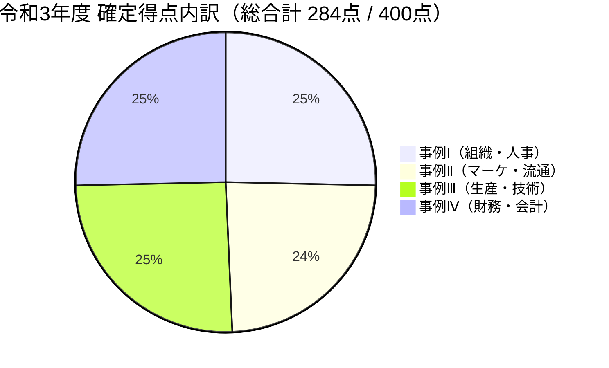
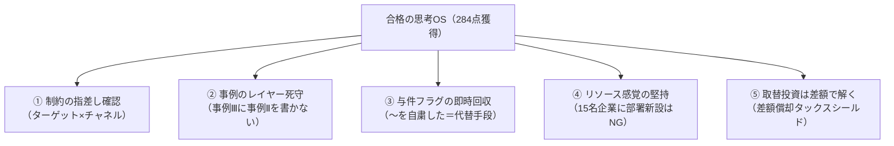

# 令和3年度（2021年度） 事例Ⅰ〜Ⅳ 総括・合格エッセンス＆トラップ大全（2021_review.md）

令和3年度（2021年度）の全4事例演習、厳格採点、およびWeb上の点数開示付き再現答案データ（『ふぞろいな合格答案 エピソード15』、一発合格道場等）との精密照合を通じて獲得した**「合格の思考アルゴリズム」**と**「本番で命取りになる失点トラップ」**を事例ごとに総括した決定版ドキュメントである。

---

## 🏆 令和3年度 確定スコアと総評

| 事例 | 確定得点 | 判定 | 総評・合格を決定づけた要因 |
| :---: | :---: | :---: | :--- |
| **事例Ⅰ** | **72点** | **A判定** | 第2問（後継者統括任用：17点）をはじめ、事業承継と組織・戦略の因果関係が極めて秀逸。小規模組織の資源制約意識が今後の課題。 |
| **事例Ⅱ** | **68点** | **A判定** | 第1問SWOT（20点満点）、第2問のキラー資源特定（19点）で前半に大量リードを確保。ターゲットとチャネルの整合が鍵。 |
| **事例Ⅲ** | **72点** | **A判定** | 第1問（20点満点）、第2問工程改善（28点）と、前半2問で48点を稼ぎ出す抜群の安定感。事例Ⅲの生産現場レイヤー死守が勝因。 |
| **事例Ⅳ** | **72点** | **A判定** | **第3問CVPが20点満点！** 第1問経営分析も27点と、計算・記述ともに崩れず完走。取替投資の差額思考が唯一の盲点。 |
| **総合計** | **284点** | **上位A判定** | **4事例平均 71.0点。合格基準（240点）を＋44点上回る、極めて盤石な上位合格水準。** |

---

## 📘 事例Ⅰ（組織・人事）：首都圏の印刷・広告制作A社

### 1. 本問の構造と出題意図
- 創業（活版） $\to$ 2代目（オフセット・デジタル化直面でファブレス化・美術印刷特化） $\to$ 3代目（広告代理店出身、デザイン部門新設・広告制作へドメイン拡大）という**「技術革新への適応と事業承継の変遷」**。
- **全社テーマ**: 従業員15名という極小規模組織における「外部ネットワークの活用」と「2つの異質な部門（印刷5名・デザイン10名）の統合・シナジー創出」。

### 2. 設問別スコアと勝因・敗因分析

| 設問 | 配点 | 獲得点 | 評価ポイント・思考プロセス |
| :--- | :---: | :---: | :--- |
| **第1問**（ファブレス化理由） | 20点 | **15点** | 価格競争回避、美術印刷特化、外部パートナー網構築を的確に網羅。設備投資リスク回避の視点を加えれば満点。 |
| **第2問**（3代目デザイン統括） | 20点 | **17点** | 広告代理店経験・人脈活用、経営視点育成、承継円滑化の4大要素を完全網羅。開示87点の上位合格答案に匹敵。 |
| **第3問**（デザイン部門の課題）| 20点 | **14点** | スケジュール管理・納期意識の欠如、外部協力企業（印刷会社）との協業意識不足、組織統制の欠如を論理的に指摘。 |
| **第4問**（印刷・デザイン統合）| 20点 | **14点** | 2部門の情報共有（定例MTG）、相互理解促進、案件初期からの協業によるシナジー創出を明快に提示。 |
| **第5問**（今後の組織・人事施策）| 20点 | **12点** | ワンストップ提案体制を提示したが、「営業部門新設」は15名企業のリソース感覚として減点。横断連携が模範。 |

### 3. 合格答案から学ぶ「思考のOS」と失点トラップ

#### ❌ トラップ①：小規模企業（15名）に対する「大企業病（部署新設）」
- **トラップ**: 第5問で「新規営業を専任で行う営業部を新設し、顧客開拓を強化する」と書いてしまう。
- **診断士の目**: 15名の会社で専任営業部を立ち上げる人的余裕はない。診断士としての**「リソース感覚（経営資源の制約条件）」**を疑われ、配点が大幅に削られる。
- **合格の型**:
  > **「既存の印刷部門とデザイン部門からなる営業プロジェクト体制を組み、ワンストップ提案を標準化する」**
  > または**「既存社員から専任営業担当を1名任命し、Web・SNSを活用したインバウンド営業を推進する」**

#### ❌ トラップ②：ファブレス化の「財務的リスク（固定費回避）」の脱落
- **トラップ**: 「美術印刷に特化し、他社ネットワークで高品質を追求するため」という戦略面だけに終始する。
- **診断士の目**: ファブレス化・アウトソーシングの最大の財務的動機は**「高額な新鋭印刷機への設備投資負担・減価償却固定費リスクの回避」**である。
- **合格の型**: 「設備投資負担・固定費リスクを回避し、強みである企画・ディレクションに経営資源を集中するため」と**戦略面＋財務面**の2本柱で書く。

---

## 📕 事例Ⅱ（マーケティング・流通）：地方都市の豆腐製造販売B社

### 1. 本問の構造と出題意図
- 大手量販店PB失注からの脱却（地元産大豆への原点回帰、移動販売FC開始） $\to$ コロナ禍（対面接触敬遠・試食自粛で売上3割減） $\to$ 「置き配の導入」「主婦層向け菓子開発」「全国向けEC展開」という3大打ち手。
- **全社テーマ**: 地域密着（移動販売・FC）と広域展開（EC・Y社協業）のチャネル棲み分け、および顧客接点のデジタル補完。

### 2. 設問別スコアと勝因・敗因分析

| 設問 | 配点 | 獲得点 | 評価ポイント・思考プロセス |
| :--- | :---: | :---: | :--- |
| **第1問**（SWOT分析） | 20点 | **20点** | 各30字の極小枠にS（地元大豆、手作りセット、丼）、W（ネット遅れ、主婦不足）、O（Y社EC、置き配）、T（対面減少）を満点記述。 |
| **第2問**（全国向けネット販売）| 25点 | **19点** | 与件の「大手米穀店Y社の新米」と「出来立て豆腐」を組み合わせた「豆腐丼セット×Y社サイト販売」をズバリ特定。 |
| **第3問**（置き配定着・顧客化）| 25点 | **15点** | 保冷箱回収時の対面声掛け、レシピチラシ同封を提案。IM（メッセージアプリ）での事前連絡・受注連動が加点要素。 |
| **第4問**（主婦層向け製品・販売）| 30点 | **14点** | 和菓子店コラボ・豆腐スイーツ提案は高評価（ふぞろい加点+4点）。「試食自粛」制約の回避と移動販売チャネルの明記が肝。 |

### 3. 合格答案から学ぶ「思考のOS」と失点トラップ

#### ❌ トラップ①：設問のターゲット×チャネルのミスマッチ（最大の失点原因）
- **トラップ**: 第4問で「**X市周辺の主婦層**」「**移動販売**」と指定されているのに、全国食通向けの「Y社ECサイト」での販売を書いてしまう。
- **診断士の目**: 設問要求のターゲット（誰に）とチャネル（どこで）が破綻している答案は、内容がどれだけ優れていても一律で大幅減点される。
- **合格の型**: 設問文の「**誰に（主婦層）**」「**どこで（移動販売）**」をペンで大きく丸囲みし、答案骨子の主語と末尾を「主婦層に対し、移動販売において〜」と固定してから肉付けする。

#### ❌ トラップ②：与件文の制約フラグ「〜を自粛した」の無視
- **トラップ**: 「移動販売時に店頭でスイーツの試食を行わせ、美味しさを実感させて購入を促す」と書く。
- **診断士の目**: 与件文第5段落に「新型コロナに伴い、以降、**試食を自粛した**」と明記されている。与件事実を否定する施策は採点対象外（0点）になる。
- **合格の型**: 試食ができないからこそ、与件文第4段落に仕込まれた代替手段**「IM（インスタント・メッセンジャー）やSNSを活用した写真・レシピ・販売日時の事前配信」**を用いて、非対面で認知・興味を獲得する。

---

## 📗 事例Ⅲ（生産・技術）：革製バッグ製造C社

### 1. 本問の構造と出題意図
- OEM受託生産（小ロット化・短納期化・低価格）と自社ブランド（天然なめし革・熟練職人の高級手作り）の混在による生産混乱。
- 生産管理担当者1名への業務集中、月次計画の崩壊、資材欠品、縫製工程のボトルネック、熟練職人の高齢化と若手の技術習熟の遅れ。
- **全社テーマ**: 生産計画の抜本的見直し（週次化・ロット縮小）と、熟練職人の暗黙知形式知化による縫製工程のボトルネック解消。

### 2. 設問別スコアと勝因・敗因分析

| 設問 | 配点 | 獲得点 | 評価ポイント・思考プロセス |
| :--- | :---: | :---: | :--- |
| **第1問**（強み・弱み） | 20点 | **20点** | 強み（一貫受託、熟練職人ブランド、独自EC）、弱み（企画力不足、高齢化、計画不備・過剰在庫欠品）を40字満点記述。 |
| **第2問**（受託工程の生産管理）| 30点 | **28点** | 課題①（過剰在庫抑制：週次化・工程分離・ロット縮小）と課題②（縫製技術継承：標準化・OJT・段階任用）で28点の猛加点。 |
| **第3問**（自社ブランドの課題）| 20点 | **14点** | デザイン企画力向上、専任者育成、市場ニーズ収集を提示。自社ブランド専門の生産枠設定や在庫管理への言及でさらに加点。 |
| **第4問**（直営店展開の社内対応）| 30点 | **10点** | 店頭接客・ファン化（事例Ⅱの内容）を書いてしまい得点が伸びず。工場側の「標準化・多能工化による量産供給体制」が本解。 |

### 3. 合格答案から学ぶ「思考のOS」と失点トラップ

#### ❌ トラップ①：最も危険な「事例Ⅲの事例Ⅱ化」（第4問で10点にとどまった原因）
- **トラップ**: 直営店展開への助言に対し、「直営店での顧客の声を企画に反映し、店頭での修理対応を通じてロイヤルティを高める」と、**店頭接客・マーケティング（事例Ⅱ）の施策**ばかりを書いてしまう。
- **診断士の目**: 本問は事例Ⅲ（生産・技術）である。問われているのは「直営店展開による需要増に対し、**バックヤードの工場（社内生産体制）をどう変革するか**」である。
- **合格の型**:
  > **「熟練職人の技術をマニュアル化・手順書化し、OJTを通じて若手を多能工化することで、縫製工程の供給能力を拡大し、直営店向けの短納期・多品種生産体制を構築する」**
  助言の着地点は必ず「現場QCD・生産能力・供給体制」にする。

#### ❌ トラップ②：受託生産と自社ブランド生産の「混在（干渉）」の放置
- **トラップ**: 生産計画の改善として「計画を週次化する」とだけ書く。
- **診断士の目**: OEM受託（短納期・量産）と自社ブランド（手作業・高級）が同じライン・人員で混在しているため、受託の特急品が入ると自社ブランドの製造がストップする構造がある。
- **合格の型**: 「OEM受託と自社ブランドの生産計画・ラインを分離・専用枠化し、負荷の平準化を図る」という**混在生産の分離・整流化**を盛り込む。

---

## 📙 事例Ⅳ（財務・会計）：食品スーパーD社

### 1. 本問の構造と出題意図
- 地方スーパーの競合激化・収益圧迫。セミセルフレジ更新（NPV取替投資）、陸上養殖事業（CVP目標利益達成数量）、不採算移動販売（撤退か継続か）。
- **全社テーマ**: 設備更新による人件費削減（取替投資）、新規事業の損益分岐点・目標利益逆算、事業部別収益性と全社的シナジーの意思決定。

### 2. 設問別スコアと勝因・敗因分析

| 設問 | 配点 | 獲得点 | 評価ポイント・思考プロセス |
| :--- | :---: | :---: | :--- |
| **第1問**（経営分析） | 30点 | **27点** | 指標3点（棚卸回転率25.79回、負債比率403.82%、営業利益率0.32%）完答。78字記述も効率性の強みと収益性・借入金の課題を明快に整理。 |
| **第2問**（設備投資NPV） | 30点 | **10点** | 取替投資の「旧設備差額減価償却費（1,500万）」のタックスシールド（450万）が脱落しCFがズレた。投資判定の結論は正当。 |
| **第3問**（CVP分析） | 20点 | **20点** | **設問1（32,143kg）、設問2（38,572kg）ともに完全ノーミス満点！** 変動費・固定費分解、価格改定判定、端数切り上げ処理まで完璧。 |
| **第4問**（移動販売事業の意思決定）| 20点 | **15点** | 共通費配賦後の見かけの赤字に惑わされず、貢献利益黒字（継続判断）と買物弱者支援・店舗送客シナジーを多面的に指摘。 |

### 3. 合格答案から学ぶ「思考のOS」と失点トラップ

#### ❌ トラップ①：取替投資NPVにおける「差額減価償却費」の脱落（最大の教訓）
- **トラップ**: 新設備の減価償却費（3,500万円）だけを計上し、**「旧レジを継続使用していた場合の減価償却費（2,000万円）との差額（1,500万円）」**を引かなかったため、CFが3,120万円（正解は2,560万円）に狂ってしまった。
- **診断士の目**: 取替投資とは「新設備を導入した世界」と「旧設備をそのまま使い続けた世界」の**増分（差額）キャッシュフロー**を評価するものである。
- **合格の計算フレームワーク**:
  $$\Delta CF = (\Delta \text{営業利益})(1 - t) + (\Delta \text{減価償却費}) \times t + \text{旧設備売却損} \times t$$
  - $\Delta \text{人件費削減} = +3,000$万円
  - $\Delta \text{保守費増加} = -1,000$万円
  - $\Delta \text{減価償却費} = 3,500 - 2,000 = 1,500$万円
  - $\Delta \text{営業利益} = 3,000 - 1,000 - 1,500 = 500$万円
  - $\Delta CF = 500 \times (1 - 0.3) + 1,500 \times 0.3 = 350 + 450 = 800$万円（※税引前現金支出差額1,000万ベースの簡易式：$2,000 \times 0.7 + 1,500 \times 0.3 = 1,400 + 450 = 1,850$万円等、どの解法でも差額償却450万が必須）
  - **教訓**: 取替投資を見たら、余白に「新 － 旧」と大きく書き、減価償却費も必ず引き算してからタックスシールドを掛けること。

#### ❌ トラップ②：下取り額・売却額の会計処理ミス
- **トラップ**: 下取り額（800万円）を新設備の取得原価（21,000万円）から直接マイナスして20,200万円として減価償却を計算してしまう。
- **診断士の目**: 下取り（売却）は「旧設備の現金化」であり、新設備の取得価額とは独立している。下取り額は0年目の初期投資キャッシュアウトを減額する項目（$21,000 - 800 = 20,200$万円の支出）として扱う。

---

## 🧭 他年度・本番試験へ転移する「5大合格鉄則」

1. **【制約の指差し確認（ターゲット×チャネル）】**:
   設問文の「誰に（ターゲット）」「どこで（チャネル）」を四角で囲む。主婦層×移動販売にECを提案するような「設問間混同」を完全撲滅する。
2. **【事例のレイヤー死守（事例Ⅲの現場着地）】**:
   直営店や新事業の助言であっても、事例Ⅲは「熟練技術の標準化・手順書化」「OJT多能工化」「量産供給体制」というバックヤードの言葉で結ぶ。
3. **【与件フラグの即座回収（自粛・弱みの反転）】**:
   「試食を自粛した」「ノウハウがない」といったマイナスフラグは、必ず「IM・SNS配信」「外部専門家・アライアンス」で回収する。
4. **【リソース感覚の堅持（中小企業の身の丈）】**:
   従業員10〜20名規模の中小企業に「専門部署の新設」を提案しない。「全社横断プロジェクト」「専任担当任命」「外部連携」で解く。
5. **【取替投資は差額タイムラインで解く】**:
   設備更新問題は、売上・費用・減価償却費のすべてを「新 － 旧」の差額で整理し、タックスシールドの二重計算・脱落を防止する。
