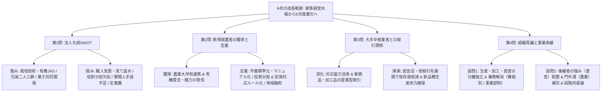
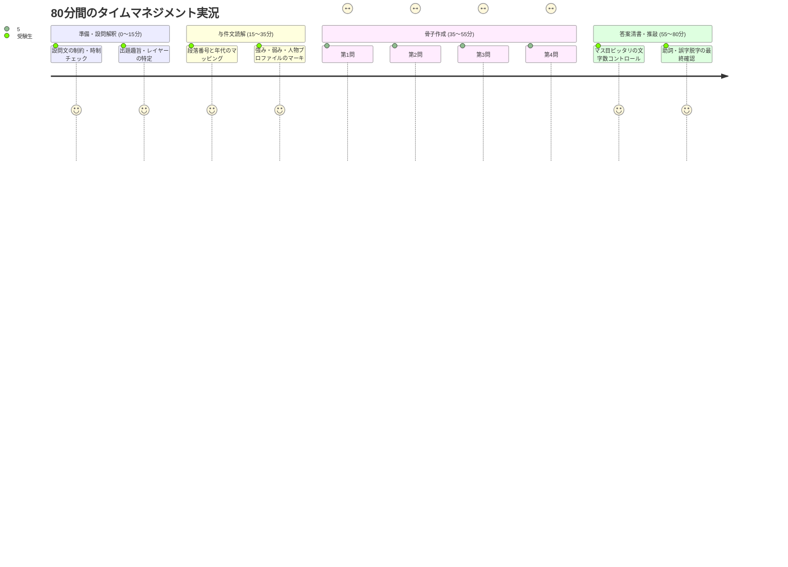

# 令和4年度 事例Ⅰ 完全攻略マスター＆農業法人の組織人事・成長戦略・事業承継のセオリー

## はじめに：令和4年度 事例Ⅰの全体構造と「合否を分けた急所」

令和4年度の事例Ⅰ（A社：サツマイモ・トマト・レタス等の栽培・加工・販売を行う農業法人）は、戦前からの家族経営水稲農家が、施設園芸、有機農業、地元菓子メーカー連携、食品加工、直営店・カフェへと**「6次産業化」**を推進しながら成長を遂げてきた軌跡を描いた、組織・人事（事例Ⅰ）の集大成とも言える重厚な出題です。

- **第1問（内部環境分析・SWOT）**: 「株式会社化（法人化）以前」という厳格な時系列制約のもとで、創業期から多角化・有機化に至る自社の強みと組織的弱みを過不足なく抽出する能力。
- **第2問（基盤事業の人材マネジメント）**: 天候や突発労働といった農業特有の制約条件の中で、机上の空論（フレックス制や無理な人員融通など）を排し、「見て盗め」からの脱却、役割分担、突発対応のルール化、地域融和支援によって新規就農者の獲得と定着を図る実務的助言力。
- **第3問（取引先関係戦略・両利きの経営）**: 厳しい要求を通じて蓄積した対応能力を活かして大手中食業者との関係を深化（提案型取引）させる一方、直営店等の多角化によって過度な売上依存を分散し新品種生産の余力を創出する「探索と深化」のバランス感覚。
- **第4問 設問1（組織構造デザイン）**: 兼任による人手不足と対応限界を打破するため、生産・加工・直営の3事業区分を明確化し専任化・専門化を進める組織構造（機能別組織または事業部制組織）の設計能力。
- **第4問 設問2（事業承継・世代交代）**: 後継者の固有プロファイル（飲食サービス・商品開発の強み、農業門外漢の弱み）に合致した適材適所の人員配置と、現経営陣（兄弟二人三脚）からの段階的な権限委譲、若手幹部登用によるチーム型経営体制の構築力。

一見すると農業という特殊な業界に見えますが、問われている本質は**「家業（どんぶり家族経営）から企業（近代組織）への脱皮プロセス」**であり、他年度・他事例にも100%転用可能な組織・人事の普遍的セオリーに貫かれています。

---

## 第1部：中小企業診断協会「公式出題趣旨」の完全解剖

| 設問 | 配点 | 公式出題趣旨の文言 | 読み解くべき本質的評価軸 |
| :--- | :---: | :--- | :--- |
| **第1問** | 20点 | 法人化前における内部環境分析に関わる問題である。 | 時系列（2000年代半ば以前）の厳格な峻別。兄弟二人三脚、有機JAS、菓子共同開発といった強みと、属人化（職人気質）、役割分担不在、定着難といった弱みの網羅。 |
| **第2問** | 20点 | 基盤事業における人材の採用と定着の方法について、助言する能力を問う問題である。 | 机上の空論の排除。有機理念の発信（獲得）と、「見て盗め」脱却（作業標準化・マニュアル化）、役割分担・突発対応のルール化、地域融和支援（定着）による現場労務改善。 |
| **第3問** | 20点 | 主要取引先との関係の強化と新しい分野の探索について、助言する能力を問う問題である。 | 「深化（関係強化）」と「探索（新分野展開・リスク分散）」の両立。蓄積した対応能力の活用、提案型取引、直営店等への展開による過度な依存の抑制と新品種生産余力の確保。 |
| **第4問 設問1** | 20点 | 経営戦略の展開にあたっての経営組織の構造について、助言する能力を問う問題である。 | 生産・加工・直営（飲食）の兼任解消。責任と権限の明確化、専門性向上を図る機能別組織または事業部制組織の設計。 |
| **第4問 設問2** | 20点 | 円滑な次世代経営体制への移行プロセスについて、助言する能力を問う問題である。 | 後継者の人物属性（強み：飲食マネジメント／弱み：農業門外漢）に即した配置。直営・加工からの段階的権限委譲、現経営陣の後見、若手幹部登用による集団指導体制。 |

---

## 第2部：全問完全解剖と満点思考プロセス



---

### 第1問：法人化前のSWOT分析（配点20点・100字以内）

#### 1. 設問要求と制約条件の精査
- **設問文**: 「A社が株式会社化（法人化）する以前において、同社の強みと弱みを100字以内で分析せよ。」
- **最大の制約（Gate 1）**: **「株式会社化（法人化）する以前」**という時系列制約。
  - 与件文第8段落に「2000年代半ばには、...事業を...譲渡されることになった。A社は、そのタイミングで株式会社化（法人化）をした」とあります。
  - したがって、第8段落以降に登場する「大手中食業者との直接取引」「自社工場での食品加工」「直営店・オープンカフェ」「常務の娘（後継者）の入社」などは、すべて法人化**以降**の事実であり、本問で書くと**一発で加点対象外（0点）**になります。

#### 2. 与件文からの要素抽出（第2〜第7段落）
- **強み（第2〜第5段落）**:
  1. サツマイモや苺等の高い栽培技術、有機JAS・JGAP認証取得、消費者が求める安全な野菜作り（第2・3・4段落）
  2. 現経営者（生産）と弟常務（販売・経営管理）の役割分担による兄弟二人三脚の経営体制（第4段落）
  3. 地元菓子メーカーとの連携による洋菓子共同開発、地元の特産品としての認知度と百貨店での人気（第5段落）
- **弱み（第6〜第7段落）**:
  1. 現経営者の職人気質（仕事は見て盗め）による属人化、従業員間の明確な役割分担の欠如（第6段落）
  2. 天候や季節的繁閑による需給調整の難しさ（繁忙期の人手不足と閑散期の人余り）（第6段落）
  3. 突発対応等の労働環境や地域融和の難しさによる従業員の低定着率、新規就農者の確保難（第7段落）

> **【模範解答（99字）】**  
> 「強みは①高品質な栽培技術と有機JAS等認証、②兄弟の生産・販売管理の役割分担、③地元企業連携の特産品開発力。弱みは①職人気質による属人化と役割分担の欠如、②季節繁閑による需給調整難と従業員の低定着率。」（99字）

---

### 第2問：新規就農者の獲得と定着（配点20点・100字以内）

#### 1. 設問要求と農業現場のリアリティ
- **設問文**: 「A社が新規就農者を獲得し定着させるために必要な施策について、中小企業診断士として100字以内で助言せよ。」
- **机上の空論を排する**:
  - 農業現場において、天候や作物の生育時期を「フレックスタイム」や「シフト制」で完全にコントロールすることは不可能です。
  - また、時系列的にこの時点（2000年代前半）には「自社加工工場」は存在していません。
  - さらに、「近隣農家と繁閑期の人員を融通する」という発想も、同じ地域であれば冬の農閑期や春・秋の農繁期は共通しており、現実的な雇用契約・オペレーションとして機能しません。

#### 2. 若手が定着しない「現場の真因」へのダイレクトアプローチ
与件文第6・7段落を精読すると、若手就農者が辞める本当の理由は以下の3点に集約されます：
1. **「誰も仕事を教えてくれない」不安**: 現経営者が職人気質で「仕事は見て盗め」と放置される。
2. **「役割が曖昧で、突発対応が不公平に押し付けられる」不満**: 役割分担がなく、台風や休日の突発対応を若手に曖昧に頼る。
3. **「地域コミュニティでの孤立」**: 新参者が地域の農業関係者に溶け込めない。

したがって、処方箋は**「現場の仕事を近代的な組織に整えること」**に尽きます。

> **【模範解答（99字）】**  
> 「獲得面は農業大学校等へ有機農業の理念を発信し共感者を募る。定着面は①作業標準化や計画的教育で成長支援、②明確な役割分担と突発対応の当番制・手当整備、③地域農業関係者との交流支援による地域融和を図る。」（99字）

---

### 第3問：大手中食業者との取引関係（配点20点・100字以内）

#### 1. 出題趣旨「関係強化」×「新しい分野の探索」の二面性
- **設問文**: 「A社は大手中食業者とどのような取引関係を築いていくべきか、中小企業診断士として100字以内で助言せよ。」
- **公式出題趣旨**: 「主要取引先との関係の強化と新しい分野の探索について、助言する能力を問う問題である。」
- **アンビデクストリティ（両利きの経営）**:
  - 単に「取引を拡大する」だけでは、過度な売上依存と忙殺による新品種生産の停滞（第8段落の課題）を加速させてしまいます。
  - 逆に「取引を縮小・解消する」のは、安定収益と蓄積された対応能力をドブに捨てる愚策です。
  - **「既存顧客との関係を活かして高付加価値化・提案型取引へ深化（関係強化）」**させつつ、**「直営店や他取引先への展開によって過度な依存度を分散し、新品種生産の余力を創出（探索）」**するという、両輪の記述が必須です。

> **【模範解答（100字）】**  
> 「蓄積した対応能力を活かして加工品や新商品の提案を行い、関係を強化して安定収益を維持する。一方で直営店や他取引先への展開で過度な売上依存を分散し、忙殺を解消して本来の強みである新品種生産の余力を確保する。」（100字）

---

### 第4問 設問1：組織構造の構築（配点20点・50字以内）

#### 1. 現状の組織課題と組織デザイン
- **現状の体制（第9・10段落）**:
  - 生産に従事する若手従業員5名とパート5名が、食品加工や直営店・カフェを兼任。
  - 売上拡大に伴い人手不足が顕著化し、生産兼務の従業員だけでは対応限界に達している。
- **組織設計の原則**:
  - 兼務を解消し、業務ごとの専門化と責任権限の明確化を図る。
  - A社が展開する**「生産（農業）」「食品加工」「直営店（飲食・販売）」の3つの事業・機能を明確に分離・独立**させる。
  - 「機能別組織」または「事業部制組織」を採用する。

> **【模範解答（48字）】**  
> 「生産、加工、直営店（飲食）の部門を独立させ、兼務を解消して責任権限を明確にする機能別部門制組織。」（48字）

---

### 第4問 設問2：世代交代・権限委譲・人員配置（配点20点・100字以内）

#### 1. 後継者プロファイルの正確な把握（適材適所）
- **後継者（常務の娘・40歳）の属性（第10段落）**:
  - **強み**: 大学卒業後、一貫して飲食サービス業で店舗マネジメントや商品開発に従事。若手の提案を取り入れ新商品（トマトジュース、苺ジャム等）をヒットさせる。
  - **弱み**: **農業については門外漢**。
- **人員配置の急所**:
  - 門外漢である農業（生産部門）の責任者に据えるのは組織論上リスクが大きすぎる。
  - 自身の最大の強みである**「直営店・食品加工」の統括責任者**に配置するのが定石。
  - 農業生産部門には、現経営者や農業経験豊富な従業員・熟練若手を現場リーダーとして配置し、後継者を支える。
- **権限委譲プロセス**:
  - 常務が担ってきた販売・管理業務や直営・加工の権限から段階的に委譲。
  - 現経営者と常務は相談役・会長等として後見し、5年間かけて全社統括権限を委譲して事業承継を完遂する。

> **【模範解答（98字）】**  
> 「人員配置は、後継者の強みである加工・直営に専任させ、門外漢の農業は熟練若手を配置する。権限委譲は、常務の業務から段階的に委譲し、現経営者と常務が後見しつつ５年間で全社統括権限を委譲し承継を完了させる。」（98字）

---

## 第3部：事例Ⅰ・80分間のタイムマネジメントと実況プロセス



### 1. 設問解釈のステップ（開始0〜15分）
- **第1問の「以前」に特大の丸をつける**: 法人化以降のファクト混入をここで100%防止する。
- **第4問の設問1と設問2の役割分担を把握する**: 設問1は「ハコ（組織構造）」、設問2は「中身（権限委譲と人の配置）」であると切り分ける。

### 2. 与件文読解とマッピング（15〜35分）
- **時系列の整理**: 1970年代（苺） $\to$ 1990年代（野菜多品種・弟入社） $\to$ 2000年代前半（有機JAS・菓子開発・経営課題） $\to$ 2000年代半ば（**法人化ライン**・中食取引） $\to$ 2010年代半ば（自社工場加工） $\to$ 昨年・現在（直営店・後継者入社）。
- この年代ラインを余白にメモするだけで、時系列トラップを完全回避できる。

### 3. 答案骨子の推敲（35〜55分）
- 1問あたり約5分で骨子を作成。「課題 $\to$ 施策 $\to$ 効果」の因果関係が繋がっているかを確認。
- 一般論（ポエム）になっていないか、与件文のキーワードが主語・述語に入っているかを厳密にチェック。

---

## 第4部：他事例に転用可能な「事例Ⅰ・4大マスターフレームワーク」

```mermaid
classDiagram
    class 組織構造進化 {
        +家族経営（どんぶり）
        +機能別部門制（専門化・兼務解消）
        +事業部制（権限委譲・独立採算）
    }
    class 人的資源管理HRM {
        +採用（理念共感・大学校連携）
        +配置（適材適所・弱み補完）
        +育成（作業標準化・計画的OJT）
        +労務環境（当番制・ルール化）
    }
    class 事業承継・世代交代 {
        +強み承継（経営理念・顧客信頼）
        +弱み補完（門外漢分野の現場補佐）
        +段階的権限委譲（日常業務から全社統括へ）
        +集団指導体制（若手リーダー登用）
    }
    class 取引先ポートフォリオ {
        +既存深化（蓄積能力・提案型取引）
        +新規探索（チャネル多角化・直営展開）
        +依存度管理（リスク分散・研究余力確保）
    }
```

### 1. 組織構造進化フレームワーク
中小企業が成長する過程で直面する「組織の壁」に対する定石パターンです。
- **創業期・小規模期**: 経営者直轄・家族経営。意思決定は速いが、属人化と役割不在がボトルネックになる。
- **成長期・多角化期**: 生産・加工・販売が混然一体となり、兼務による人手不足と対応限界が発生。
  $\implies$ **機能別組織への移行**（業務ごとに部門を独立させ、兼任を解消して専門性を高める）。
- **拡大期・複数事業期**: 直営店や加工など異なる事業特性を持つ段階。
  $\implies$ **事業部制組織への移行**（事業ごとに責任と権限を委譲し、現場の迅速な意思決定と次世代経営者の育成を図る）。

### 2. 人的資源管理（HRM）の現場改善フレームワーク
「人が採れない・定着しない」という課題に対して、机上の空論を排して現場を立て直す基本方程式です。
- **採用（獲得）**: 自社の経営理念や社会的意義を明確に発信し、共感型採用を行う（ミスマッチ防止）。
- **育成（教育）**: 「見て盗め」を打破し、作業手順の標準化・マニュアル化と計画的OJTを導入する。
- **労務環境（定着）**: 不規則・突発的な業務に対して、当番制や代休・手当などの公正なルールを整備し、不公平感を取り除く。
- **地域・人間関係（融和）**: 新参者が孤立しないよう、経営陣が間に入って地域社会や先輩社員との橋渡しを行う。

### 3. 事業承継・次世代経営体制フレームワーク
経営者の高齢化に伴う世代交代を円滑に進めるための黄金律です。
- **適材適所の人員配置**: 後継者のキャリア・強みを活かせる部門に配置し、未経験・門外漢の領域には社内の熟練工や若手エースを補佐役として付ける。
- **段階的権限委譲**: 最初から全社統括を任せるのではなく、自部門のマネジメントからスタートし、実績と信頼を積み上げながら徐々に全社経営権限を委譲する。
- **現経営陣の後見体制**: 現社長・役員は会長や相談役として後見役に回り、大所高所から経営ノウハウの伝承と対外的な信頼の引き継ぎをサポートする。
- **集団指導体制（次世代幹部育成）**: 後継者と同世代の若手従業員を各部門のリーダーに抜擢し、後継者を支える「次世代経営チーム」を同時に立ち上げる。

### 4. 主要顧客マネジメント（両利きの経営）フレームワーク
特定の大口顧客に依存する中小企業が、リスクを抑えながら成長するための戦略ロジックです。
- **既存取引の深化（搾取されない関係構築）**: 蓄積した対応能力と信頼を武器に、下請け的な受動取引から「企画提案型取引」へと昇華させ、付加価値と利益率を高める。
- **新分野の探索（依存度の適正化）**: 自社直営店や新規販路を開拓し、売上ポートフォリオを分散させることで、大口顧客に対する価格交渉力を高めるとともに、新商品・新品種の研究開発余力を確保する。

---

## 第5部：合否を分ける深掘り論点と過去問の系譜

### 1. 事業承継の隠れた死角：兄弟折半出資（各50%）と経営権集約
第1段落で兄（社長）と弟（常務）が「各50%を出資」して設立されたA社。これは兄弟仲が良い創業期には問題ありませんが、事業承継期には重大なガバナンスリスクとなります。
- **会社法上の制約**: 普通決議（取締役選任等）には過半数、特別決議（定款変更や事業譲渡等）には3分の2以上の議決権が必要。
- **承継リスク**: 兄（社長）の株式が相続等で複数人に分散すると、後継者（常務の娘）は過半数を握れず、意思決定が麻痺する。
- **診断士の助言**: 後継者への株式買取り・生前贈与による議決権集約や、事業承継税制（特例承継計画）の活用による納税猶予と経営権の一本化が裏の重要課題となる。

### 2. 組織風土の変革：職人気質からボトムアップ・心理的安全性へ
- **現社長の時代**: 「仕事は見て盗め」というトップダウン文化。創業期の品質向上には貢献したが、社員の指示待ちや新規就農者の定着難を招いた。
- **後継者の時代**: 直営店で若手従業員の提案を積極的に採用し、新商品をヒットさせた（**心理的安全性**の醸成）。
- **組織論的意義**: 単なる世代交代にとどまらず、「トップダウンの職人文化」から「若手の内発的動機づけ・自己効力感を刺激する自律共創型文化」への組織文化変革を成し遂げることが、持続的成長の鍵となる。

### 3. 組織デザインにおける「分化と統合」
- **分化（専門性の追求）**: 生産・加工・直営の3部門を独立させ、兼務を解消して責任と権限を明確化する。
- **統合（サイロ化の防止）**: 部門が独立すると「部門間の壁（セクショナリズム）」が生じやすくなるため、定期的な全社連絡会議の設置や、直営店の顧客の声を生産現場に還元するフィードバック経路を仕組み化し、6次産業化のシナジーを最大化する。

### 4. 過去問の系譜との構造的一致
事例Ⅰは、業界（農業・製造業・酒造・飲食）を変えながら、同じ本質的テーマを繰り返し出題しています。
| 出題年度 | 業種・企業 | 共通する本質的構造 |
| :--- | :--- | :--- |
| **平成28年度** | 契約野菜生産販売の農業法人 | 成長に伴う組織肥大化と兼務の弊害 $\to$ 機能分化と権限委譲による組織再編 |
| **令和元年度** | 伝統的酒造会社（アグリ事業） | 外部若手後継者の新事業展開 $\to$ 既存部門との軋轢・兼務の限界と集団指導体制 |
| **令和4年度** | 有機農業法人（加工・直営展開） | 家族経営どんぶり農業からの脱皮 $\to$ 兼務解消・適材適所の人員配置・段階的権限委譲 |
| **令和5年度** | 老舗蕎麦店（製麺・直営多角化） | 家業から近代企業への承継 $\to$ 創業家と新経営陣の役割分担・多角化組織 |

### 5. 答案表現の推敲実況：抽象語を具体策へ変換するリライト鉄則
採点官に1点も加点されない「フワッとした抽象語」を、具体的な制度・仕組みにリライトする変換ドリルです。
- ❌「モチベーションを向上させる」 $\implies$ ⭕「明確な評価基準に基づくインセンティブ設計」「権限委譲による自律性の付与」
- ❌「コミュニケーションを円滑にする」 $\implies$ ⭕「定期的な部門横断ミーティングの開催」「直営店の顧客声を生産現場へ共有する仕組み化」
- ❌「ノウハウを共有する」 $\implies$ ⭕「写真付き作業手順書の作成と計画的OJT指導」
- ❌「シフト制やフレックスで柔軟にする（※農業現場では机上の空論）」 $\implies$ ⭕「突発対応の輪番制（当番制）と代休・手当の明確なルール化」

