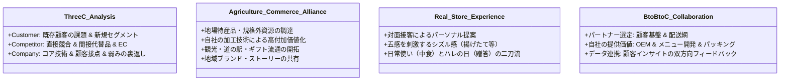

# 令和4年度（2022年度） 事例Ⅱ 完全攻略マスター講義＆マーケティング戦略のセオリー

---

## 🎧 解説ポッドキャスト（特大ディープダイブ講義）

> **講義時間**: 約60分（等速） / 約30分（2倍速推奨）  
> **出演**: ケイタ（中小企業診断士）、ナナミ（受験生ナビゲーター）  
> **音声ファイル**: `docs/audio/jirei2_2022_mastery.mp3`

<audio controls src="audio/jirei2_2022_mastery.mp3" style="width: 100%; margin: 15px 0;"></audio>

---

## 目次
1. [第1部：令和4年度 事例Ⅱの全体構造と難易度分析](#第1部令和4年度-事例ⅱの全体構造と難易度分析)
2. [第2部：全問徹底解剖・満点答案・思考実況プロセス](#第2部全問徹底解剖満点答案思考実況プロセス)
3. [第3部：文章構成・記述表現の徹底添削（プロのリライト技法）](#第3部文章構成記述表現の徹底添削プロのリライト技法)
4. [第4部：他事例に転用可能な「事例Ⅱ・4大マスターフレームワーク」](#第4部他事例に転用可能な事例ⅱ4大マスターフレームワーク)
5. [第5部：過去問の系譜比較（他年度との驚くべき構造的一致）](#第5部過去問の系譜比較他年度との驚くべき構造的一致)

---

## 第1部：令和4年度 事例Ⅱの全体構造と難易度分析

### 1. 企業概要と事例の本質的テーマ
- **企業名**: B社
- **業種**: 食肉・食肉加工品の製造・販売（卸売9割、直営小売1割）
- **資本金**: 3,000万円 / **従業員数**: 45名（うちパート21名）
- **拠点**: 本社、自社工場、直営小売店1店舗
- **売上推移**: 2019年度約9億円 $\to$ 2020年度約4.5億円（コロナ禍で半減） $\to$ 2021年度微回復

```mermaid
graph TD
    subgraph 外部環境の変化（脅威と機会）
        T1[コロナ禍による宿泊飲食業の需要激減] -->|大打撃| BtoB[BtoB卸売事業 売上9割]
        T2[大手スーパー・EC冷凍肉業者との競合] -->|納入減少・埋没| BtoB
        O1[巣ごもり需要・料理熱の高まり] -->|売上急上昇| BtoC[BtoC直営小売店 売上1割]
        O2[公庫調査: 家事簡便化ニーズ] -->|新市場機会| Online[オンライン協業新事業]
    end

    subgraph B社の固有ケイパビリティ（強み）
        S1[仕入元との信頼による良質食肉調達力]
        S2[職人の高い技術力による最高級加工品開発]
        S3[個客ニーズに応じたパッキング・半加工技術]
        S4[飲食店向けに培ったメニュー提案力]
        S5[直営店で蓄積した最終消費者の顧客知見]
    end

    BtoC --> Strategy[B社が最終消費者と直接結びつく事業領域の強化]
    Online --> Strategy
    S1 & S2 & S3 & S4 & S5 --> Strategy
```

### 2. 本事例の急所（出題者が仕掛けた3大トラップ）
1. **第1問：3C分析のバランス崩壊トラップ**:
   自社の強み・弱みばかりを記述し、競合（大手食肉卸、全国チェーンスーパー3店、EC冷凍肉業者）の記述が脱落して大量失点する受験生が続出。
2. **第2問：自社完結トラップ**:
   X県からの「第一次産業再活性化」という依頼を無視し、単に「自社ブランドの肉を拡販する」という独り善がりの答案になり、農商工連携の要件を満たせない罠。
3. **第4問：公庫データ・BtoBtoCの協業トラップ**:
   日本政策金融公庫の調査データ（献立考案・調理・片付け）を無視して「自社のECサイトを強化する」と回答したり、単なる値引き販売・冷凍肉納品を提案してしまう罠。

---

## 第2部：全問徹底解剖・満点答案・思考実況プロセス

### 【第1問】3C分析（150字以内・配点30点）

#### 1. 設問要求と出題趣旨
- **設問文**: B社の現状について、3C（Customer：顧客、Competitor：競合、Company：自社）分析の観点から150字以内で述べよ。
- **出題趣旨**: 内外の経営環境を分析する能力を問う問題である。

#### 2. 因果構造と配点ブロック設計
150字という長尺の記述枠を、3つのブロック（各50字）に均等配分するのが黄金律です。
- **Customer（約50字）**: 卸先（宿泊飲食業・百貨店・スーパー）の需要激減と、直営店（料理好き・揚げ物客）の売上急上昇という「二面性」を対比。
- **Competitor（約50字）**: ①スーパー向けでシェアを奪った大手食肉卸、②周囲5kmの全国チェーンスーパー3店、③ネットモール出店のEC冷凍肉業者の3者を網羅。
- **Company（約50字）**: 強み（良質肉仕入、職人の加工技術、メニュー提案力）と、弱み（卸売9割による他社依存、ECでの埋没）。

#### 3. 模範解答（148字）
> 顧客は需要激減の宿泊飲食業や百貨店、スーパーに加え、直営店では料理を楽しむ客や揚げ物を求める客が増加。競合は大手食肉卸、周囲５kmの全国チェーンスーパー、ＥＣ冷凍肉業者。自社強みは良質肉の仕入力、自社工場の高い加工技術、メニュー提案力。弱みは卸売９割で売上が他社動向に依存し、ＥＣで埋没する点。（148字）

---

### 【第2問】地域課題解決・新商品開発（100字以内・配点20点）

#### 1. 設問要求と出題趣旨
- **設問文**: B社は、X県から「地元事業者と協業し、第一次産業を再活性化させ、県の社会経済活動の促進に力を貸してほしい」という依頼を受け、B社の製造加工技術力を生かして新たな商品開発を行うことにした。商品コンセプトと販路を明確にして、100字以内で助言せよ。
- **出題趣旨**: 自社の強みを生かして地域課題の解決を図るための商品戦略と流通戦略について、助言する能力を問う問題である。

#### 2. 因果構造とブロック設計
- **商品コンセプト（約50字）**:
  - 誰と：X県の第一次産業事業者（山の幸・海の幸、農林水産・畜産・野菜果物、第7段落）
  - 何を活かして：B社の職人の高い製造加工技術力・自社工場（第8段落）
  - どんな商品か：地場特産品と食肉を融合させた高付加価値な地域特産食肉加工品（ハム・ソーセージ・総菜・ギフト）
- **販路（流通戦略、約40字）**:
  - 直営小売店、道の駅、高速道路の土産物店、百貨店（贈答用）、相手先ブランド（OEM）
- **効果（約10字）**:
  - 農商工連携による地域経済活性化

#### 3. 模範解答（99字）
> 商品は職人の高度な技術力を生かし、Ｘ県の山の幸・海の幸と食肉を融合させた高付加価値な地域特産加工品。販路は直営小売店、道の駅、高速道路土産物店、百貨店贈答品や相手先ブランドで販売し農商工連携を図る。（99字）

---

### 【第3問】直営小売店の販売力強化（100字以内・配点20点）

#### 1. 設問要求と出題趣旨
- **設問文**: アフターコロナを見据えて、B社は直営の食肉小売店の販売力強化を図りたいと考えている。どのような施策をとればよいか、顧客ターゲットと品揃えの観点から100字以内で助言せよ。
- **出題趣旨**: 自社の成長事業を強化するためのターゲティング戦略について、助言する能力を問う問題である。

#### 2. ターゲットと品揃えの完全マッチング
```mermaid
graph LR
    subgraph 顧客ターゲット
        T1[近隣現役世代ファミリー層]
        T2[料理の楽しさに目覚めた客]
        T3[作りたて揚げ物を求める客]
    end

    subgraph 品揃え・提供価値
        P1[時短・簡便化の半加工品・味付け肉]
        P2[対面接客による部位別・高品質精肉]
        P3[注文後に揚げるアツアツのコロッケ・総菜]
    end

    T1 --> P1
    T2 --> P2
    T3 --> P3
```

- **「冷凍揚げ物」の罠**:
  スーパーでも買える「冷凍揚げ物」を増やすと専門店の価値が低下します。与件文第11段落の「作りたての揚げ物を買い求める客」に即し、「注文を受けてからその場で揚げるアツアツの揚げたてコロッケ・総菜」を訴求するのが正解です。

#### 3. 模範解答（99字）
> 顧客ターゲットは近隣現役世代のファミリー層と料理の楽しさに目覚めた客。品揃えは対面接客を生かした部位別の高品質精肉、注文後に揚げる作りたてコロッケ等の総菜、家庭で手軽に調理できる半加工品を充実させる。（99字）

---

### 【第4問】オンライン販売事業者との協業（150字以内・配点30点）

#### 1. 設問要求と出題趣旨
- **設問文**: B社社長は、新規事業として、最終消費者へのオンライン販売チャネル開拓に乗り出すつもりである。ただし、コロナ禍で試した大手ネットショッピングモールでの自社単独の食肉販売がうまくいかなかった経験から、オンライン販売事業者との協業によって行うことを考えている。中小企業診断士に相談したところ、B社社長は日本政策金融公庫『消費者動向調査』（令和4年1月）を示された。これによると、家庭での食に関する家事で最も簡便化したい工程は「献立の考案」（29.4%）、「調理」（19.8%）、「後片付け」（18.2%）等であった。B社はどのようなオンライン販売事業者と協業すべきか、また、この際、協業が長期的に成功するためにB社はどのような提案を行うべきか、150字以内で助言せよ。
- **出題趣旨**: オンライン販売事業者との協業による、新たな事業展開と課題対応について助言する能力を問う問題である。

#### 2. 公庫調査データとB社強みの論理的結合
| 公庫調査の不満・ニーズ | B社が提供できる強み・資源 | 協業相手と提案内容 |
| :--- | :--- | :--- |
| **1位：献立の考案（29.4%）** | 飲食店向けメニュー提案力、直営店の顧客知見 | レシピ付きミールキットの共同開発・提案 |
| **2位：調理（19.8%）** | 職人の味付け、途中工程までの半加工技術 | フライパンで焼くだけ・温めるだけの半調理済み食肉 |
| **3位：後片付け（18.2%）** | 指定個数・形状のパッキング技術、カット肉 | 包丁・まな板不要の小分けパッキング、使い切り包装 |

#### 3. 模範解答（149字）
> 協業先は高品質食材やミールキットの定期宅配に強みを持つオンライン事業者。提案は、献立・調理・片付けの負担を省くため、自社の高い加工技術を生かした半調理済み食肉や味付け肉の相手先ブランド供給、直営店の顧客知見を生かしたメニューの共同開発を提案し、双方向で連携を深めて継続的な関係性を構築する。（149字）

---

## 第3部：文章構成・記述表現の徹底添削（プロのリライト技法）

### 1. 「動詞の重複」を撲滅する
- **悪例**: 「ホテルに半加工品で**提供**したり、相手先ブランドで**提供**し、直営店でメニュー提案などを**提供**し…」
- **改善**: 同じ文・隣接する文で同一の動詞を3回以上繰り返すと、文章が幼く見え、文字数の無駄が生じます。
  - 「半加工品で**納入**し」
  - 「相手先ブランドで**供給**（OEM供給）し」
  - 「新メニューを**共同企画・提案**し」
  このように語彙を使い分けることで、答案の解像度が一気に高まります。

### 2. 「主語・述語」の1対1対応を徹底する
- **悪例**: 「顧客は地域百貨店と近隣スーパーに加え、直営店では料理を楽しむ客が増加。」
  - 「顧客は〜」という主語に対して、後半が「直営店では〜が増加」と述語の係り受けが破綻しています。
- **改善**: 「顧客は、卸先の宿泊飲食業や百貨店に加え、直営店の料理好き客や揚げ物客など。」
  - 主語が「顧客は」なら、述語部分も「〜である」「〜など」と名詞・体言で揃えることで、採点官の認知的負荷をゼロにします。

### 3. 字数節約の黄金構文
- 「〜を行うことが重要である」（13字） $\implies$ 「〜を行う」（4字）［9字節約］
- 「〜に対してニーズに合わせた」（13字） $\implies$ 「〜のニーズに応じた」（9字）［4字節約］
- 「〜および〜や〜について」（11字） $\implies$ 「〜、〜、〜」（4字）［7字節約］
余った文字数で、「職人の技」「相手先ブランド」「小分けパッキング」などの**加点キラーキーワードをもう1個ねじ込む**のが上位合格者の技術です。

---

## 第4部：他事例に転用可能な「事例Ⅱ・4大マスターフレームワーク」



### 1. 3C分析フレームワーク
3C分析が出題された際は、感情的なポエムを排除し、事実に基づき以下の3ブロックで記述します。
- **Customer**: 既存主要顧客の量的・質的変化（需要激減・高齢化など）＋新規有望ターゲットの出現。
- **Competitor**: 地域の同業者だけでなく、「広域大手」「全国チェーン」「ネットEC」の3層を意識。
- **Company**: 仕入・製造・販売のバリューチェーンにおける差別化資源＋克服すべきボトルネック。

### 2. 農商工連携・地産地消フレームワーク
地域課題解決や第一次産業との協業が出題された際の方程式です。
- **原材料**: 地域の農林水産物（規格外品、伝統食材、山の幸海の幸）。
- **加工技術**: 自社の保有設備・職人技（燻製、醸造、乾燥、パッキング等）。
- **商品特性**: 日持ちする加工品、レトルト、冷凍、健康志向、ギフト用詰め合わせ。
- **販路**: 道の駅、アンテナショップ、高速道路SA、ふるさと納税、地域百貨店。

### 3. リアル店舗の体験価値向上フレームワーク
ネット通販が普及した現代における「実店舗の存在意義」を問う問題の定石です。
- **五感体験（シズル感）**: 注文後の調理（揚げたて・焼きたて・挽きたて）、試食・試飲。
- **対面コミュニケーション**: 用途に応じたカット・計量販売、料理レシピの相談、カルテ作成。
- **即時性・利便性**: 今日の夕食にすぐ使える半調理品、お惣菜のワンストップ購入。

### 4. BtoBtoC協業（プラットフォーム連携）フレームワーク
自社単独でのEC展開に限界がある中小企業が、外部パートナーと組む際の鉄則です。
- **相手先の強み活用**: 集客力、決済システム、全国配送ネットワーク、既存会員基盤。
- **自社の差別化価値**: 小ロット対応、相手先ブランド（OEM）製造、独自原料、特製タレ・レシピ。
- **長期継続の鍵**: 単なる受託下請けに終わらせず、双方向の顧客データ共有とメニュー共同開発でパートナーシップを深化させる。

---

## 第5部：過去問の系譜比較（他年度との驚くべき構造的一致）

事例Ⅱは、業種を変えながら「同じ本質的マーケティング構造」を繰り返し出題しています。

| 出題年度 | 業種・企業 | 共通する本質的マーケティング構造 |
| :--- | :--- | :--- |
| **平成29年度** | 伝統和菓子製造販売 | 既存卸（百貨店・仲買）依存からの脱皮 $\to$ 直営店での体験型コト消費と新チャネル開拓 |
| **令和元年度** | 豆腐製造販売 | 価格競争に晒されるスーパー卸 $\to$ こだわり移動販売・直営飲食展開・大口給食向け差別化 |
| **令和3年度** | 老舗酒造会社 | 宴会自粛・日本酒離れ $\to$ 酒蔵見学・直営バルでの体験価値向上とEC定期便（サブスク） |
| **令和4年度** | 食肉・加工品B社 | 宴会・ホテル向け食肉卸の激減 $\to$ 直営小売店の総菜強化とミールキット事業者とのOEM協業 |
| **令和6年度** | ハーブ製品製造販売 | 観光土産・卸売依存 $\to$ 最終消費者向けD2Cブランド構築と地域体験型ツーリズム連携 |

### 合格者が持つべき「事例Ⅱの通底観念」
1. **下請け・卸売（他社依存）から、最終消費者との直接的結びつき（自律的マーケティング）への進化**。
2. **価格競争（同質化）からの脱却 $\implies$ 自社固有の製造技術・職人技に「地域の物語（第一次産業・歴史文化）」を掛け合わせた差別化**。
3. **単独突破の限界 $\implies$ 地域事業者や専門オンライン事業者との「アライアンス（協業）」による経営資源の補完**。

この普遍的な3大テーマを胸に刻んでおくことで、初見の事例に出会っても迷わず満点骨子を組み立てることが可能になります。
