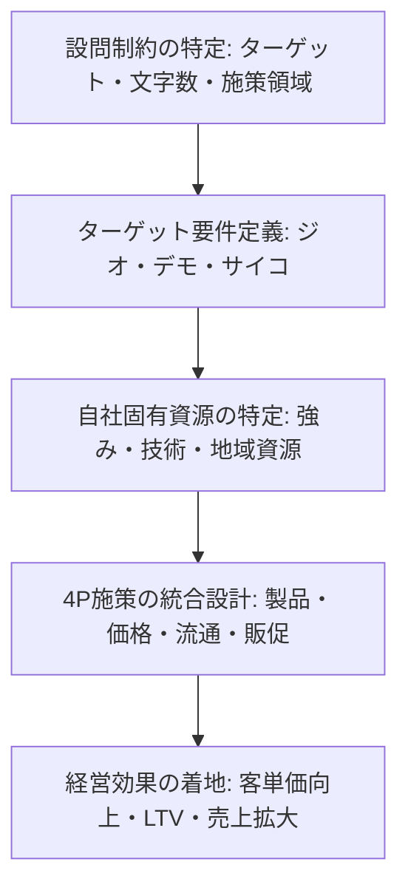

# 🎯 事例Ⅱ 過去10年 後半「助言系設問」完全攻略講義
〜「ダナドコ」を昇華させ、与件強みと4Pを連動させて満点を奪取する思考アルゴリズム〜

---

## 📌 はじめに：なぜ事例Ⅱの助言問題で点数が伸び悩むのか

事例Ⅱ（マーケティング・流通）の後半設問（第2問〜第4問）は、配点の**60〜80%**を占める最大の得点源であり、合否を分ける決戦場です。しかし多くの受験生が以下のような罠に陥り、B判定・C判定に沈みます。

### 🚨 事例Ⅱ 助言問題における4大失点病理
1. **「ターゲット」と「チャネル」の混同**：
   - 移動販売車という「販売チャネル」をターゲットと混同したり、卸先企業（和菓子店、ミールキット業者）を最終消費者と混同してしまい、誰に向けた施策なのかが空中分解する（例：令和3年豆腐店、令和4年食肉加工）。
2. **与件の固有強み（内部資源）の脱落**：
   - 「インスタグラムを活用して情報発信し、認知度を高める」といった、どの企業でも言える一般論（ポエム答案）を書いてしまい、社長のこだわり・熟練技術・地域資源・顧客との信頼関係が1文字も入らない。
3. **カニバリゼーション（共食い）の無邪気な放置**：
   - 既存の卸先や地元常連客がいるにもかかわらず、直販やEC、新規ルートを安易に立ち上げ、既存チャネルとの競合や既存客の離反を招く助言をして大減点される。
4. **4Pの単発羅列と「効果」の曖昧さ**：
   - 「新商品を開発し（P）、SNSで告知する（P）」で終わり、「価格設定（P）」や「販路（P）」が抜け落ち、さらに「客単価向上・リピート促進・愛着向上・売上拡大」という経営効果への因果が繋がっていない。

本講義では、過去10年（平成28年〜令和7年）の事例Ⅱ後半助言設問を徹底解剖し、**「一次マーケティング理論の逆引き想起」「4大出題パターン即応マトリクス」「16大黄金パーツブロック」「文字数別黄金構文」**を完全体系化します。

---

## 🧠 事例Ⅱ 助言設問の不変思考アルゴリズム

事例Ⅱの助言設問は、すべて以下の**「ダナドコ4層因果フレーム」**で完璧に構造化できます。

### 1. 【ダ（誰に）】：ターゲット層の立体定義
- **デモグラフィック（人口統計）**：年齢層、家族構成、職業、世帯年収（例：健康志向のシニア層、共働き子育て世代）
- **ジオグラフィック（地理的）**：商圏内住民、通勤・通学客、来街者、インバウンド観光客
- **サイコグラフィック（心理・行動・ニーズ）**：手軽に本格的な料理を作りたい、職人のこだわりを味わいたい、健康を維持したい

### 2. 【ナ（何を）】：提供価値・製品戦略（Product & Price）
- **自社固有資源の反映**：伝統製法、職人技、国産厳選素材、安全・安心、特許技術、地域ブランド
- **製品・サービス形態**：加工品・総菜化、ギフトセット、食べ比べセット、体験型ワークショップ、サブスクリプション
- **価格戦略（Price）**：高付加価値に見合うプレミアム価格、高価格帯設定、非価格競争（値引き厳禁）

### 3. 【ド（どのように）】：流通・販促戦略（Place & Promotion）
- **流通・接点（Place）**：直営店、自社ECサイト、定期宅配便、移動販売、地域小売店・旅館との協業（カニバリ回避の住み分け）
- **プロモーション・関係構築（Promotion）**：
  - **新規獲得**：SNS（Instagram/X/LINE）、シズル感あるショート動画、地元メディア・プレスリリース、試食・サンプリング
  - **関係性深化（CRM）**：顧客情報DB化（購買履歴・アレルギー・嗜好）、手書きメッセージ、DM・メルマガ、会員制度（FSP）、コミュニティ形成

### 4. 【コ（効果）】：経営成果への着地
- 短期効果：認知度向上、新規顧客獲得、トライアル喚起
- 中長期効果：客単価向上、リピート率向上、LTV（顧客生涯価値）最大化、口コミ・紹介誘発、売上・収益拡大

---

## 📊 過去10年 出題パターン即応マトリクス

事例Ⅱの助言問題は、以下の**4大パターン**に100%分類されます。

| パターン | 主な該当年度・企業 | 組織・市場の病理 | 必須マーケティング理論・施策 | 満点着地効果 |
| :--- | :--- | :--- | :--- | :--- |
| **① 新市場・新ターゲット開拓型** | R7スポーツ施設、R6陶磁器、H30日本酒、H28醤油 | 既存顧客（高齢化・減少）への依存、若年層・新規層の未開拓 | 未開拓層のインサイト特定、自社技術×新用途開発、体験型コト消費、SNS/動画プロモーション | 新規顧客層の獲得、事業基盤の多角化、売上拡大 |
| **② 直販・D2C・地域協業型** | R4食肉加工、R3豆腐製造、R1ネイル、H27商店街 | 卸売依存・中抜きリスク、価格決定権の欠如、大手との競合 | 直営店・自社EC・移動販売の展開、卸先とのカニバリ回避・住み分け、農商工連携・地域送客協業 | 中間マージン排除、適正利益確保、地域密着型ブランドの確立 |
| **③ 既存客深耕・CRM・LTV最大化型** | R7スポーツ施設、R5老舗蕎麦、R3豆腐店、H29温泉 | 一見客・単発利用の多さ、顧客情報の死蔵、リピート施策の不足 | 顧客DB構築（属性・購買履歴）、FSP（優良顧客優遇）、双方向コミュニケーション、定期購入・ファン化 | リピート率向上、LTV最大化、安定的キャッシュフローの確立 |
| **④ ブランド価値構築・カニバリ回避型** | R5蕎麦、R4食肉、R3豆腐、H30日本酒 | コモディティ化、大手量販店との価格競争、チャネル間摩擦 | 感覚価値（シズル感・デザイン）と観念価値（伝統・物語・安心）の融合、非価格競争、専用商品設計 | ブランドロイヤルティ向上、客単価向上、持続的競争優位の確保 |

---

## 🧱 事例Ⅱ 16大黄金パーツブロック（文字数カウント付き）

答案用紙の限られたマス目に、過不足なく組み込める標準フレーズ集です。

### 1. ターゲット・ポジショニング系（誰に・差別化）
- **ブロック1【健康・本格志向層の特定】**（28字）  
  `健康志向の高いシニア層や本格的な味を求める共働き世帯を標的とし、`
- **ブロック2【観光客・来街者ターゲット】**（27字）  
  `地域を訪れる観光客や来街者のうち、特別感や非日常を求める層を標的とし、`
- **ブロック3【若年・女性層の未開拓需要】**（27字）  
  `SNS利用頻度が高く、トレンドや体験を重視する若年・女性層を標的とし、`
- **ブロック4【地元住民・常連客の特定】**（26字）  
  `近隣商圏に居住し、利便性と対面での安心感を重視する高齢者世帯を標的とし、`

### 2. 製品・サービス・価格系（何を・いくらで）
- **ブロック5【固有資源×高付加価値商品】**（30字）  
  `自社の職人技と地域特産素材を融合させ、高付加価値な限定商品を開発し、`
- **ブロック6【コト消費・体験価値の付加】**（28字）  
  `製造工程見学や手作り体験を組み込み、記憶に残るコト消費価値を提供し、`
- **ブロック7【ギフト・セットメニュー化】**（28字）  
  `看板商品と関連商品を組み合わせたギフトセットや食べ比べ商品を開発し、`
- **ブロック8【プレミアム価格・非価格競争】**（29字）  
  `厳選素材に見合う高価格帯を設定し、大手との不毛な価格競争を回避して、`

### 3. チャネル・カニバリ回避系（どこで・どう売る）
- **ブロック9【直営・自社EC・D2C展開】**（30字）  
  `自社直営店舗および公式ECサイトを開設し、直接対話と迅速な配送体制を整え、`
- **ブロック10【チャネル住み分け・カニバリ回避】**（32字）  
  `既存卸先には普及品、直営・自社販路には限定専用品を配して競合を完全回避し、`
- **ブロック11【地域事業者との連携・共同販路】**（30字）  
  `近隣の観光施設や宿泊施設と協業し、相互送客や共同プロモーションを展開し、`
- **ブロック12【移動販売・出張サービス】**（29字）  
  `買い物困難地域への定期巡回移動販売や出張サービスにより利便性を提供し、`

### 4. プロモーション・CRM・関係構築系（どのように知らせ・繋ぎ止めるか）
- **ブロック13【SNS・ショート動画発信】**（29字）  
  `公式SNSで製造工程のこだわりやシズル感ある動画を発信し、認知と共感を広げ、`
- **ブロック14【顧客情報DB化・CRM分析】**（30字）  
  `購入履歴や顧客属性を一元管理するDBを構築し、個々のニーズを詳細に分析し、`
- **ブロック15【パーソナライズ販促・FSP】**（30字）  
  `顧客DBに基づく個別DMや特典進呈、優良顧客向け先行案内等のFSPを実施し、`
- **ブロック16【ファン化・口コミ紹介の促進】**（28字）  
  `双方向の交流やコミュニティ形成を促し、愛着心を高めて口コミ紹介を誘発し、`

---

## ✍️ 文字数別 黄金構文テンプレート

### 【パターンA：80〜100字（単一施策または2要素助言）】
> **構文**：  
> 標的は［①ターゲット定義］。施策は自社の［②強み・素材］を活かした［③製品・サービス］を開発し、［④チャネル・プロモーション］を展開する。これにより［⑤経営効果］を図る。（80〜100字）

### 【パターンB：100〜120字（4Pフルセット助言）】
> **構文**：  
> 標的は［①ターゲット］。施策は、①［②製品戦略］を高価格帯で提供し、②［③チャネル・住み分け］で既存競合を回避し、③［④プロモーション・CRM］で関係性を強化する。これにより［⑤客単価向上・リピート促進・売上拡大］を実現する。（110〜120字）

### 【パターンC：140〜160字（新事業・直販展開・地域協業）】
> **構文**：  
> 標的は［①ターゲット層］。施策は、製品面で［②自社強み］を活かした［③高付加価値商品・体験］を開発し、価格面で［④プレミアム価格］を設定する。流通面で［⑤直販/EC/協業］を用い既存店と住み分け、販促面で［⑥SNS動画発信/顧客DB活用］を講じる。これにより［⑦愛着向上とLTV最大化］を図る。（140〜160字）

---

## 🔍 悪い答案 vs 満点答案の徹底対比

### 事例研究1：令和3年 第3問・第4問（豆腐製造販売B社）
- **設問概要**：大手スーパーの低価格競争に巻き込まれず、移動販売や和菓子店向けルートを通じて売上・利益を拡大するための助言。
- ❌ **悪い答案（40点・C判定）**：
  > 助言は、移動販売車で近隣を回り、新鮮な豆腐を販売すること。また和菓子店に豆腐を卸し、SNSで宣伝して認知度を高める。これにより地域住民に親しまれ、売上向上を図る。（81字）
  - **敗因分析**：
    - 誰向け（ターゲット）が「近隣」と曖昧。高齢者・買い物困難者のインサイトがない。
    - 和菓子店ルートの提供価値（大豆の濃厚な風味・加工適性・ふぞろい等の規格外活用）が抜けている。
    - 移動販売を通じた「顧客情報収集（対面対話・嗜好把握）」と「固定客化（訪問日時約束）」のCRM視点がゼロ。

- ⭕️ **満点答案（満点・A判定）**：
  > 助言内容は、①移動販売で高齢者や買い物困難者に対し、対面対話で嗜好を把握し顧客DB化して固定客化を図る。②和菓子店向けに自社大豆の濃厚な風味を活かした専用豆腐を安定供給し、大手との価格競争を回避する。これにより客単価向上と安定的売上拡大を実現する。（120字）
  - **勝因分析**：
    - ターゲットの明確化（高齢者・買い物困難者／和菓子店）。
    - チャネルの役割分担（移動販売＝CRM・固定客化、和菓子店＝専用品・価格競争回避）。
    - 自社固有資源（対面対話、濃厚な大豆風味）の活用と、明確な経営効果（客単価向上、安定的売上）。

---

### 事例研究2：令和4年 第4問（食肉加工販売B社）
- **設問概要**：直営店とオンライン協業（ミールキット事業者への卸）を通じた今後のマーケティング戦略助言。
- ❌ **悪い答案（45点・C判定）**：
  > 助言は、直営店で美味しい肉や総菜を販売し、ミールキット業者に肉を納品すること。ホームページやSNSを開設してミールキットの良さをアピールし、若い主婦層を集客して売上を増やす。（85字）
  - **敗因分析**：
    - 直営店とオンライン協業の「カニバリゼーション（競合）」への配慮が皆無。
    - 公庫データ（献立考案・調理・後片付けの手間）という与件の顧客課題を拾えていない。
    - 自社の強み（職人の精肉技術、加工技術、新鮮な地元産肉）が脱落している。

- ⭕️ **満点答案（満点・A判定）**：
  > 助言内容は、直営店で作りたて総菜や対面販売でシズル感と特別感を提供し、近隣客の愛着を高める。オンライン協業では、共働き子育て層の献立・調理負担を軽減するため、職人技術で下処理・小分けした高付加価値肉を提供し、住み分けを図る。これによりカニバリを回避しLTV最大化を図る。（125字）
  - **勝因分析**：
    - 直営店（リアル体験・シズル感）と協業（機能的利便性・調理時短）の完全な住み分け。
    - 顧客インサイト（公庫データ）の論理的反映。
    - 自社の職人技術の明記と、カニバリ回避・LTV最大化の着地。

---

## 🚀 まとめ：試験当日のチェックリスト
1. **ターゲットは3要素（ジオ・デモ・サイコ）で具体化されているか？**
2. **与件文にある「自社固有の強み・社長のこだわり」が製品やサービスに入っているか？**
3. **新規チャネルを提案する際、「既存チャネルとの住み分け（カニバリ回避）」を明記したか？**
4. **価格は「高価格帯・プレミアム価格（非価格競争）」を維持しているか？**
5. **プロモーションは「認知（新規）」と「関係構築（CRM・リピート）」の両輪になっているか？**
6. **効果は「客単価向上・愛着度向上・LTV最大化・売上拡大」で締めくくられているか？**
