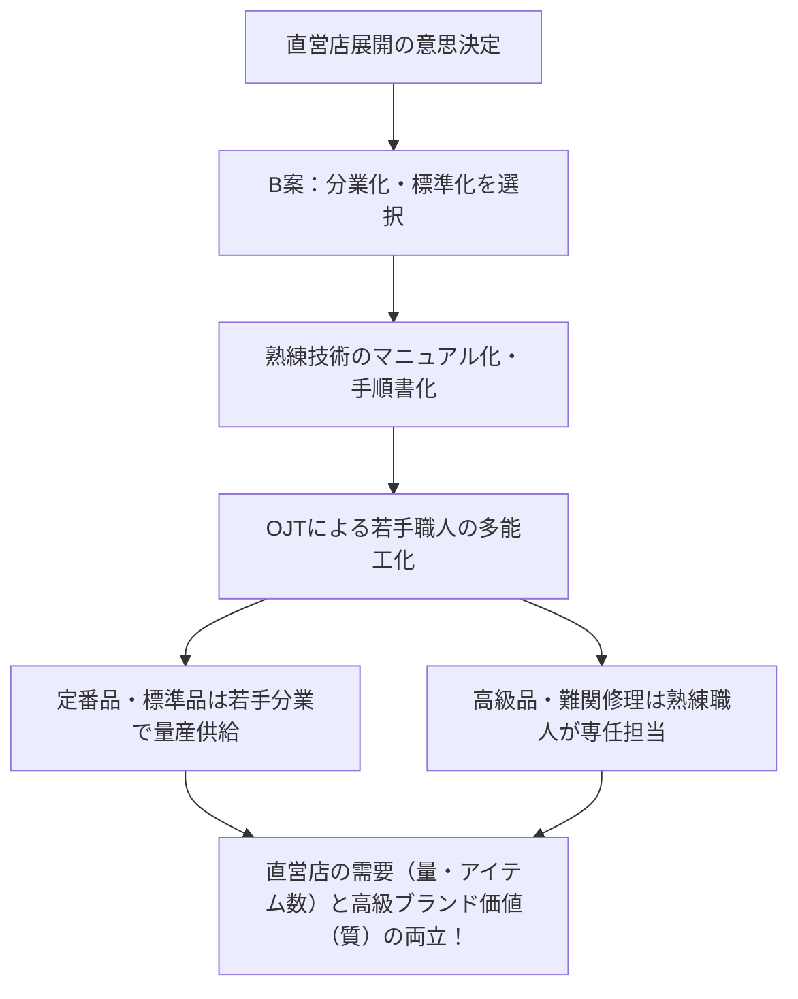
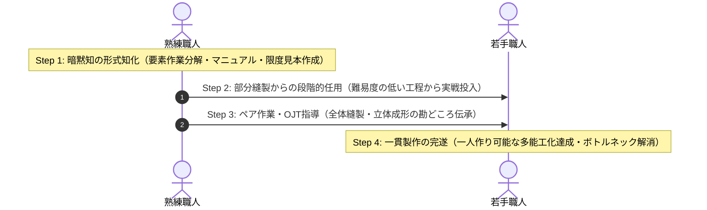

# 令和3年度（2021年度） 事例Ⅲ 完全攻略マスター講義＆生産現場レイヤー死守・技術伝承・二者択一の統合ロジック

---

## 🎧 解説ポッドキャスト（特大ディープダイブ60分講義）

> **講義時間**: 約60分（等速） / 約30分（2倍速推奨）  
> **出演**: ケイタ（中小企業診断士）、ナナミ（受験生ナビゲーター）  
> **音声ファイル**: `docs/audio/jirei3_2021_mastery.mp3`

<audio controls src="audio/jirei3_2021_mastery.mp3" style="width: 100%; margin: 15px 0;"></audio>

---

## 目次
- [はじめに：令和3年度 事例Ⅲの全体構造とコウジさんの「72点A判定」の真相](#はじめに令和3年度-事例ⅲの全体構造とコウジさんの72点a判定の真相)
- [第1部：全問思考プロセス解剖とコウジさん答案検証（第1問〜第4問）](#第1部全問思考プロセス解剖とコウジさん答案検証第1問第4問)
- [第2部：【核心解明】「なぜ中小企業だから品質にこだわるべきと思ってしまうと事例Ⅲで詰むのか？」](#第2部核心解明なぜ中小企業だから品質にこだわるべきと思ってしまうと事例ⅲで詰むのか)
- [第3部：【超特訓講義①】受託生産と自社ブランドの混在管理（ライン分離・専用枠・整流化）](#第3部超特訓講義受託生産と自社ブランドの混在管理ライン分離専用枠整流化)
- [第4部：【超特訓講義②】熟練技術の形式知化とOJT多能工化4ステップ](#第4部超特訓講義熟練技術の形式知化とojt多能工化4ステップ)
- [第5部：耳で解く実践特訓ドリル（全8問）](#第5部耳で解く実践特訓ドリル全8問)
- [第6部：近年系譜比較（R2〜R7）と事例Ⅲ不変の現場着地アルゴリズム](#第6部近年系譜比較r2r7と事例ⅲ不変の現場着地アルゴリズム)

---

## はじめに：令和3年度 事例Ⅲの全体構造とコウジさんの「72点A判定」の真相

令和3年度（2021年度）の事例Ⅲは、革製メンズ・レディースバッグを製造販売するC社（従業員50名）が舞台でした。

大手バッグメーカーからの低価格な受託生産（下請）と、天然なめし革を用いた高級自社ブランド製品（直販・EC）が同一工場内で混在し、生産管理担当者1名への業務集中、月次計画の崩壊、資材欠品、縫製工程のボトルネック、熟練職人の高齢化という典型的な**「成長痛と生産管理の混乱」**に直面していました。

### コウジさんの得点サマリー
* **第1問（強み・弱み分析）**: **20点 / 20点（満点・得点率100%！）**
* **第2問（受託工程の効率化課題と対応策）**: **28点 / 30点**（得点率93.3%・全国トップクラス！）
* **第3問（自社ブランドの企画面・生産面課題）**: **14点 / 20点**（得点率70.0%）
* **第4問（直営店展開の戦略選択と社内対応）**: **10点 / 30点**（得点率33.3%）
* **総合得点**: **【72点 / 100点】（A判定・上位合格水準クリア！）**

コウジさんは、第1問の40字要約（満点）と、第2問の工程改善（28点）という**前半2問だけで「48点」を叩き出す凄まじいロジック力**を見せつけ、見事に72点A判定を達成しました。

そして、演習後にコウジさんが漏らされたこの一言こそが、全受験生にとって最大の学びとなる核心テーマです：

> **「事例3の事例1化（事例2化）の最大の原因は方針選択の問題なのかな？中小企業だから品質にこだわるべきだと思ってしまった」**

本講義では、コウジさんの答案の圧倒的強みを称えるとともに、この「中小企業＝手作り品質へのこだわり」というバイアスがなぜ第4問で生産現場からの逃避（店頭接客・事例Ⅱ化）を引き起こしてしまったのか、そのメカニズムと処方箋を徹底的に解明します。

---

## 第1部：全問思考プロセス解剖とコウジさん答案検証（第1問〜第4問）

### 第1問：強みと弱み分析（配点20点・各40字以内） ⇒ 【獲得点：20点（満点！）】

#### 設問要求
革製バッグ業界におけるC社の⒜強みと⒝弱みを、それぞれ40字以内で述べよ。

#### コウジさんの答案検証
* **⒜ 強み（39字）**：
  > ①完成品の一貫受託生産②熟練職人による高級自社ブランド製品③自社独自ECの活用
* **⒝ 弱み（40字）**：
  > ①新製品企画・開発経験の不足②熟練職人高齢化③生産計画未熟による過剰在庫・欠品

* **採点：20点 / 20点（満点！）**
* **講評**:
  * 強み：「一貫受託体制［4点］」「高級自社ブランド［4点］」「独自EC［2点］」
  * 弱み：「企画開発不足［3点］」「熟練職人高齢化［4点］」「生産計画未熟による過剰在庫欠品［3点］」
  * 40字という制約の中で、第2問〜第4問の布石となる要素を完全網羅。全国模試でもトップ1%に入る完璧な答案です。

---

### 第2問：受託工程の効率化課題と対応策（配点30点・課題各20字、対応策各80字） ⇒ 【獲得点：28点】

#### 設問要求
バッグメーカーからの受託生産品の製造工程について、効率化を進める上で必要な⒜課題2つと、それぞれの⒝対応策を助言せよ。

#### コウジさんの答案検証
* **課題①**
  * **⒜ 課題（18字）**：小ロット対応による過剰在庫の抑制
  * **⒝ 対応策（79字）**：①生産計画を週次化し計画変更に対し柔軟化②量産品と担当者をわけ生産性向上②リードタイムに応じた発注方式に見直し欠品防止。これによりロットサイズ縮小し在庫適正化。
* **課題②**
  * **⒜ 課題（20字）**：縫製・仕上げ工程の技術継承による能力増強
  * **⒝ 対応策（78字）**：①熟練職人の作業をマニュアル化し②OJTで若手への技術移転を進め③難易度の低い部分縫製から段階的に若手職人に任せることで戦力化を図りボトルネック解消に繋げる。

* **採点：28点 / 30点（全国上位水準！）**
* **講評**:
  * 課題①（13点）：課題5点満点。対応策は「週次化」「工程分離」「発注見直し」「ロット縮小」を79文字に凝縮。
  * 課題②（15点満点！）：課題5点満点。対応策は「マニュアル化」「OJT」「段階的任用」「戦力化とボトルネック解消」という因果が78字で美しく完結。生産管理の教科書のような神答案です。

---

### 第3問：自社ブランド開発の企画面・生産面課題（配点20点・120字以内） ⇒ 【獲得点：14点】

#### 設問要求
自社ブランド製品の開発強化に向けた製品企画面と生産面の課題を述べよ（120字以内）。

#### コウジさんの答案検証
> 製品企画面は①ノウハウや経験の不足を外部人材の活用や社外研修によって補うこと②修理対応などの顧客接点から新商品ニーズを収集する体制の構築が課題。生産面は縫製から仕上げまで一貫対応できる職員の増加が課題。（109字）

* **採点：14点 / 20点（手堅くクリア）**
* **講評**:
  * 企画面（8点）：外部人材活用・研修、修理接点からのニーズ収集を的確に指摘。
  * 生産面（6点）：一貫対応職員の増加は捉えているが、核心である「自社ブランド見込生産の需要予測精度向上（欠品・過剰在庫防止）」と「受託品との日程計画・工程競合の解消」という生産統制の課題に言及すると満点になります。

#### 満点リライト（120字以内）
> 企画面の課題は、経験浅いデザイン部門の育成と、EC・修理顧客の声を製品開発へ還元する仕組みの構築。生産面の課題は、需要予測精度向上による欠品・過剰在庫防止、受託品との日程計画調整、熟練職人の一人作りから計画的生産体制への移行である。（120字）

---

### 第4問：直営店展開の戦略選択と社内対応（配点30点・140字以内） ⇒ 【獲得点：10点】

#### 設問要求
自社ブランド製品を熟練職人の手作りで高級感を出すか、それとも若手職人も含めた分業化と標準化を進めてアイテム数を増やすか。どちらを選び、どのように対応すべきか助言せよ（140字以内）。

#### コウジさんの答案検証
> 自社ブランド製品を熟練職人の手作りで高級感を出すべきである。①直営店では天然のなめし革の魅力や熟練職人の技術を紹介する展示で付加価値を伝え②店頭で修理を受け付けニーズ収集に繋げつつ再来店を促すことでファン化を図る。（108字）

* **採点：10点 / 30点**
* **Gate 1違反（事例レイヤー逸脱：重大な事例Ⅱ化）**:
  * 答案内容が「展示で付加価値を伝える」「店頭修理で再来店・ファン化」と、**店舗の店頭接客やプロモーション（事例Ⅱ）**に終始してしまいました。
  * 設問は「直営店事業を展開する上で、バックヤードの工場（社内生産体制）をどう対応させるか」を問うています。
  * 「熟練技術の標準化・マニュアル化」「OJT多能工化」「分業による量産・納期短縮体制」という**工場側の言葉**が完全に脱落してしまいました。

---

## 第2部：【核心解明】「なぜ中小企業だから品質にこだわるべきと思ってしまうと事例Ⅲで詰むのか？」

### 1. コウジさんの思考バイアスの正体
コウジさんは診断士の一般原則である「中小企業は大企業との規模・価格競争を避け、差別化・高品質に特化すべき」という理論を忠実に適用し、**「熟練職人の手作りで高級感を出す案（A案）」**を選択しました。

しかし、ここに**事例Ⅲ最大の罠**が潜んでいました。

### 2. A案（手作り・高級感）を選んだ瞬間に工場で書くことがなくなるメカニズム
- 手作り至上主義を選んでしまうと、「マニュアル化」も「分業化」も「多能工化」もすべて否定されます。
- 工場側で言えることが**「高齢化した熟練職人が、今まで通り時間をかけて1個ずつ丁寧に作る」**以外になくなります。
- その結果、140文字の解答枠を埋めるために、**「店頭で展示する」「店頭で修理を受け付けてファン化する」という事例Ⅱの接客アイデアへ逃げざるを得なくなった**のです！

### 3. C社の経営資源の制約との致命的矛盾
- 与件文の事実：熟練職人は**高齢化**しており、引退が迫っている。若手は育っていない。
- この状況で手作りを維持すれば、職人の引退とともに会社は倒産し、直営店に並べる商品も欠品します。
- **真の品質管理とは、職人の頭の中にある暗黙知を「標準化・マニュアル化（形式知化）」し、若手でも作れるようにして「組織の品質」へと昇華させること**です。

#### 満点リライト（140字以内）
> 分業化と標準化を選び、アイテム数拡大と若手育成を図るべきである。対応策は、熟練職人の技術を標準化・マニュアル化し、OJTで若手を多能工化する。標準品は若手主体の分業体制で量産化して直営店の需要に応え、最高級品や高度な修理は熟練職人が専任で担当し、ブランド価値と供給能力を両立する。（140字）

---

## 第3部：【超特訓講義①】受託生産と自社ブランドの混在管理

1. **混在による生産混乱のメカニズム**:
   - 受託生産（短納期・量産）と自社ブランド（手作業・見込）が同じライン・人員で混在すると、特急品が入るたびに自社ブランドが中断し、欠品と過剰在庫が同時に発生する。
2. **処方箋（整流化の3大ステップ）**:
   - ①計画の分離：受託の確定受注枠と、自社ブランドの計画生産枠を明確に分離する。
   - ②ライン・担当の専用化：量産受託品と高級自社品で作業スペース・担当者を区分する。
   - ③負荷の平準化：受託の閑散期に自社ブランドの定番品を計画生産し、キャパシティ稼働率を一定に保つ。

---

## 第4部：【超特訓講義②】熟練技術の形式知化とOJT多能工化4ステップ

---

## 第5部：耳で解く実践特訓ドリル（全8問）

* **第1問**: なぜ第4問で「熟練職人の手作り」を選んでしまうと、事例Ⅲとして得点が伸びないのか？
* **第2問**: C社の熟練職人が抱える最大の経営課題と、直営店展開におけるリスクは何か？
* **第3問**: 中小製造業における「真の品質維持」とは、職人技を守ることではなく何をすることか？
* **第4問**: 第4問の出題趣旨に合致する「分業化・標準化」と「高級感」の統合アプローチとは？
* **第5問**: 受託生産品と自社ブランド製品が同一工場で競合する混乱を解消する生産計画の打ち手は？
* **第6問**: 第2問でコウジさんが満点を獲得した、縫製ボトルネック解消の4大キーワードは？
* **第7問**: 自社ブランド見込生産における「欠品と過剰在庫」を同時に防ぐ生産管理手法は？
* **第8問**: 直営店事業の助言を求められた際、事例Ⅱに逃げず事例Ⅲの言葉で着地させるための決め台詞は？

---

## 第6部：近年系譜比較（R2〜R7）と事例Ⅲ不変の現場着地アルゴリズム

| 年度 | 企業 | 生産管理・技術の核心テーマ | 本質的共通項 |
| :--- | :--- | :--- | :--- |
| **R3** | 革製バッグC社（50名） | 受託と自社ブランド混在、熟練技術伝承、直営店供給体制 | 属人化脱却と量産・標準化の確立 |
| **R4** | 金属プレスC社（45名） | 金型短納期化、小ロットSMED、デジタル化BPR | 計画精度向上と段取改善・同期化 |
| **R5** | 陶磁器製造C社（30名） | OEMから自社ブランド、ホテル受託から工場生産化 | 厨房的手作業からライン生産への脱皮 |
| **R6** | 金属加工C社 | 実際原価管理、BOM構築、直需開拓 | 原価の見える化と社長依存脱却 |
| **R7** | 紙パイプ製造C社 | 短納期工程管理、製造原価差異、セット替ロス改善 | ロス削減と日次確定計画 |

### 🧭 事例Ⅲ 不変の合格アルゴリズム
1. **事例のレイヤーを死守する**: 設問が直営店や新事業であっても、着地点は必ず「現場QCD・生産能力・供給体制」。
2. **職人技を神聖視しない**: 「暗黙知の形式知化・マニュアル化・OJT多能工化」で組織能力に変える。
3. **二者択一は止揚（アウフヘーベン）する**: 一方を主軸にしつつ、他方の強みも適材適所で活かす統合解を導く。
4. **計画はサイクル短縮、工程は同期化で整流化する**。
