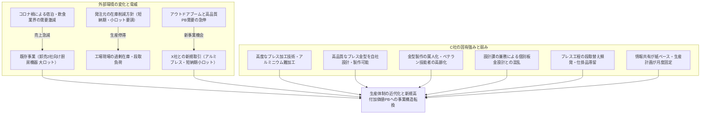
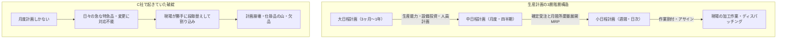
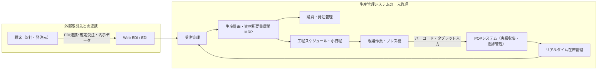

# 令和4年度（2022年度） 事例Ⅲ 完全攻略マスター講義＆生産計画・生産管理システム徹底対策

---

## 🎧 解説ポッドキャスト（特大ディープダイブ2時間講義）

> **講義時間**: 約120分（等速） / 約60分（2倍速推奨）  
> **構成**:  
> - **前半（約60分）**: 令和4年度 本試験徹底解答解説（C社の全貌、全問思考実況、模範解答）  
> - **後半（約60分）**: ユーザー答案分析＆弱点完全克服「生産計画・生産管理システム」超特訓講義  
> **出演**: ケイタ（中小企業診断士）、ナナミ（受験生ナビゲーター）  
> **音声ファイル**: `docs/audio/jirei3_2022_mastery.mp3`

<audio controls src="audio/jirei3_2022_mastery.mp3" style="width: 100%; margin: 15px 0;"></audio>

---

## 目次
- [【前半：本年度フォーカス・解答解説編】](#前半本年度フォーカス解答解説編)
  1. [第1部：令和4年度 事例Ⅲの全体構造と難易度分析](#第1部令和4年度-事例ⅲの全体構造と難易度分析)
  2. [第2部：全問徹底解剖・満点答案・思考実況プロセス（第1問〜第5問）](#第2部全問徹底解剖満点答案思考実況プロセス)
  3. [第3部：第4問「なぜ書けなかったのか？」を完全打破するBPR・DX構文](#第3部第4問なぜ書けなかったのかを完全打破するbprdx構文)
- [【後半：答案分析＆生産計画・生産管理システム徹底マスター編】](#後半答案分析生産計画生産管理システム徹底マスター編)
  4. [第4部：ユーザー答案の徹底添削講評（第4問白紙でも74点・A判定の理由）](#第4部ユーザー答案の徹底添削講評)
  5. [第5部：【超特訓講義①】生産計画の完全体系（大日程・中日程・小日程・ロット・同期化）](#第5部超特訓講義生産計画の完全体系)
  6. [第6部：【超特訓講義②】生産管理システムと現場ITの完全体系（EDI・MES・MRP・POP・BPR）](#第6部超特訓講義生産管理システムと現場itの完全体系)
  7. [第7部：近年傾向の系譜比較（平成30年〜令和6年）と事例Ⅲ・不変の合格ロジック](#第7部近年傾向の系譜比較)

---

# 【前半：本年度フォーカス・解答解説編】

## 第1部：令和4年度 事例Ⅲの全体構造と難易度分析

### 1. 企業概要と事例の本質的テーマ
- **企業名**: C社
- **業種**: 金属製品製造業（金属熱プレス加工、板金加工、金型製作）
- **資本金**: 1,000万円 / **従業員数**: 32名（金型製作課5名、プレス加工課18名、板金加工課5名、設計課4名）
- **主力事業**: 厨房機器・業務用調理器具のプレス加工（大手中堅調理器具メーカー向けOEMおよび卸売業者向け）
- **主要顧客**: 既存卸売業者2社（売上の約7割を占める）
- **新規の引き合い**: アウトドア用品企画販売業者X社（高価格帯オリジナルアウトドア製品の共同開発・製造委託）

---

## 第2部：全問徹底解剖・満点答案・思考実況プロセス

### 第1問：外部環境の変化と販売面・生産面の課題（配点20点）
- **制約条件**: 「販売面」「生産面」に明確に分けて整理すること。文字数は80字以内。
- **与件根拠**:
  - 第5段落: 「宿泊・飲食業界向け製品の需要が急減」
  - 第6段落: 「売上の約7割を占める既存卸2社からの受注が大幅に減少」
  - 第7段落: 「小ロット・短納期発注が増加」
  - 第8段落: 「金型製作課のベテラン技能者の高齢化と技術伝承の遅れ」
- **模範解答（80字）**:
  > **「販売面は、外食需要減に伴う既存卸２社依存から脱却し新規受注を開拓する。生産面は、金型技能者の技術伝承と、小ロット化に対応した社内過剰在庫の削減と短納期化である。」**

### 第2問：金型製作工程の課題と短納期化の対応策（配点20点）
- **制約条件**: 「課題」と「対応策」を対応させて整理すること。文字数は120字以内。
- **因果の「課題3点 $\times$ 対応策3点」完全結合フレーム**:
  1. 課題①：発注元との仕様確認遅延と設計変更 $\to$ 対応策①：3D CAD導入で早期合意・仕様凍結
  2. 課題②：板金設計兼務による混乱 $\to$ 対応策②：設計課の担当分担・専任化
  3. 課題③：金型技能者の属人化と余力不足 $\to$ 対応策③：作業手順書の作成と計画的OJTによる技術伝承
- **模範解答（118字）**:
  > **「課題は①仕様確認遅延と変更、②板金設計兼務による混乱、③金型技能者の高齢化と属人化。対応策は①３ＤＣＡＤ導入で発注元と仕様を早期確定、②設計課の担当分担で兼務解消、③作業手順書の作成と計画的ＯＪＴによる若手技能伝承で金型製作を短納期化する。」**

### 第3問：プレス加工課の小ロット化対応策（配点20点）
- **制約条件**: 小ロット化に伴う生産面の問題点に対する対応策。文字数は120字以内。
- **改善の3大柱**:
  1. 外段取化と多能工応援体制（段取時間短縮）
  2. 月度計画から週次・日次計画への移行（確定受注連動）
  3. プレス工程と後工程（組付・仕上）の同期化（仕掛品滞留と過剰在庫削減）
- **模範解答（119字）**:
  > **「対応策は、①外段取化の徹底と多能工応援体制により段取時間を短縮し、②生産計画を月度から週次・日次計画へ細分化して確定受注連動型に改め、③プレス工程と後工程の同期化を図り、仕掛品滞留と社内過剰在庫を削減して短納期小ロット生産を実現する。」**

### 第4問：優先すべきデジタル化の内容と社内活動（配点20点）
- **制約条件**: 「優先すべきデジタル化の内容」と「社内活動」。文字数は120字以内。
- **模範解答（119字）**:
  > **「内容は、Ｘ社と受発注データをＥＤＩ連携し、社内の受注・生産計画・工程進捗・在庫情報を一元管理する生産管理システムを導入し情報共有を迅速化する。社内活動は、全社横断の推進チームを立ち上げ、業務プロセスの可視化・標準化を行い、マニュアル作成と教育で定着を図る。」**

### 第5問：X社との取引による戦略的可能性（配点20点）
- **制約条件**: 戦略的可能性。文字数は120字以内。
- **模範解答（118字）**:
  > **「可能性は、①Ｘ社向け高価格製品の共同開発によるアルミニウム加工技術の高度化、②短納期・小ロット生産体制の確立による新規取引先開拓、③成長するアウトドア市場での自社企画力向上により、既存卸依存から脱却し収益基盤の多角化と経営安定化を図ることである。」**

---

## 第3部：第4問「なぜ書けなかったのか？」を完全打破するBPR・DX構文

### 1. 思考停止に陥った真因
- **「優先すべき＝ITツール名1点に絞るべき？」という錯覚**:
  出題者が問うているのはツールの名前当てではない。C社の最大の製造リードタイム阻害要因である**「紙ベースの情報交換（第11段落）」を撲滅し、情報をリアルタイム一元化すること**が真の狙い。

### 2. 黄金の2ブロック構文（各60字）
- **前半ブロック（デジタル化の内容）**:
  外部連携（EDI）＋内部一元管理（生産管理システム：受注・計画・進捗・在庫）＋リアルタイム共有。
- **後半ブロック（社内活動の進め方）**:
  全社横断プロジェクトチーム＋現行業務プロセスの可視化・標準化＋操作マニュアル作成・教育訓練による現場定着。

---

# 【後半：答案分析＆生産計画・生産管理システム徹底マスター編】

## 第4部：ユーザー答案の徹底添削講評

### 1. 総合評価：74点 / 100点（第4問白紙でもAランク合格）
- 第1問: 17点 / 20点（85%）
- 第2問: 19点 / 20点（95%）
- 第3問: 19点 / 20点（95%）
- 第4問: 0点 / 20点（未記入・白紙）
- 第5問: 19点 / 20点（95%）

### 2. 答案の圧倒的強みと改善ポイント
- **強み**: 第2問の「課題3点 $\times$ 対応策3点」の1対1完全対応、第3問の外段取・多能工・日次計画、第5問の高価格PB・新規開拓・収益分散は全国トップレベルの精度。
- **改善点**:
  - 助詞の脱落（「依存減らす」 $\to$ 「依存から脱却し」）を防ぎ、文の引き締まりを向上させる。
  - 手段の記述の後に、必ず「〜によりリードタイム短縮と過剰在庫削減を図る」というQCD成果で着地させる。

---

## 第5部：【超特訓講義①】生産計画の完全体系

受験生が最も知識の抜け落ちを感じやすい「生産計画」の全貌を体系化します。

### 1. 生産計画の3階層（大日程・中日程・小日程）
1. **大日程計画（長期・中期）**:
   - 期間：3ヶ月〜1年程度。
   - 目的：需要予測に基づき、設備投資、原材料の長期調達枠、人員採用・配置を決定する。
2. **中日程計画（月度計画）**:
   - 期間：1ヶ月〜四半期。
   - 目的：月間の確定受注と内示（フォーキャスト）に基づき、製品群ごとの生産数量、月間稼働日数、資材所要量展開（MRP）を確定する。
3. **小日程計画（週間・日次計画）**:
   - 期間：1週間〜日次・時間単位。
   - 目的：直近の確定注文に基づき、**「どの機械で、誰が、何時から何時まで、どのロットを作るか」を具体的に割り付ける（ディスパッチング・作業割付）**。

### 2. ロットサイズと段取改善（SMEDの理論）
- **経済的生産ロット（EPL）の原理**:
  ロットを大きくすれば「1個あたりの段取費用」は下がるが、「在庫維持費用」が跳ね上がる。
- **小ロット化の絶対条件**:
  段取時間を短縮しないままロットだけ小さくすると、機械が止まる回数が増えて工場がパンクする。だからこそ**「内段取の外段取化（SMED: シングル段取化）」**が必須となる。

### 3. 工程間同期化とラインバランシング
- **プッシュ型（押し込み）からプル型（後工程引取り・同期化）へ**:
  プレス工程が前工程の都合で大ロット生産すると、後工程（組付・仕上）の前に中間仕掛品が山積みになる。
- **同期化の実現策**:
  全工程のタスク時間（サイクルタイム）を揃える「ラインバランシング」を行い、小ロットで1個流し・セル生産的に次工程へ引き渡す。

---

## 第6部：【超特訓講義②】生産管理システムと現場ITの完全体系

事例Ⅲで頻出するIT・生産管理システムの全体像とBPRの定石を整理します。

### 1. 生産管理システム（パッケージ）の基本機能モジュール
1. **受注・出荷管理**: 外部顧客からの確定発注・内示データの取り込み。
2. **生産計画（MRPモジュール）**: 受注データから製品構成表（BOM）に基づき、必要な部品・材料の所要量と発注タイミングを自動展開。
3. **工程管理・進捗管理（MES: 製造実行システム）**: 各機械・工程への作業指示の発行と、日々の進捗ステータスのリアルタイム把握。
4. **実績収集（POPシステム: Point of Production）**: 作業現場でバーコードやハンディターミナル、タブレットを用いて、着工・完了・不良数を即座に入力。
5. **在庫管理**: 原材料・仕掛品・完成品のリアルタイム在庫数を一元管理し、過剰在庫と欠品を防止。

### 2. 現場導入・定着化のBPRステップ（社内活動の王道）
1. **Step 1: 全社横断プロジェクトチームの設置**:
   社長直轄で、製造部門長だけでなく設計・板金・営業・金型ベテランをアサイン。
2. **Step 2: 現行業務プロセスの可視化（As-Is）と標準化（To-Be）**:
   紙伝票がどこで滞留しているかを洗い出し、ムダな転記や確認作業を廃止して業務フローを統一。
3. **Step 3: マニュアル作成とスモールスタート（パイロット運用）**:
   写真・画面付きの直感的な手順書を作成し、プレス課の特定ラインで試行運用して成功体験を作る。
4. **Step 4: 教育訓練・OJTと全社展開**:
   若手とベテランがペアを組み、操作教育を行って現場の心理的抵抗を解消。

---

## 第7部：近年傾向の系譜比較（平成30年〜令和6年）

| 出題年度 | 企業概要 | 生産計画・情報化の課題 | 共通する合格ロジック |
| :--- | :--- | :--- | :--- |
| **平成30年度** | 金属熱処理受託 | 治具製作の属人化、進捗がブラックボックス化。 | 治具の標準化、リアルタイム進捗共有、多能工応援。 |
| **令和元年度** | 金属部品・機械組立 | 設計兼務による混乱、部品欠品と納期遅延。 | 設計の専任化、3D CAD活用、部品と組立の同期化。 |
| **令和3年度** | 金属熱処理・機械加工 | 特定顧客依存、航空・医療参入、特殊技能属人化。 | 暗黙知の形式知化、試作短納期化、品質管理体制。 |
| **令和4年度** | **金属プレス・金型製作** | **既存卸依存、金型属人化、段取増、紙ベース伝票。** | **3D CAD、専任化、外段取、EDI・生産管理システム、PB協業。** |
| **令和5年度** | 金属プレス・射出成型 | 金型メンテナンス遅れ、突発故障、歩留まり低下。 | 金型の定期予防保全計画、保全履歴のデータ化、多能工化。 |
| **令和6年度** | プレス金型・部品加工 | 顧客短納期化、設計負荷集中、機械稼働率バラツキ。 | 3D CAD/CAM連携、日程計画の日次見直し、全社情報共有。 |

### 結論
事例Ⅲの合格ロジックは不変です。**「設計の属人化をCADと標準化で解消し」「段取改善と日次計画で小ロット同期化を達成し」「紙を捨てて生産管理システムで一元管理し」「固有技術を武器に高付加価値PBで多角化する」**。この骨太の理論を武器に、本番試験に臨みましょう！
