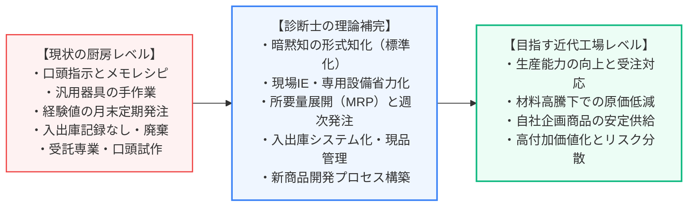
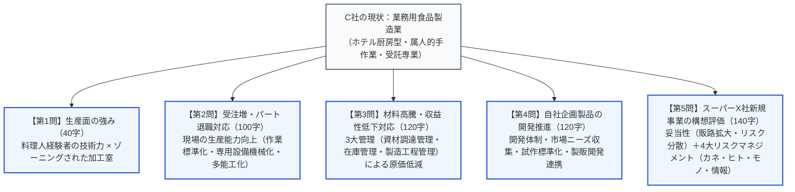
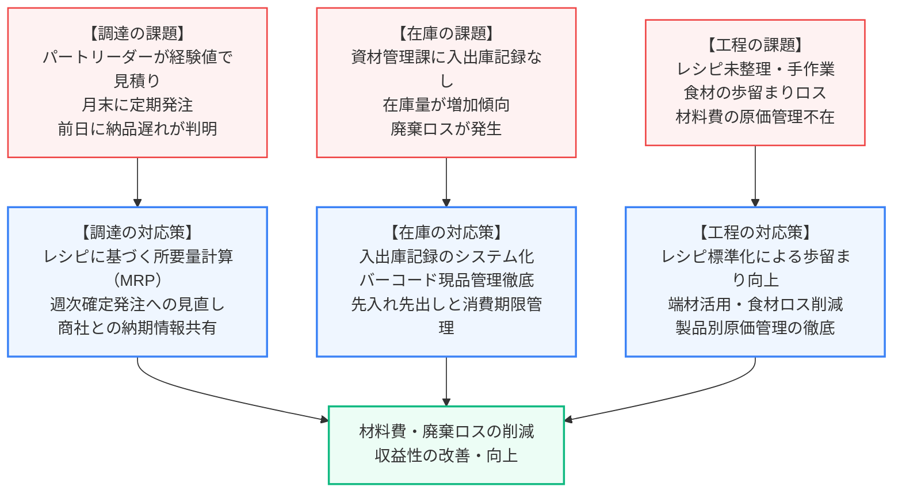
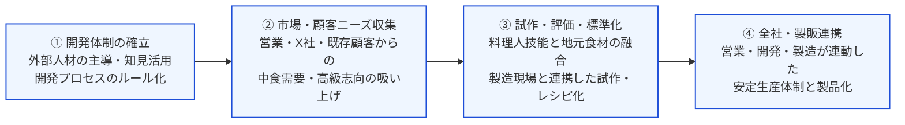
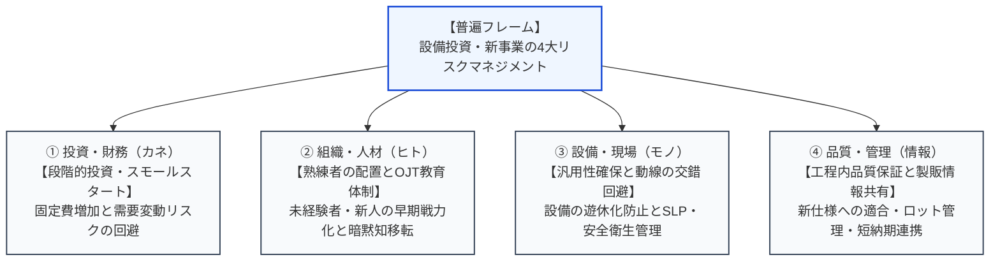
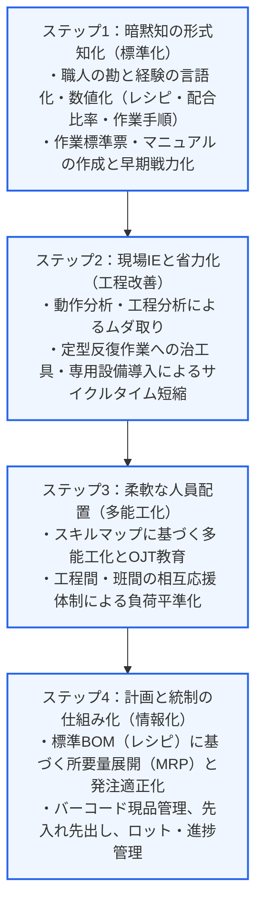

# 令和5年度（2023年度） 事例Ⅲ 完全攻略マスター講義＆食品製造業・生産管理のセオリー

## はじめに：令和5年度 事例Ⅲの全体構造と「文字数が埋まらない」正体

### 1. なぜ「与件文の言葉を拾っても文字数が埋まらない」のか？

令和5年度の事例Ⅲ（C社：業務用食品製造業）に取り組み、「何を書けばいいのか分からない」「与件文の言葉を拾っても文字数が全然埋まらない」と感じた受験生は非常に多く存在します。
この違和感は、あなたの記述力不足によるものではありません。**本事例の構造自体が、従来の事例Ⅲとは全く異なる「出題設計」になっていたから**です。

従来の事例Ⅲ（典型的な金属加工業や機械部品メーカーなど）では、与件文の中に「問題点と原因のペア」が分かりやすく明記されていました。
- 「○○工程で段取り替えが多く仕掛品が滞留している」→「段取りの標準化・内段取りの外段取り化で仕掛品削減」
- 「納期遅延が多発している。原因は営業と製造の連絡不備」→「定期的な生産会議を開催し日程計画を確定」

そのため、与件文の記述を「そのまま抜き出して裏返す（Aだから改善する）」だけで、100字〜120字の解答枠の7割〜8割が自然に埋まる構成になっていました。

しかし、令和5年度のC社は違います。
与件文に書かれているのは、以下のような**「厨房の日常風景や断片的な事実（現象）」**だけです。
- 「汎用調理器具を使って手作業で進められている」
- 「販売先料理長が来社し、口頭で指示。メモ程度のレシピが整理されずにいる」
- 「パートリーダーが経験値で見積り、月末に定期発注」
- 「資材管理課に入出庫記録がなく、在庫量は増える傾向で廃棄も生じる」

これを素朴に裏返して答案を作ろうとすると、どうなるでしょうか。
> 「レシピを整理し、手作業をやめて、入出庫記録をつけて廃棄を減らし収益性を高める。（40字）」

これ以上、与件文に何も書かれていないため、**「あと60〜80字も余ってしまうが、何を足せばいいのか分からない」**と手が止まり、文字数を埋めきれないパニックに陥るのです。

---

### 2. 「与件の裏返し」から「生産管理理論による因果補完」への脱皮

令和5年度の事例Ⅲで満点・高得点を獲得するための絶対的要件は、**「生産管理の専門知識（一次知識）という骨格を使って、与件文の断片的な事実の間に『論理的な因果関係の肉付け』を行うこと」**です。

C社は「製造業」を標榜していますが、その実態は**「職人（料理人・ベテランパート）の勘と経験、手作業に頼った“巨大なホテルの厨房”」**です。
中小企業診断士として求められている助言の本質は、**「属人的な手作業の厨房から、組織的・計画的にモノを作る『近代的なマニュファクチャリング工場』へと脱皮させること」**にあります。

このように、与件文の「種（事実）」に対して、診断士試験のコア知識である**「工程管理・作業管理・資材調達管理・在庫管理・新製品開発・設備投資評価」のフレームワークを掛け合わせ、具体的な因果の鎖を紡ぐこと**によって初めて、100字〜140字の指定文字数が過不足なく論理的に埋まるようになります。

---

### 3. 設問間の「縄張り争い（切り分け）」の完全設計図

受験生が文字数を埋められなかったり、途中で混乱するもう一つの原因が**「設問間の切り分け（縄張り争い）」**です。
どの設問にどの要素を書くべきかの境界線を明確に引いておかないと、同じような改善策（レシピの標準化など）を各問で重複して書いてしまい、書くべき固有論点が抜け落ちて失点します。

- **第1問（40字）**: 「生産面の強み」に絞り、ヒト（料理人経験）と設備・環境（交差汚染防止ゾーニング）を極限まで凝縮。
- **第2問（100字）**: 「製造部の生産能力向上」＝現場のボトルネック解消、手作業の機械化・省力化、作業標準化、班間応援・多能工化。
- **第3問（120字）**: 「材料高騰・収益性低下」＝コスト削減に直結する「調達」「在庫」「工程（歩留まり）」の3本柱。
- **第4問（120字）**: 「自社企画開発の進め方」＝組織（製品開発部）・マーケティング（顧客ニーズ）・開発プロセス（試作・レシピ化）・連携。
- **第5問（140字）**: 「社長の増築構想の助言」＝妥当性判定、その理由（中食需要・リスク分散）、および【4大リスクマネジメント（カネ・ヒト・モノ・情報）】に基づく助言。

この「全体マップ」が頭にあれば、どの設問で何を語るべきかが一目瞭然となり、文字数の過不足に悩まされることは一切なくなります。

---

## 第1部：中小企業診断協会「公式出題趣旨」の完全照合

試験委員が答案のどこを評価していたのか、中小企業診断協会が公表した公式の「出題の趣旨」を確認します。

| 設問 | 配点 | 公式出題趣旨の文言 | 読み解くべき採点の急所 |
| :--- | :---: | :--- | :--- |
| **第1問** | 10点 | C社の生産面の強みについて、分析する能力を問う問題である。 | 経営面や営業面ではなく**「生産面」**の強みに限定。料理人経験を持つ人材力と、交差汚染を防ぐ設備・環境の2点を抽出する。 |
| **第2問** | 20点 | コロナ禍後の増加する受注量に対応するための C社生産面の課題を整理し、その対応策について、助言する能力を問う問題である。 | 「課題」と「対応策」のセット。手作業・属人化によるキャパシティ不足に対し、**標準化・機械化・多能工化**で生産能力を引き上げる。 |
| **第3問** | 20点 | 最近の材料価格高騰に対応するため、C社の**資材調達管理、在庫管理、製造工程管理**の課題を整理し、その対応策について、助言する能力を問う問題である。 | **出題趣旨に3大管理（調達・在庫・工程）が明記**されている。この3つの切り口を漏れなく網羅しているかが最大の合否分岐点。 |
| **第4問** | 20点 | 自社企画製品の販売を実現するために、創業から受託品の製造に特化してきた C社の製品企画開発の課題を整理し、そのために必要となる社内対応策について、助言する能力を問う問題である。 | 受託専業体質からの脱却。新設された製品開発部（外部人材）の活用、顧客ニーズ収集、試作・レシピ標準化、全社的連携を問う。 |
| **第5問** | 30点 | 工場増築などの設備投資によって生産体制を構築し、新規事業の生産に対応しようとする C社社長の構想の妥当性とその理由、またその際の留意点について、助言する能力を問う問題である。 | 「妥当性」「理由」「留意点」の3要素要求。社長の構想を肯定しつつ、**製造業の4大リスクマネジメント（カネ・ヒト・モノ・情報）**に基づく助言ができるか。 |

---

## 第2部：全設問の思考プロセス解剖と「満点答案」

ここからは、各設問について「設問要求・出題趣旨の解剖」「与件文の要素抽出」「満点骨子の組み立て」「満点答案例」を徹底的に解説します。

---

### 第1問：生産面の強み（40字以内、配点10点）

#### 1. 設問の意図と出題者の狙い
- **設問要求**: 「C 社の生産面の強みを 2 つ 40 字以内で述べよ。」
- **出題趣旨**: C社の生産面の強みについて、分析する能力を問う問題である。
- **制約条件**:
  1. **「生産面」の強みに限定**: 営業力、社長の提案力、販売先との強固な関係性などは加点対象外。
  2. **「2つ」**: 2つの要素を並列で提示する。
  3. **「40字以内」**: 1要素あたり約18〜19字という極限の圧縮が要求される。

#### 2. 与件文からの要素抽出
与件文の第2段落〜第5段落から、C社の「生産現場固有の強み」を探します。
- **ヒト（技能・経験）**: 「工場管理者（製造部長、総菜製造課長、菓子製造課長）は、ホテルや旅館での料理人の経験がある」「ベテランのパートリーダーが配置されている」
- **設備・衛生環境**: 「食品衛生管理上交差汚染を防ぐようゾーニングされている」「各加工室の設備機器のレイアウトはホテルや旅館の厨房と同様なつくりとなっている」

40字という制約を考慮すると、「①料理人経験者による高い調理技術」「②交差汚染を防ぐゾーニングされた加工室」の2点に絞り込むのが最も無駄がなく加点効率が最大化されます。

#### 3. 満点答案（39字）

> 強みは、①料理人経験者の高い調理技術、②交差汚染を防ぐゾーニングされた加工室。（39字）

---

### 第2問：受注増と高齢パート退職への生産面対応策（100字以内、配点20点）

#### 1. 設問の意図と出題者の狙い
- **設問要求**: 「C 社の製造部では、コロナ禍で受注量が減少した 2020 年以降の工場稼働の低下による出勤日数調整の影響で、高齢のパート従業員も退職し、最近の増加する受注量の対応に苦慮している。 生産面でどのような対応策が必要なのか、 100 字以内で述べよ。」
- **出題趣旨**: コロナ禍後の増加する受注量に対応するための C社生産面の課題を整理し、その対応策について、助言する能力を問う問題である。
- **制約条件**:
  - 対象：製造部（生産現場）。
  - 原因：高齢パート退職による人員不足・技能喪失、および受注量の急回復。
  - 要求：**「生産面」の対応策**。第3問の「資材調達・在庫・コスト」と明確に切り分け、**「現場の作業・工程の生産能力向上」**にフォーカスする。

#### 2. 与件文の事実と「生産管理理論」による因果展開
なぜC社製造部は受注増に対応できないのか？ 与件文から現場のボトルネックを洗い出します。

1. **作業方法の属人化・口頭指導**:
   - 与件事実：「工場管理者3名とパートリーダーが直接作業方法を指導・監督」「メモ程度のレシピが整理されず」
   - 生産理論の補完：口頭指導では新人パートが戦力化しない。**レシピを標準化・マニュアル化**し、作業手順を可視化して早期戦力化を図る。
2. **手作業への過度な依存**:
   - 与件事実：「鍋やボウル、包丁など汎用調理器具を使って手作業で進められている」
   - 生産理論の補完：前処理や計量・カットなど、定型的な工程に**専用調理機器・省力化設備を導入**し、作業時間を短縮する。
3. **固定化された班体制と繁閑差**:
   - 与件事実：「総菜製造班は販売先ごとに製造（5班）」「朝食用は前日午後製造、夕食用は当日14時まで製造」
   - 生産理論の補完：販売先ごとに班が分断され、納品時間帯によって負荷の偏りが発生している。パートの**多能工化を推進し、班間の工程間応援体制**を構築して稼働率を平準化する。

#### 3. 満点答案（100字）

> 対応策は、①レシピを整理・マニュアル化して作業標準化とパート教育を進め早期戦力化を図る、②手作業の工程に専用調理器具や省力化設備を導入する、③多能工化を推進し班間の相互応援体制を構築して生産能力を向上させる。（100字）

---

### 第3問：材料価格高騰と収益性低下への対応策（120字以内、配点20点）

#### 1. 設問の意図と出題者の狙い
- **設問要求**: 「C 社では、最近の材料価格高騰の影響が大きく、付加価値が高い製品を販売しているものの、収益性の低下が生じている。どのような対応策が必要なのか、120 字以内で述べよ。」
- **出題趣旨**: 最近の材料価格高騰に対応するため、C社の**資材調達管理、在庫管理、製造工程管理**の課題を整理し、その対応策について、助言する能力を問う問題である。
- **最重要ポイント**: 出題趣旨に明記された**「資材調達管理」「在庫管理」「製造工程管理」の3大管理**をそのまま解答の3本柱（①調達、②在庫、③工程）として採用すること。これが文字数を完璧に埋め、満点を獲得する絶対的フレームです。

#### 2. 与件文の事実と3大管理の因果展開

1. **資材調達管理の課題と策**:
   - 現状：パートリーダーが経験値で見積り、月末に定期発注しているため過剰や不足が発生。
   - 改善：標準レシピに基づく**確定所要量計算（MRP的手法）**へ改め、宿泊客数の変動に合わせて**週次・日次発注へ移行**し、商社と納期情報を密に共有する。
2. **在庫管理の課題と策**:
   - 現状：資材管理課で入出庫記録がなく、在庫が増加し廃棄ロスが発生。
   - 改善：**入出庫記録のデータ化・現品管理を徹底**し、**先入れ先出し**や**消費期限管理**を行って余剰在庫と廃棄ロスを根絶する。
3. **製造工程管理の課題と策**:
   - 現状：レシピが未整理で調理が手作業のため、食材の歩留まりにバラつきが生じている。
   - 改善：**調理レシピの標準化により歩留まりを向上**させ、端材の再利用や食材ロスを抑制して原価低減を図る。

#### 3. 満点答案（120字）

> 対応策は、①調達面でレシピに基づく所要量計算を行い経験値発注を改め週次発注と納期管理を徹底する、②在庫面で入出庫記録をデータ化し現品管理・先入れ先出し・消費期限管理を行い廃棄ロスを削減する、③工程面で標準レシピ化により歩留まりを高め原価を低減する。（120字）

---

### 第4問：受託特化からの自社企画製品開発（120字以内、配点20点）

#### 1. 設問の意図と出題者の狙い
- **設問要求**: 「C 社社長は受注量が低迷した数年前から、既存の販売先との関係を一層密接にするとともに、他のホテルや旅館への販路拡大を図るため、自社企画製品の製造販売を実現したいと思っていた。また、食品スーパー X 社との新規事業でも総菜の商品企画が必要となっている。創業から受託品の製造に特化してきた C 社は、どのように製品の企画開発を進めるべきなのか、120 字以内で述べよ。」
- **出題趣旨**: 自社企画製品の販売を実現するために、創業から受託品の製造に特化してきた C社の製品企画開発の課題を整理し、そのために必要となる社内対応策について、助言する能力を問う問題である。
- **制約条件**:
  - 背景：受託製造特化（相手の指示通りに作るだけ）だったため、自社で企画開発した経験・ノウハウがない。
  - 目的：既存顧客との関係強化、新規ホテル・旅館への販路拡大、スーパーX社との新規事業成功。
  - 要求：**「製品の企画開発をどのように進めるべきか（プロセスと社内体制）」**。

#### 2. 与件文のヒント極小を突破する「自社企画開発の4大因果展開フレーム」
与件文には「製品開発部を新設し、中堅食品製造業で経験のある外部人材を採用した」ことくらいしか書かれていません。
ここで「外部人材を活用して商品を開発する」とだけ書くと、40字程度で止まってしまいます。
受託型中小製造業が「自社企画開発」を成功させるための王道プロセス（開発のバリューチェーン）を展開します。

1. **体制・組織（誰が主導するか）**: 新設した製品開発部の外部人材のノウハウ・知見を核として開発手順を確立する。
2. **ニーズ収集（何を作るか）**: 営業部門を通じて既存ホテル・旅館の要望や、食品スーパーX社との共同企画を通じてエンドユーザーの中食ニーズ・市場動向を収集する。
3. **強みの活用と試作・標準化（どう作るか）**: C社の強みである料理人経験者の調理技術や地元食材を活かし、季節性・高級感のある総菜を試作。製造現場と連携して標準レシピ・製造手順へ落とし込む。
4. **部門間連携（製販開発連携）**: 営業部・製品開発部・製造部が定期的に情報共有・連携する開発会議を設置し、量産化への移行を円滑にする。

#### 3. 満点答案（120字）

> 進め方は、①製品開発部の外部人材を中心に開発手順を確立し、②営業部やX社との共同企画を通じ市場・顧客ニーズを収集・分析する、③自社の料理人経験や地元食材を活かした差別化商品を企画・試作し、④製造部と連携して標準レシピ化を行い量産・安定供給体制を構築する。（120字）

---

### 第5問：スーパーX社新規事業の構想評価（140字以内、配点30点）

#### 1. 設問の意図と出題者の狙い
- **設問要求**: 「食品スーパー X 社と共同で行っている総菜製品の新規事業について、C 社社長は現在の生産能力では対応が難しいと考えており、工場敷地内に工場を増築し、専用生産設備を導入し、新規採用者を中心とした生産体制の構築を目指そうとしている。この C 社社長の構想について、その妥当性とその理由、またその際の留意点をどのように助言するか、140 字以内で述べよ。」
- **出題趣旨**: 工場増築などの設備投資によって生産体制を構築し、新規事業の生産に対応しようとする C社社長の構想の妥当性とその理由、またその際の留意点について、助言する能力を問う問題である。
- **最重要制約（採点ゲートキーパー）**:
  設問文が要求している**「①妥当性」「②その理由」「③留意点」の3要素**を漏れなく回答枠の中に盛り込むこと。配点30点のうち、妥当性・理由に約10点、留意点に約20点が配分されています。

#### 2. 他事例へ100%転用できる【設備投資・新事業の4大リスクマネジメント】

社長の構想（工場増築・専用設備・新規採用）に対し、中小企業診断士としてどのような視点からリスクを評価し助言すべきか。
ここで「衛生管理」という個別事実だけで覚えていると、他業種（機械加工、金属プレス、プラスチック成型など）の試験で全く太刀打ちできません。

事例Ⅲの最終問で過去10年以上共通して問われているのは、**「経営資源（カネ・ヒト・モノ・情報）の4大リスクマネジメント」**です。

##### ① 妥当性の判定と理由
- **妥当性**: **「妥当である」**。
- **理由**: 宿泊業依存からの脱却により**経営リスクを分散**し、自社の強みを活かして**高付加価値な中食需要を獲得**できるため。

##### ② 留意点（4大マネジメント視点の適用）
1. **投資・財務（カネ）**: 取引先の需要拡大ペース（当初数店舗→徐々に10数店舗）を見極め、過大投資を避ける**段階的設備投資**を行うこと。
2. **組織・人材（ヒト）**: 新規採用者だけに頼らず、**ベテラン従業員を指導員として配置し、作業マニュアル・OJT教育**を徹底して品質を担保すること。
3. **設備・現場（モノ）**: 既存ラインとの動線交錯を避け、**食品衛生管理（交差汚染防止ゾーニング）を徹底**すること（※機械加工ならSLPによるワンウェイ動線確保・専用設備の汎用性確保）。

#### 3. 満点答案（140字）

> 構想は妥当。理由は、宿泊業依存からの脱却と販路多角化により経営リスクを分散し、高付加価値な中食需要を獲得できるため。留意点は、①X社の店舗拡大に合わせ過大投資を避ける段階的な設備投資を行うこと、②新規採用者へベテランのOJTや標準化による教育を徹底すること、③交差汚染を防ぐ衛生管理を維持すること。（140字）

---

## 第3部：事例Ⅲで一生使える普遍理論と他事例転用マトリクス

試験対策として最も重要な、「本事例の学びを他年度・他業種でどう使い回すか」という普遍の理論体系を整理します。

### 1. 設備投資・新事業問題における「他事例転用マトリクス」

事例Ⅲの最終問（第4問または第5問）で、設備投資や新規事業、直需開拓、新工場建設が出題された場合、以下のマトリクスから自社の業種に合ったキーワードを代入するだけで、瞬時に満点骨子が完成します。

| 4大マネジメント視点 | 機械加工・金属部品（R4・R6など） | プラスチック・金型（R1など） | 業務用食品製造（R5・本事例） |
| :--- | :--- | :--- | :--- |
| **① 投資・財務（カネ）** | 専用機を一括導入せず、当初は汎用機・外注を活用し**受注規模に合わせ段階的投資** | 量産金型・成型機を急行せず、試作評価後に**需要動向を見極め段階導入** | いきなり10数店舗分を増築せず、**X社の店舗拡大に合わせ段階的投資** |
| **② 組織・人材（ヒト）** | 新人オペレーター任せにせず、**熟練工を配置しプログラミング等をOJT教育** | 若手成型工に任せず、**熟練の金型保全工によるOJT・条件出し標準化** | 新規採用者に丸投げせず、**ベテランを指導役に配置しマニュアル・OJT教育** |
| **③ 設備・現場（モノ）** | 専用ラインの遊休化を防ぐ**汎用機＋治工具化**、材料と製品の**物流動線の交錯回避（SLP）** | 単一成型専用機の遊休化防止、金型交換の段取り改善、**工場内レイアウト最適化** | 専用設備の遊休化防止、既存ホテルラインとの**交差汚染を防ぐ衛生ゾーニング** |
| **④ 品質・管理（情報）** | 三次元測定による**工程内検査基準の明確化**、図面データ共有による短納期化 | 不良低減に向けた**ロットトレーサビリティ**、取引先との確定日程情報共有 | 午前午後配送に対応する**確定注文情報共有**、消費期限・ロット管理 |

---

### 2. 「職人の作業所」を「近代工場」に変革する4ステップ

業種が食品、金属、印刷、伝統工芸のいずれであっても、中小製造業が抱える問題の本質は共通しています。**「属人的な職人技に頼りすぎており、近代的な生産管理（組織的管理）が機能していない」**という点です。
これを改善するための処方箋は、常に以下の4ステップに集約されます。

---

### 3. 資材調達・在庫・原価管理の普遍チェックリスト

第3問で問われた「資材調達管理」「在庫管理」「製造工程管理」は、事例Ⅲで最も失点しやすい頻出テーマです。

| 管理分野 | 現場で起きている悪癖（与件の罠） | 診断士としての定石対応策（満点キーワード） |
| :--- | :--- | :--- |
| **資材調達管理（発注）** | ・担当者の「勘と経験」で見積もっている ・月1回の定期発注で需要変動に対応できない ・前日に欠品や納期遅れが発覚する | ・部品表（BOM）・レシピに基づく**所要量計算（MRP）** ・確定注文に合わせた**発注サイクルの短縮（週次・日次発注）** ・サプライヤーとの**納期・発注データの事前共有** |
| **在庫管理（保管・現品）** | ・入出庫記録をつけていない ・どこに何があるか分からず探すムダがある ・滞留在庫が増加し廃棄・陳腐化ロスが出る | ・**入出庫記録のシステム化・データ化** ・**現品管理の徹底（置場指定・棚番・表示）** ・**先入れ先出し（FIFO）**と**消費期限・ロット管理** ・安全在庫・適正発注点の設定 |
| **製造工程管理（原価・品質）** | ・作業者によって仕上がりや歩留まりがバラつく ・端材や食材の廃棄が多い ・製品ごとの実際原価が把握できていない | ・作業標準化による**歩留まりの向上** ・端材・余剰材料の有効活用 ・標準原価と実績原価の差異分析による**原価管理の徹底** |

---

## 第4部：本試験80分間のタイムマネジメントと実況手順

事例Ⅲで確実にA判定（65〜80点）を叩き出すための、本番80分間の推奨タイムマネジメントです。

```mermaid
gantt
    title 事例Ⅲ 本試験80分間のタイムマネジメント
    dateFormat  m
    axisFormat %M分
    
    設問文の把握・制約チェック :active, 0, 8
    与件文の精読・段落ナンバリング :crit, 8, 25
    設問別要素マッピング・骨子作成 :active, 25, 45
    答案清書（第1問〜第3問） : 45, 62
    答案清書（第4問〜第5問） : 62, 77
    最終チェック（字数・誤字・制約） : 77, 80
```

1. **【0〜8分】：設問文の制約分解と「フォルダ」の準備**
   - 与件文を読まずに設問文だけを精読。第1問（生産面強み）、第2問（現場能力向上）、第3問（調達・在庫・工程の3大管理）、第4問（開発バリューチェーン）、第5問（4大リスクマネジメント）の5つの箱を準備。
2. **【8〜25分】：与件文の段落ナンバリングと事実の振り分け**
   - 与件文の各段落に番号を振り、色分けしながら事実を5つの設問フォルダへマッピング。
3. **【25〜45分】：骨子の組み立て（因果の鎖の連結）**
   - 問題用紙の余白に「原因・課題→生産理論による対策→期待効果」の骨子をメモし、文字数配分を確定。
4. **【45〜77分】：一気に清書（32分間）**
   - 1問あたり約6分ペースで、迷いなくマス目を埋める。
5. **【77〜80分】：最後の3分間（命拾いチェック）**
   - 文字数超過がないか、第5問で「妥当性」「理由」「留意点」の3要素が揃っているかを確認。

---

## おわりに：令和5年度事例Ⅲからの学びを合格への武器にする

令和5年度の事例Ⅲは、「与件文の言葉をただ拾って並べるだけの受験生」を篩（ふる）い落とし、**「中小製造業の現場を深く理解し、生産管理理論に基づいて論理的な改善策を自ら組み立てられる受験生」**を明確に選抜する試験でした。

「文字数が埋まらなかった」という感覚は、あなたが**「与件文の抜き出しから、理論を駆使した論理構成へと進化する絶好のチャンス」**を掴んだことを意味しています。

1. **第1問**: 制約（生産面）を守り、ヒトと設備の強みを極限まで凝縮する。
2. **第2問**: 手作業の現場を、標準化・省力化設備・多能工化で工場化する。
3. **第3問**: 出題趣旨に忠実に、「調達」「在庫」「工程」の3大管理を並列展開する。
4. **第4問**: 外部人材を核に、ニーズ収集から試作標準化までの開発バリューチェーンを繋ぐ。
5. **第5問**: 新規事業の成長機会を肯定しつつ、**製造業4大リスクマネジメント（カネ・ヒト・モノ・情報）**を駆使して全事例共通の鉄壁の助言を行う。

この5つの武器をマスターすれば、今後の事例Ⅲでどんな業種・どんな難問が出題されても、迷うことなく満点答案を組み立てることができるようになります。
自信を持って次の演習に進みましょう！
