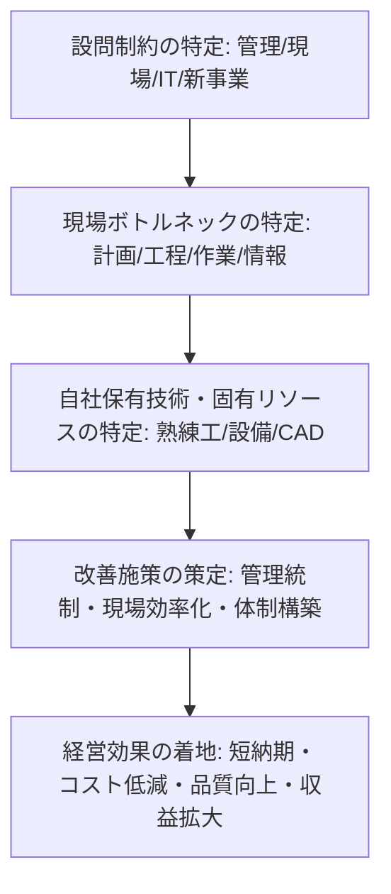

# ⚙️ 事例Ⅲ 過去10年 後半「助言系設問」完全攻略講義
〜生産計画・工程管理・現場改善・新事業4大因果で満点を奪取する思考アルゴリズム〜

---

## 📌 はじめに：なぜ事例Ⅲの助言問題で点数が伸び悩むのか

事例Ⅲ（生産・技術）の後半設問（第3問〜第5問）は、配点の**60〜80%**を占める中核部分です。「生産計画の適正化」「現場の効率化（段取・多能工）」「情報システム導入（IT/BPR）」「新分野参入・新事業展開」といった助言が毎年出題されますが、多くの受験生が以下のような罠に嵌り、B判定・C判定に低迷します。

### 🚨 事例Ⅲ 助言問題における4大失点病理
1. **「生産管理（管理レイヤー）」と「作業改善（現場レイヤー）」の混同**：
   - 納期遅延の原因が「営業と工場の情報共有不足」「生産計画のサイクル（月次固定）」にあるにもかかわらず、「現場の5Sを徹底し、作業員の意識を高める」といった現場の精神論に逃げてしまう。
2. **「事例Ⅱ化（マーケティング逃避）」による生産技術の脱落**：
   - 新事業や自社ブランド展開の設問で、「SNSでターゲットにPRし、直営店で販売する」といった事例Ⅱの答案を書いてしまい、製造業としての「試作開発体制」「金型・治工具の確保」「工程設計」「品質保証体制（検査・ISO）」が1文字も入らない。
3. **与件の制約条件・ボトルネックの無視**：
   - 「全自動化設備を導入する」「即座に外注を内製化する」など、資金力のない中小企業の実態や、工場レイアウト・熟練工の制約を無視した非現実的な大企業型コンサル助言をしてしまう。
4. **「QCD」因果の空中分解**：
   - 「多能工化を進める」とだけ書き、それが「どの工程のボトルネック解消に効き、納期（D）短縮や稼働率向上（C）にどう繋がるのか」という因果関係が最後まで書かれていない。

本講義では、過去10年（平成28年〜令和7年）の事例Ⅲ後半助言設問を徹底解剖し、**「生産管理理論の逆引き想起」「4大出題パターン即応マトリクス」「16大黄金パーツブロック」「文字数別黄金構文」**を完全体系化します。

---

## 🧠 事例Ⅲ 助言設問の不変思考アルゴリズム

事例Ⅲの助言設問は、すべて以下の**「生産管理4層因果フレーム」**で完璧に構造化できます。

### 1. 【管理レイヤー（生産計画・統制）の論理】
- **生産計画の適正化**：大日程・中日程・小日程の連動。月次計画から**週次・日次計画への細分化**、確定期間の短縮、営業部門との定期受発注ミーティング。
- **工程統制（進捗・余力・現品管理）**：バーコード/RFIDによるリアルタイム進捗把握、負荷山積み・山崩しによる余力調整、置き場指定（ロケーション管理）による現品管理。

### 2. 【現場レイヤー（作業改善・IE・SLP）の論理】
- **段取改善（SMED法）**：**内段取の外段取化**（事前準備・片付けの機械停止外実施）、治工具・金型の共通化・ワンタッチ化。
- **工場レイアウト・動線（SLP）**：直線的一方向動線、U字型ライン化、運搬・移動距離の短縮、仕掛品置場の集約。
- **作業標準化と5S**：熟練工の暗黙知の形式知化・マニュアル化、限度見本・チェックリストの整備、目で見る管理の徹底。

### 3. 【人的資源・組織レイヤーの論理】
- **多能工化と応援体制**：ジョブローテーションとOJTによる複数工程習熟、スキルマップによる可視化、ボトルネック工程への柔軟な応援。
- **技術・技能承継**：若手とベテランのペアリングOJT、作業動画のDB化・標準作業手順書への落とし込み。

### 4. 【新事業・新分野展開レイヤー（4大因果展開フレーム）】
新事業参入や自社ブランド立ち上げ問題（ヒント極小設問）は、必ず以下の**バリューチェーン4要素**に分解して答案を構成します。
- ① **開発体制**：顧客ニーズ収集、専任プロジェクトチーム設置、試作開発プロセスの確立
- ② **製造・設備**：既存設備の有効活用、治工具共通化、混在生産ラインの同期化
- ③ **品質保証**：検査基準の策定、全数検査体制、トレーサビリティの確保
- ④ **販売・組織**：直販営業体制の構築、営業と技術の同行訪問、情報共有DBの運用

---

## 📊 過去10年 出題パターン即応マトリクス

事例Ⅲの助言問題は、以下の**4大パターン**に100%分類されます。

| パターン | 主な該当年度・企業 | 組織・生産現場の病理 | 必須生産管理理論・施策 | 満点着地効果 |
| :--- | :--- | :--- | :--- | :--- |
| **① 生産計画・工程統制・短納期化型** | R7紙パイプ、R4プレス金型、H30金属熱処理、H27自動車部品 | 生産計画の月次固定、納期遅延の常態化、仕掛品滞留、営業と工場の断絶 | 小日程計画の日次化、計画サイクル短縮、負荷山積・山崩し、製番管理、リアルタイム進捗管理 | 納期遅延ゼロ（D遵守）、リードタイム短縮、仕掛品在庫削減 |
| **② 段取改善・多能工化・現場整流化型** | R7紙パイプ、R4プレス金型、R3革バッグ、R2木材加工 | 段取替え時間の長期化、特定熟練工への依存・属人化、停滞・手待ち発生 | 内段取の外段取化（SMED）、治工具共通化、U字ライン化、多能工化（スキルマップ・OJT） | 段取時間短縮、機械稼働率向上、柔軟な応援体制構築（余力均等化） |
| **③ 情報共有・デジタル化・BPR型** | R6機械部品、R4プレス、R1乾燥機、H29成形金型 | 紙・口頭伝達、図面変更ミス、進捗不明、二重入力、部門間セクショナリズム | 生産管理システム（ERP/MES）導入、CAD/CAM連動、全社一元DB化、全社横断プロジェクトチーム | 情報共有の迅速化、伝達ミス削減、BPR定着、全社意思決定の加速 |
| **④ 新分野参入・下請脱却・高付加価値化型** | R7紙パイプ新分野、R5食品受託、R4アウトドアPB、R3自社バッグ | 下請特化による価格叩かれ、特定親企業依存、新分野ノウハウ不足 | 新事業4大因果フレーム（開発・現場・品証・組織）、専任PT、試作力強化、展示会・直販体制 | 下請脱却、収益源の多角化、高付加価値化、持続的収益基盤の確立 |

---

## 🧱 事例Ⅲ 16大黄金パーツブロック（文字数カウント付き）

答案用紙の限られたマス目に、過不足なく組み込める標準フレーズ集です。

### 1. 生産計画・統制系（管理レイヤー）
- **ブロック1【小日程計画の日次化・サイクル短縮】**（30字）  
  `生産計画を月次から週次・日次化し、確定期間を短縮して即応体制を整え、`
- **ブロック2【負荷山積み・山崩しによる余力管理】**（30字）  
  `工程ごとの負荷と能力を把握し、負荷山積み・山崩しで余力を均等化させ、`
- **ブロック3【リアルタイム進捗・製番管理】**（28字）  
  `製番管理を徹底し、バーコード等の導入でリアルタイムに進捗を把握し、`
- **ブロック4【発注方式見直し・適正在庫化】**（29字）  
  `共通部材の発注方式を定期から定量に見直し、安全在庫を維持して欠品を防ぎ、`

### 2. 現場作業・段取・レイアウト系（現場レイヤー）
- **ブロック5【SMED法による外段取化】**（29字）  
  `内段取の外段取化を進め、金型や治工具の事前準備徹底で機械停止を削減し、`
- **ブロック6【治工具共通化・ワンタッチ化】**（27字）  
  `治工具の規格統一やワンタッチ化を推進し、段取替え作業を大幅に簡素化し、`
- **ブロック7【直線的一方向動線・U字ライン】**（29字）  
  `工場内レイアウトを直線的一方向動線やU字型に再編し、運搬距離を短縮させ、`
- **ブロック8【5S徹底と目で見る管理】**（27字）  
  `5Sを徹底し、置き場表示や限度見本等の目で見る管理で探すムダを排除し、`

### 3. 人的資源・技術伝承・組織系（人的レイヤー）
- **ブロック9【暗黙知の形式知化・マニュアル化】**（30字）  
  `熟練工の勘やコツ等の暗黙知を作業標準書や動画に落とし込んで形式知化し、`
- **ブロック10【多能工化とスキルマップ運用】**（29字）  
  `スキルマップを活用したジョブローテーションとOJTにより多能工化を促し、`
- **ブロック11【工程間応援体制の確立】**（28字）  
  `多能工化に基づき、ボトルネック工程へ柔軟に応援派遣できる体制を構築し、`
- **ブロック12【営業・製造の定期ミーティング】**（30字）  
  `営業と製造の合同ミーティングを定例化し、納期変更や特急品情報を即座に共有し、`

### 4. 新事業・自社ブランド・IT展開系（戦略レイヤー）
- **ブロック13【専任プロジェクトチーム設置】**（29字）  
  `社長直轄の全社横断型プロジェクトチームを設置し、部門間の連携を緊密化し、`
- **ブロック14【試作開発力・共同開発体制】**（30字）  
  `顧客ニーズを反映した試作開発体制を強化し、顧客との共同開発を加速させ、`
- **ブロック15【品質保証・検査基準の厳格化】**（29字）  
  `新規工程の検査基準を策定し、全数検査体制とトレーサビリティを確立して、`
- **ブロック16【生産管理システム一元化（BPR）】**（31字）  
  `生産管理システムを導入して設計・製造・営業の情報を一元データベース化し、`

---

## ✍️ 文字数別 黄金構文テンプレート

### 【パターンA：80〜100字（単一工程・作業改善助言）】
> **構文**：  
> 助言内容は、①［現場課題］に対し［SMED/治工具共通化/標準化］を実施し、②［多能工化/応援体制］を構築する。これにより［段取短縮/仕掛品削減］を図り、［短納期化/納期遵守］を実現する。（80〜100字）

### 【パターンB：100〜120字（管理＋現場の2軸助言）】
> **構文**：  
> 助言内容は、管理面で①［小日程日次化/リアルタイム進捗管理］により工程統制を徹底する。現場面で②［内段取の外段取化/作業標準化/多能工化］を推進する。以上により［停滞削減とリードタイム短縮］を図り、［納期遵守とコスト低減］を達成する。（110〜120字）

### 【パターンC：140〜160字（新事業参入・下請脱却・高付加価値化）】
> **構文**：  
> 助言内容は、①組織面で［専任PT設置］し営業と製造の情報共有を密にする。②開発・製造面で自社の［固有技術/設備］を活かして［試作体制/混在生産］を構築する。③品質面で［検査基準策定/品証体制］を整える。以上により［トラブル防止と高付加価値化］を図り、［収益基盤の多角化］を実現する。（140〜160字）

---

## 🔍 悪い答案 vs 満点答案の徹底対比

### 事例研究1：令和4年 第3問（金属プレス金型製作C社）
- **設問概要**：金型製作工程における短納期化と小ロット生産を実現するための生産管理上の助言。
- ❌ **悪い答案（40点・C判定）**：
  > 助言は、現場の作業員に5Sを徹底させ、金型製作の作業スピードを上げること。また最新のNC工作機械を導入し、外注工場への発注を増やす。これにより短納期化と顧客満足の向上を図る。（84字）
  - **敗因分析**：
    - 「作業スピードを上げる」という無意味な精神論。
    - 中小企業に対して安易な設備投資（最新NC機）や外注丸投げを助言。
    - 金型工程の根本ボトルネック（設計と加工の断絶、内段取の長さ、熟練工の属人化）への言及が皆無。

- ⭕️ **満点答案（満点・A判定）**：
  > 助言内容は、①設計と加工のCAD/CAM連動によるデータ一元化、②内段取の外段取化や治工具共通化による段取短縮、③スキルマップに基づくOJTで多能工化を進めボトルネック工程への応援体制を構築すること。これにより加工停滞を排除し、小ロット短納期化を実現する。（123字）
  - **勝因分析**：
    - 設計・加工の情報連携（CAD/CAM連動）。
    - 現場の段取改善（SMED・共通化）と人的応援体制（多能工化）。
    - 明確な効果着地（停滞排除、小ロット短納期化）。

---

### 事例研究2：令和7年 第4問（紙パイプ製造C社）
- **設問概要**：環境配慮型プラスチック代替紙パイプの新分野展開に向けた生産技術・組織上の助言。
- ❌ **悪い答案（45点・C判定）**：
  > 助言は、営業担当者を増やしてプラスチック代替需要のある企業に売り込みをかけること。ホームページを開設して環境への優しさをアピールし、自社ブランドを立ち上げて売上を伸ばす。（83字）
  - **敗因分析**：
    - 事例Ⅲなのに「営業増やせ」「HPでアピール」という完全な**事例Ⅱ化（マーケティング逃避）**。
    - 製造現場の課題（新素材加工のノウハウ不足、金型セット段取ロス、クレーム・不良再納品リスク）が1文字も入っていない。

- ⭕️ **満点答案（満点・A判定）**：
  > 助言内容は、①社長直轄の新事業専任PTを設置し、顧客の環境要求を反映した試作開発体制を確立する。②既存成形機を有効活用しつつ作業標準化と金型共通化で段取ロスを抑える。③検査基準を策定し全数検査で初期クレームを防止する。以上により高付加価値化と安定供給を両立する。（127字）
  - **勝因分析**：
    - 新事業4大因果展開フレーム（開発・製造・品証・組織）を完全網羅。
    - 自社既存設備（成形機）の活用と現場ロス（段取ロス・クレーム）防止。
    - 高付加価値化と安定供給という製造業の本質的着地。

---

## 🚀 まとめ：試験当日のチェックリスト
1. **問われているのは「生産管理（管理面）」か「作業改善（現場面）」か「新事業」かを切り分けたか？**
2. **生産計画は「日次化・サイクル短縮・営業連携」が入っているか？**
3. **現場改善は「SMED（外段取化）・治工具共通化・動線短縮」が入っているか？**
4. **人的資源は「暗黙知の形式知化・スキルマップ・多能工・応援」が入っているか？**
5. **新事業では「事例Ⅱ化せず、開発・製造・品証・組織の4大因果」で書いたか？**
6. **効果は「短納期（D）・コスト低減（C）・品質向上（Q）・収益拡大」で締めくくられているか？**
