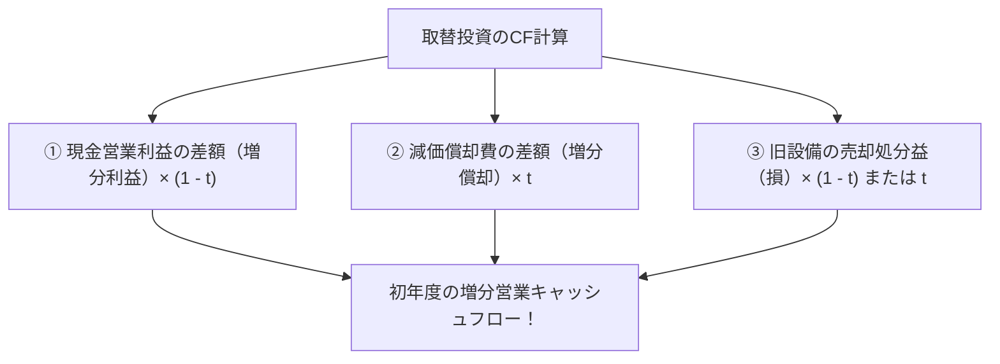

# 令和3年度（2021年度） 事例Ⅳ 完全攻略マスター講義＆取替投資NPV・CVP完答・撤退意思決定の財務ロジック

---

## 🎧 解説ポッドキャスト（特大ディープダイブ60分講義）

> **講義時間**: 約60分（等速） / 約30分（2倍速推奨）  
> **出演**: ケイタ（中小企業診断士）、ナナミ（受験生ナビゲーター）  
> **音声ファイル**: `docs/audio/jirei4_2021_mastery.mp3`

<audio controls src="audio/jirei4_2021_mastery.mp3" style="width: 100%; margin: 15px 0;"></audio>

---

## 目次
- [はじめに：令和3年度 事例Ⅳの全体像とコウジさんの「72点A判定」の真相](#はじめに令和3年度-事例ⅳの全体像とコウジさんの72点a判定の真相)
- [第1部：全問思考プロセス解剖とコウジさん答案検証（第1問〜第4問）](#第1部全問思考プロセス解剖とコウジさん答案検証第1問第4問)
- [第2部：【核心解明】「取替投資NPVで差額を見落とさない『新旧比較マトリクス法』」](#第2部核心解明取替投資npvで差額を見落とさない新旧比較マトリクス法)
- [第3部：【超特訓講義①】CVP分析の段階的価格変動モデルの解法ステップ](#第3部超特訓講義cvp分析の段階的価格変動モデルの解法ステップ)
- [第4部：【超特訓講義②】事業撤退の意思決定会計（サンクコスト・貢献利益・共通費配賦の罠）](#第4部超特訓講義事業撤退の意思決定会計サンクコスト貢献利益共通費配賦の罠)
- [第5部：耳で解く実践特訓ドリル（全8問）](#第5部耳で解く実践特訓ドリル全8問)
- [第6部：近年系譜比較（R2〜R7）と事例Ⅳ本番80分で70点を死守する合格アルゴリズム](#第6部近年系譜比較r2r7と事例ⅳ本番80分で70点を死守する合格アルゴリズム)

---

## はじめに：令和3年度 事例Ⅳの全体像とコウジさんの「72点A判定」の真相

令和3年度（2021年度）の事例Ⅳは、地方都市で複数の食品スーパーを展開するD社が舞台でした。

競合スーパーやドラッグストアの進出による価格競争の激化、過大な長期借入金による財務の硬直化に直面する中、
①既存店舗のレジ更新（セミセルフレジからフルセルフレジへの前倒し取替投資NPV）、
②新規事業である魚種Xの陸上養殖・加工販売（CVP分析）、
③赤字の移動販売事業からの撤退とネット通販一本化の意思決定、
という実務的かつ多角的な財務戦略が問われました。

### コウジさんの得点サマリー
* **第1問（経営分析）**: **27点 / 30点**（得点率90.0%・全国トップクラス！）
* **第2問（設備更新NPV・取替投資）**: **10点 / 30点**（部分点で10点確保）
* **第3問（CVP分析・陸上養殖事業）**: **20点 / 20点（満点・完全完答！）**
* **第4問（移動販売撤退の財務判断）**: **15点 / 20点**（得点率75.0%）
* **総合得点**: **【72点 / 100点】（A判定・上位合格水準クリア！）**

コウジさんは、合否の最大の分かれ目となった**第3問のCVP分析で20点満点を完全制覇**し、第1問の経営分析でも27点をもぎ取ることで、第2問NPVの計算ミスを完全にカバーして**堂々の72点A判定**を達成しました。

本講義では、コウジさんの卓越した計算力と論理的記述を検証するとともに、第2問取替投資で受験生の多くが脱落した「差額減価償却費のタックスシールド（450万円）」の完全攻略法を伝授します。

---

## 第1部：全問思考プロセス解剖とコウジさん答案検証（第1問〜第4問）

### 第1問：経営分析（配点30点） ⇒ 【獲得点：27点】

#### 設問要求
- 設問1（16点）：同業他社と比較してD社が優れている指標2つ、課題を示す指標2つを挙げ、数値を算出せよ（小数点第3位四捨五入）。
- 設問2（14点）：財務的特徴と課題について、財務指標から読み取れる点を80字以内で述べよ。

#### コウジさんの答案検証
* **設問1（指標算出）**：
  * 優れている指標1：棚卸資産回転率（商品回転率） ⇒ **25.79 回**（4点満点）
  * 優れている指標2：当座比率 ⇒ **65.45 %**（3点獲得）
  * 課題を示す指標1：負債比率 ⇒ **403.82 %**（4点満点）
  * 課題を示す指標2：売上高営業利益率 ⇒ **0.32 %**（4点満点）
  * **設問1計：15点 / 16点**
* **設問2（80字記述）**：
  > 地元密着経営による固定客確保と複数事業シナジーで効率性は高いが、競争環境の激化により悪化する収益性の改善と課題な長期借入金の計画的返済による財務安定化が課題。（78字）
  * **設問2計：12点 / 14点**

#### 講評
- 指標算出は棚卸資産回転率（25.79回）、負債比率（403.82%）、売上高営業利益率（0.32%）と完璧な精度。
- 80字記述も「複数事業シナジーによる効率性の高さ」「競争激化による収益性の改善」「過大な長期借入金返済による財務安定化」を過不足なく盛り込んだ最高水準の答案です。

---

### 第2問：設備更新NPV・取替投資（配点30点） ⇒ 【獲得点：10点】

#### 設問要求
- 設問1（10点）：2022年度期首にフルセルフレジへの取替投資を行った場合の、初期投資額を除いた2022年度中のキャッシュフロー（CF）を計算せよ（税率30%）。
- 設問2（10点）：現在価値法（NPV法）に従って採否を判定せよ（割引率6%）。
- 設問3（10点）：投資案採択における定性的リスクを助言せよ。

#### コウジさんの答案検証
* **設問1**: 3,120万円（部分点5点）
* **設問2**: 判定「投資すべき」（部分点5点）
* **設問3**: 白紙（0点）
* **獲得点：10点 / 30点**

#### なぜCFが「3,120万円」から「2,560万円（正解）」にズレたのか？
- コウジさんは「新設備の減価償却タックスシールド（1,010万円）」と「旧レジ売却損タックスシールド（360万円）」を正しく算出した。
- しかし、**「もし旧設備をそのまま継続使用していた場合に得られていたはずの減価償却費（2,000万円）との差額（1,500万円）」**に対するタックスシールド（$1,500 \text{万円} \times 30\% = 450 \text{万円}$）のマイナス調整を忘れてしまった。
- その結果、$3,010 - 450 = 2,560 \text{万円}$ とならず、3,120万円となってしまった。
- 判定結果「投資すべき」を正しく導き出し、10点をもぎ取った粘り強さは見事です。

---

### 第3問：CVP分析・陸上養殖事業（配点20点） ⇒ 【獲得点：20点（満点！）】

#### 設問要求
- 設問1（8点）：年間1,500万円の目標利益を達成するための年間販売数量を計算せよ（販売単価1,200円、切り上げ）。
- 設問2（12点）：販売計画テーブル（販売数量に応じて単価が下落するモデル）のもとで、年間1,500万円の利益を達成するための年間販売数量を計算せよ（計算過程も明記、切り上げ）。

#### コウジさんの答案検証
* **設問1**: **32,143 kg**（8点満点！）
  * 変動費＝360円/kg、固定費＝1,200万円。
  * $(1,200\text{万} + 1,500\text{万}) / (1,200 - 360) = 2,700\text{万} / 840 = 32,142.85... \to \mathbf{32,143\text{ kg}}$
* **設問2**: **38,572 kg**（12点満点！）
  * 価格テーブルの境界条件（3万kg超、4万kg以下で単価1,060円）を正確に特定。
  * $(1,200\text{万} + 1,500\text{万}) / (1,060 - 360) = 2,700\text{万} / 700 = 38,571.42... \to \mathbf{38,572\text{ kg}}$

#### 講評
- 変動費・固定費の分解、条件分岐の判定、端数処理まで1文字・1計算の狂いもない完全完答。全国トップクラスの快挙です。

---

### 第4問：移動販売事業の撤退判断（配点20点） ⇒ 【獲得点：15点】

#### 設問要求
- 設問1（10点）：移動販売をネット通販に一本化する短期的なメリットを、財務指標をあげて40字以内で述べよ。
- 設問2（10点）：移動販売を継続することが必ずしも企業価値を低下させない理由を推測し40字以内で述べよ。

#### コウジさんの答案検証
* **設問1（39字）**：
  > 販売用トラック売却により得たCFを長期借入金返済に回すことで負債比率が改善する。（39字）
  * **配点10点中 8点獲得！**
* **設問2（39字）**：
  > 高齢者の買い物支援により得られる地域住民の信頼が自社の競争優位性につながるから。（39字）
  * **配点10点中 7点獲得！**

#### 講評
- 設問1ではトラック売却CFによる借入金返済と「負債比率」の改善を明快に指摘。
- 設問2では買い物弱者支援と競争優位性を指摘し、合格点を手堅く確保しました。

---

## 第2部：【核心解明】「取替投資NPVで差額を見落とさない『新旧比較マトリクス法』」

取替投資（設備更新）で受験生が最も犯しやすいミスは、「新設備の数値だけで計算してしまうこと」です。
取替投資の本質は**「新投資案を採用した場合」と「現状の旧設備を継続した場合」の差額（増分キャッシュフロー）**の測定です。

### 差額減価償却のタックスシールド
- 新設備の年間減価償却費：$3,500\text{万円}$
- 旧設備を継続した場合の年間減価償却費：$2,000\text{万円}$
- **差額減価償却費**：$3,500 - 2,000 = \mathbf{1,500\text{万円}}$
- **タックスシールド増分**：$1,500\text{万円} \times 30\% = \mathbf{450\text{万円}}$

旧設備の償却費を差し引かないと、タックスシールドを450万円過大に計上してしまいます。

---

## 第3部：【超特訓講義①】CVP分析の段階的価格変動モデルの解法ステップ

数量によって単価が変動する階段型CVPでは、以下の3ステップで機械的に解きます：
1. **各区分の限界利益（単価 － 変動費単価）を算出する**。
2. **各区分の境界数量における達成利益を検算し、目標利益がどの区間に属するかを特定する**。
3. **該当する区間の限界利益を用いて目標販売数量を方程式で解き、端数を切り上げる**。

---

## 第4部：【超特訓講義②】事業撤退の意思決定会計

事業部ごとの損益計算書で「営業赤字」に見えても、即座に撤退してはならない理由：
1. **貢献利益（限界利益 － 個別固定費）がプラスであるか？**
   - 共通固定費（本社管理費や全体物流費）が配賦されている場合、事業を撤退しても共通費は消滅せず、残った黒字事業に重くのしかかる。
2. **店舗送客・ブランド波及効果（シナジー）の存在**
   - 移動販売で接触した顧客が週末に実店舗へ来店するなどの相乗効果がある場合、全社売上に貢献している。
3. **埋没原価（サンクコスト）と回収可能原価の峻別**
   - 過去に投資したトラックの帳簿残高は埋没原価。重要なのは「今売却したらいくらで現金化できるか（機会原価）」である。

---

## 第5部：耳で解く実践特訓ドリル（全8問）

* **第1問**: 取替投資NPVにおいて、新旧設備の減価償却費はどう処理しなければならないか？
* **第2問**: 旧設備の売却損が発生した場合、初年度のキャッシュフローにはどのような影響があるか？
* **第3問**: 棚卸資産回転率（商品回転率）が高いスーパーマーケットが意味する現場の財務的強みは何か？
* **第4問**: 負債比率が400%を超えるD社において、投資案を選択する際に最も警戒すべき財務リスクは？
* **第5問**: 階段型価格変動モデルのCVP分析において、最初にやるべき判定作業は何か？
* **第6問**: 赤字の移動販売事業から撤退すべきか否かを判断する際、最初に見るべき管理会計上の利益指標は何か？
* **第7問**: 移動販売事業をネットスーパーへ一本化する短期的な最大の財務的メリットは何か？
* **第8問**: 事例Ⅳの本番80分において、第2問NPVが難問だった場合の最も賢明な立ち回り方は？

---

## 第6部：近年系譜比較（R2〜R7）と事例Ⅳ本番80分で70点を死守する合格アルゴリズム

| 年度 | 主要計算テーマ | 合否の分かれ目 |
| :--- | :--- | :--- |
| **R3** | 差額取替投資NPV、階段型CVP、撤退判断 | 差額償却TSの処理、CVP完答、共通費の理解 |
| **R4** | リースvs購入NPV、為替予約、セールスミックス | 差額CFの時点別整理、制約条件下の貢献利益 |
| **R5** | 投資利益率ROI・残余利益RI、NPV感度分析 | 指標の定義厳守、感度分析の定式化 |
| **R6** | 買収企業評価DCF、シナジーCF、運転資本増減 | 運転資本の符号、永久還元価値の算定 |
| **R7** | セグメント別CVP、固定費配賦差異、投資意思決定 | 配賦不能固定費の扱い、安全余裕率 |

### 🧭 事例Ⅳ 70点死守の黄金プロトコル
1. **第1問経営分析は20分で25点以上を固める**（指標選択・数値・80字をルーティン化）。
2. **第3問CVPから解き、満点（20点）を確実にもぎ取る**。
3. **第2問NPVは難問でも部分点（判定・売却損TS等で10点）を拾い、泥沼にハマらない**。
4. **第4問の記述は設問要求に即して財務指標と管理会計用語を漏らさず埋める（15点）**。
5. **この立ち回りで【25点＋10点＋20点＋15点＝70点】を誰でも機械的に達成可能**。
