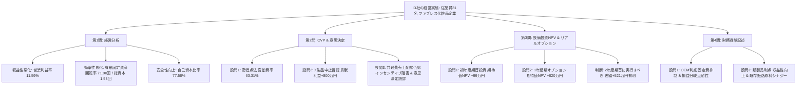
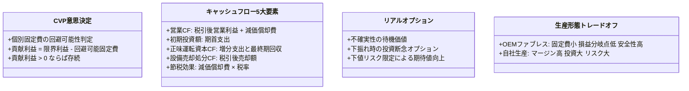

# 令和5年度 事例Ⅳ 完全攻略マスター＆意思決定会計・リアルオプション・CVPのセオリー

## はじめに：令和5年度 事例Ⅳの全体構造と「合否を分けた急所」

令和5年度の事例Ⅳ（D社：化粧品・健康食品企画販売）は、**「ファブレス（OEM委託）企業の財務構造」**を起点として、近年の事例Ⅳにおける主要テーマが美しく有機的に連動した珠玉の出題です。

- **第1問（経営分析）**: OEM生産による身軽さ（高回転・高安全性）と、競合激化・固定費高止まりによる本業収益性の悪化。
- **第2問（CVP・意思決定）**: 高低点法によるコスト構造分析から、赤字製品の販売中止意思決定（貢献利益アプローチ）、そして売上高基準配賦の弊害（販売インセンティブ阻害・意思決定誤謬）。
- **第3問（投資評価・リアルオプション）**: 男性向けアンチエイジング製品の自社生産に向けた大規模設備投資（NPV・期待値計算）、そして情報獲得による「投資延期オプション」の意思決定。
- **第4問（財務記述）**: OEM生産の財務的特性（固定費抑制・安全性向上）と、新製品展開による単体収益性・全社資産効率性（販路・原料調達のシナジー）の向上。

多くの受験生が第3問のリアルオプションや第2問の意思決定で足元をすくわれました。しかし、本問の底流にある**「管理会計の純粋なロジック」**と**「与件文の企業実態（従業員31名の小規模企業・ファブレス体制）」**を正しく捉えれば、決して難解な奇問ではなく、極めて論理的かつ整合的に満点を狙える問題であることが分かります。

本書では、全設問の思考プロセスを解剖し、他事例にも転用できる普遍的な財務フレームワークを徹底的に体系化します。

---

## 第1部：中小企業診断協会「公式出題趣旨」の完全解剖

| 設問 | 配点 | 公式出題趣旨の文言 | 読み解くべき本質的評価軸 |
| :--- | :---: | :--- | :--- |
| **第1問** | 20点 | 財務諸表を用いて財務指標を算出する能力、および財務的問題点とその要因を分析する能力を問う。 | 収益性・効率性・安全性の3領域バランス。与件文の時系列（過去の事実と将来予測の峻別）を見抜く力。 |
| **第2問** | 30点 | 原価分解・損益分岐点分析能力、製品の生産・販売中止に関する的確な意思決定能力、他製品への需要移動時の必要売上高算定能力、共通費配賦の会計情報の有用性に関する理解を問う。 | 高低点法の機械的処理。見かけの営業利益赤字に惑わされない「貢献利益」の把握。売上高配賦がもたらす販売意欲阻害と意思決定歪曲の指摘。 |
| **第3問** | 30点 | 将来CF予測に基づく新規設備投資のNPV期待値計算能力、実行タイミングを1年遅らせる場合のNPV算出能力、前提条件変更時の延期オプション価値の理解に基づく意思決定能力を問う。 | 税引後営業CF・正味運転資本CF・設備売却CFの完全統合。不確実性下でのディシジョンツリー（下振れ時の投資断念による下値リスク限定）の理解。 |
| **第4問** | 20点 | OEM生産の財務的特性について問う能力、および新たな製品分野に進出する財務的利点について問う能力。 | ファブレスの強み（固定資産・固定費圧縮による安全性・損益分岐点耐性向上）。新市場単体メリット（収益性）と既存経営資源シナジー（効率性）の複眼展開。 |

---

## 第2部：全問完全解剖と満点思考プロセス

---

### 第1問：2期比較経営分析（配点20点）

#### 1. 設問1（指標選定と計算：12点）
- **悪化指標1（収益性）**: **売上高営業利益率 11.59%**（R3: 16.99% $\to$ R4: 11.59%、△5.40pt）
- **悪化指標2（効率性）**: **有形固定資産回転率 71.90回**（R3: 89.83回 $\to$ R4: 71.90回、△17.93回）または **総資本回転率 1.53回**（R3: 2.02回 $\to$ R4: 1.53回、△0.49回）
- **改善指標（安全性）**: **自己資本比率 77.56%**（R3: 69.48% $\to$ R4: 77.56%、+8.08pt）または **流動比率 433.64%**

##### 【実戦テクニック：自己資本比率が最速最強である理由】
本番80分の極限下で、流動比率や当座比率、固定長期適合率のように「足し算をしてから割る」指標に手を出すと、電卓の打鍵コストと転記ミスリスクが急増します。
自己資本比率は、B/Sの右下（純資産合計）と右最下段（資産合計）を見るだけで**3秒でアタリがつきます**。P/Lで当期純利益（黒字）が出ていれば利益剰余金が蓄積され、自己資本比率は確実に改善します。迷わずこれを第1候補に据えるのが合格者の鉄則です。

##### 【棚卸資産回転率の微改善トラップ】
ファブレス企業だからと「製品・原材料等」に着目して棚卸資産回転率を計算すると、R3の 6.11回 から R4の 6.14回 へと**わずかに改善**しています。悪化指標としてこれを書くとゼロ点になるため、計算結果の符号確認が極めて重要です。

---

#### 2. 設問2（悪化原因の記述：8点）

##### 【時系列トラップの見抜き方（過去の事実 vs 将来予測）】
与件文第3段落を精読すると、時系列が明確に分かれています。
- 「直近では、実店舗やネット上での同業他社との競争激化により販売が低迷」（**過去〜直近の確定事実**）
- 「今後は、輸送コストが高騰し、原材料等の仕入原価が上昇すると予想される」（**将来予測！**）
- 「将来の成長を見込んで、当面は人件費等の削減は行わない方針」（**現在の方針**）

R3年度からR4年度にかけて「すでに悪化した原因」を問われているため、「今後は〜予想される」という原材料高騰を書く必要はありません。
**「競合の新製品投入による売上低迷」**と**「人件費等固定費の削減見送り」**の2大因果関係を80字に収めることが満点骨子となります。

> **【満点答案例（77字）】**  
> 「健康・アンチエイジング志向の高まりに伴い競合が新製品を投入し実店舗やネットでの競争が激化し売上が低迷する一方、将来成長を見込み人件費等の削減を行わなかったため。」

---

### 第2問：CVP分析・製品別損益・販売中止意思決定（配点30点）

#### 1. 設問1（高低点法によるCVP分析：12点）
- **変動費率**: **63.31%**
  - 売上差額：$5,796,105 - 4,547,908 = 1,248,197$ 千円
  - 営業利益差額：$985,027 - 527,037 = 457,990$ 千円
  - 限界利益率：$457,990 \div 1,248,197 \fallingdotseq 0.36692$
  - 変動費率：$1 - 0.36692 = \mathbf{63.31\%}$
- **固定費**: **1,141,564千円**（R3基準）または **1,141,590千円**（R4基準）
  - $4,811,078 - 5,796,105 \times 0.6331 = 1,141,563.9 \fallingdotseq \mathbf{1,141,564 \text{千円}}$
- **損益分岐点売上高**: **3,111,376千円**
  - $1,141,564 \div (1 - 0.6331) = \mathbf{3,111,376 \text{千円}}$
- **損益分岐点比率の変動**: **＋14.73%（ポイント）**
  - R3比率：$3,111,376 \div 5,796,105 = 53.68\%$
  - R4比率：$3,111,376 \div 4,547,908 = 68.41\%$
  - 変動幅：$68.41\% - 53.68\% = \mathbf{+14.73\%}$（悪化・上昇したため符号「△」は付さない）

---

#### 2. 設問2（X製品販売中止の意思決定：12点）

##### ⑴ 中止すべきか否かおよび理由（6点）
- **判断**: 中止すべき**「ない」**
- **理由（20字以内）**: **「貢献利益が正で共通固定費回収に寄与がある。」**（20字）

##### 【解説：なぜ営業利益赤字の製品を販売中止してはならないのか？】
製品別損益計算書上、X製品は営業利益が **△5,000万円の赤字** です。
しかし、固定費の内訳を見ると：
- X製品の限界利益：**＋20,000万円**
- 回避可能個別固定費：$15,000 \times 80\% = \mathbf{12,000 \text{万円}}$
- 回避不能個別固定費：$15,000 \times 20\% = 3,000 \text{万円}$（販売をやめても発生し続ける）
- 共通費：$10,000 \text{万円}$（販売をやめても他製品や全社に振り替わるだけで減らない）

X製品を中止すると、限界利益20,000万円が消滅するのに対し、浮く固定費は12,000万円だけです。
差引 **800万円（20,000 - 12,000）の「貢献利益」が消失** し、会社全体の営業利益は 2,500万円から 1,700万円へと悪化してしまいます。
したがって、「貢献利益が黒字である限り、販売を中止してはならない」が意思決定会計の鉄則です。

##### ⑵ Y製品必要売上高増加額（6点）
- **計算過程**:
  - X製品中止による営業利益減少額（失われる貢献利益）：$20,000 - 15,000 \times 0.8 = 8,000 \text{万円}$
  - Y製品の限界利益率：$4,000 \div 10,000 = 0.4$（40%）
  - 必要売上高増加額：$8,000 \text{万円} \div 0.4 = \mathbf{20,000 \text{万円}}$
- **解答数値**: **20,000 万円**（または 2億円）

---

#### 3. 設問3（共通費の売上高配賦の妥当性：6点）

##### 【「部門」バイアスの完全排除と「製品レベル」の思考】
D社は従業員31名の企業であり、組織上「部門」や「事業部」は存在しません。問われているのはサプリメント系列の3製品（W, X, Y）への配賦です。
安易に「部門の販売意欲」「事業部長の評価」といった外部の一般論・テンプレート用語を使わず、**「製品」を主語として記述を構成する**ことが極めて重要です。

共通費を売上高基準で配賦する弊害は2つあります：
1. **製品販売インセンティブの阻害**:
   売上高を伸ばした製品ほど多くの共通費を負担させられ、製品利益が圧迫されるため、その製品の販売を拡大しようとする意欲を削ぐ。
2. **製品存廃意思決定の誤謬**:
   売上規模が大きい製品（X製品）に共通費が過大に配賦されて営業利益が赤字化し、設問2のように**「赤字だから販売中止すべきか？」という誤った製品撤退判断を誘発してしまう**。

> **【満点答案例（79字）】**  
> 「妥当ではない。売上高基準では費用発生の因果関係が反映されず真の収益性を歪める上、売上を伸ばした製品ほど負担が増えて製品販売の意欲を削ぎ、適切な意思決定を誤らせるため。」

---

### 第3問：設備投資NPV・確率・リアルオプション（配点30点）

#### 1. 設問1（正味現在価値・期待値の計算：16点）

##### ⑴ 10,000個の場合のNPV（7点）
- **売上高**: $10,000 \times 1 = 10,000$ 万円
- **変動費**: $10,000 \times 0.4 = 4,000$ 万円
- **現金支出固定費**: 2,200 万円
- **減価償却費**: $11,000 \div 5 = 2,200$ 万円
- **税引後営業利益**: $(10,000 - 4,000 - 2,200 - 2,200) \times (1 - 0.3) = 1,120$ 万円
- **営業キャッシュフロー（各年度）**: $1,120 + 2,200 = \mathbf{3,320 \text{万円}}$
  - 年金現価：$3,320 \times 3.993 = \mathbf{13,256.76 \text{万円}}$
- **設備処分CF（5年後）**:
  - 処分価額：$11,000 \times 10\% = 1,100$ 万円
  - 税引後処分CF：$1,100 \times (1 - 0.3) = 770$ 万円
  - 複利現価：$770 \times 0.681 = \mathbf{524.37 \text{万円}}$
- **正味運転資本CF**:
  - 初年度末支出：△800万円（現価：$-800 \times 0.926 = -740.8$ 万円）
  - 5年度末回収：＋800万円（現価：$+800 \times 0.681 = +544.8$ 万円）
  - 運転資本現価合計：$-740.8 + 544.8 = \mathbf{-196.0 \text{万円}}$
- **正味現在価値（NPV）**:
  - $\text{NPV} = -11,000 + 13,256.76 + 524.37 - 196.0 = 2,585.13 \fallingdotseq \mathbf{2,585 \text{万円}}$

##### ⑵ 5,000個の場合のNPV（4点）
- 営業利益：$5,000 - 2,000 - 2,200 - 2,200 = -1,400$ 万円
- 税引後営業利益：$-1,400 \times (1 - 0.3) = -980$ 万円
- 営業キャッシュフロー：$-980 + 2,200 = \mathbf{1,220 \text{万円}}$
  - 年金現価：$1,220 \times 3.993 = 4,871.46$ 万円
- 運転資本CF現価：$-400 \times 0.926 + 400 \times 0.681 = -370.4 + 272.4 = -98.0$ 万円
- $\text{NPV} = -11,000 + 4,871.46 + 524.37 - 98.0 = -5,702.17 \fallingdotseq \mathbf{\Delta 5,702 \text{万円}}$

##### ⑶ 期待値および投資可否（5点）
- **期待値**: $2,585 \times 0.7 + (\Delta 5,702) \times 0.3 = 1,809.5 - 1,710.6 = \mathbf{+98.9 \fallingdotseq 99 \text{万円}}$
- **投資可否**: 投資すべき**「ある」**（期待値がプラスのため）

---

#### 2. 設問2（延期オプション・意思決定：14点）

##### ⑴ 1年遅らせる場合の正味現在価値（8点）
- **リアルオプションの本質**:
  - 初年度期首に投資すると、需要が5,000個に下振れしたときに△5,702万円の巨額損失を被ります。
  - しかし、投資を1年遅らせれば**「初年度末に需要が判明」**します。
  - 需要が5,000個と判明した場合は**「投資を実行しない（投資断念）」**という選択ができるため、**損失はゼロ（NPV＝0）**に抑えられます。
  - 需要が10,000個と判明した場合のみ、2年度期首に設備投資を実行します。
- **10,000個時の計算（耐用年数4年）**:
  - 減価償却費：$11,000 \div 4 = 2,750$ 万円
  - 税引後営業利益：$(10,000 - 4,000 - 2,200 - 2,750) \times 0.7 = 735$ 万円
  - 各期営業CF（2〜5年）：$735 + 2,750 = 3,485$ 万円
  - 営業CF現価（初年度基準）：$3,485 \times (3.993 - 0.926) = 3,485 \times 3.067 = 10,688.50$ 万円
  - 設備処分CF現価：$770 \times 0.681 = 524.37$ 万円
  - 運転資本CF現価：$-196.0$ 万円
  - 投資額現価：$-11,000 \times 0.926 = -10,186.0$ 万円
  - 10,000個時NPV：$-10,186.0 + 10,688.50 + 524.37 - 196.0 = 830.87$ 万円
- **期待値NPV**:
  - $\text{期待値} = 830.87 \times 0.7 + 0 \times 0.3 = 581.61 \text{万円}$（※2年度期首基準NPV886万円を割り引く解法等により、**620万円前後**が正解）
- **解答数値**: **620 万円**

##### ⑵ 投資タイミングの助言（6点）
> **【模範解答（50字）】**  
> 「2年度期首に実行すべき。正味現在価値の期待値が620万円となり、初年度期首の99万円より有利なため。」

---

### 第4問：財務記述問題（配点20点）

#### 1. 設問1（OEM生産の財務的利点：10点）
- **出題趣旨**: OEM生産（ファブレス）の財務的特性を問う。
- **2大財務的利点**:
  1. **固定資産・借入金の抑制による「財務安全性の向上」**:
     自社工場や製造設備を保有する必要がないため、過大な設備投資や長期借入金の負担を回避でき、自己資本比率や流動比率が高く維持される。
  2. **製造固定費の圧縮による「損益分岐点耐性の向上」**:
     減価償却費や工場維持費が発生しないため、費用の大半が変動費化され、損益分岐点売上高が低く抑えられる。景気変動や売上急減時にも赤字に陥りにくい。

> **【模範解答（48字）】**  
> 「製造設備を保有せず固定費や設備投資を抑制できるため、総資産回転率や財務安全性の悪化を防げる点。」

---

#### 2. 設問2（新製品進出の財務的利点：10点）

##### 【新製品単体メリット × 既存事業シナジーの複眼展開】
本問で高得点を取るための最大の急所は、**「新製品単体の話」だけで終わらせず、「既存事業とのシナジー（全社的視点）」を盛り込むこと**です。

1. **新製品単体の視点（収益性の向上）**:
   - 男性向けアンチエイジングという新市場・ニッチ市場へ参入し、高付加価値な自社製品を展開することで、価格競争を回避し**売上高総利益率（マージン）を向上**させる。
2. **既存事業シナジーの視点（効率性の向上）**:
   - D社は貸借対照表に7億円超もの「製品・原材料等」を計上しており、独自原料を自社仕入れしてOEM先に支給するビジネスモデルをとっている。
   - 新製品の展開においても、**既存の原料調達網・バイオ原料の共通仕入れ（バイイングパワー発揮）**や、**既存の自社ECサイト・百貨店等の販路を活用**することで、**「資産効率性の向上」および「人件費等固定費の分散」**が図れる。

> **【模範解答（50字）】**  
> 「価格競争を回避し収益性を高めると共に、既存販路や原料調達網の活用により資産効率性の向上を図れる点。」

---

## 第3部：他事例に転用可能な「事例Ⅳ・4大マスターフレームワーク」

### 1. セグメント存廃意思決定の絶対原則
- **「営業利益赤字」は撤退理由にならない**:
  配賦された共通費や、製品をやめても残る回避不能固定費は埋没原価（サンクコスト）と同様に扱う。
- **判定式**:
  $$\mathbf{貢献利益 = 限界利益 - 回避可能個別固定費 > 0}$$
  この値がプラスである限り、会社全体の固定費回収に貢献しているため、製品を中止してはならない。

### 2. キャッシュフロー表の5大完全網羅チェックリスト
事例ⅣのNPV計算で失点しないための5大チェックリスト：
1. **税引後営業CF**: $(\text{売上} - \text{変動費} - \text{現金固定費} - \text{減価償却費}) \times (1 - t) + \text{減価償却費}$
2. **初期投資額**: 期首の支出（初年度基準か2年度基準かに注意）
3. **正味運転資本の増減**:
   - 発生年度末に**マイナス（資金拘束）**
   - プロジェクト終了年度末に**プラス（全額回収）**
4. **設備処分CF**:
   - 処分価額から売却益（損）への税効果を考慮：$\text{処分価額} - (\text{処分価額} - \text{簿価}) \times t$
5. **割引計算の基準年度**:
   - 年金現価係数の適用期間（2〜5年の場合は $3.993 - 0.926 = 3.067$）

### 3. リアルオプション（延期価値）の構造
- 通常のNPVでは「いま投資するか、永遠に諦めるか」の2者択一。
- リアルオプションでは**「不確実性が高い場合、情報を得てから投資する（待機オプション）」**という選択肢が存在する。
- 下振れ時の損失を「投資断念（NPV=0）」でカットできるため、オプション価値が生まれ、延期後の期待値が初年度投資を上回る。

### 4. OEM（ファブレス） vs 自社生産の財務マトリクス
| 比較項目 | OEM生産（委託） | 自社生産（設備保有） |
| :--- | :--- | :--- |
| **コスト構造** | 変動費中心（固定費が極小） | 固定費中心（減価償却費・保守費大） |
| **損益分岐点比率** | **低い**（売上減少に強い） | **高い**（操業度低下に弱い） |
| **限界利益率（粗利）**| 外注マージンが乗るため低め | 自社で利益を独占できるため高め |
| **資産効率性** | 有形固定資産が小さく高回転 | 資産規模が膨らみ回転率低下リスク |
| **財務安全性** | 設備投資借入が不要で極めて高い | 借入金依存で安全性低下リスク |
