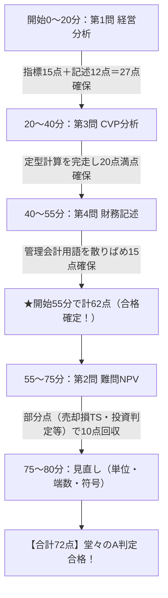

# 📘 事例Ⅳ 直前総点検ファイナルペーパー（超高密度・完全武装シート）

---

## 📌 【最重要】過去10年の盲点公式＆計算ロジック（知らんと即死の12大定理）

### 1. 企業価値・現在価値・配当割引モデル
- **永久年金の現在価値**:
  $$\text{現在価値}(PV) = \frac{\text{毎年のキャッシュフロー}(CF)}{\text{割引率}(r)}$$
  ※一定のCFが永久に続くと仮定する場合（継続価値・ターミナルバリューの基礎）。
- **定率成長モデル（ゴードン成長モデル）**:
  $$PV = \frac{CF_1}{r - g} = \frac{CF_0 \times (1 + g)}{r - g}$$
  ※CFが毎年一定率 $g$ で永久成長する場合。$r > g$ が必須条件。分母は「資本コスト $-$ 成長率」。
- **フリーキャッシュフロー（FCF）の定義式**:
  $$\text{FCF} = \text{営業利益} \times (1 - \text{税率 } t) + \text{減価償却費} - \text{設備投資} - \Delta\text{運転資本}$$
  ※「営業CF $-$ 投資CF」の実務簡便型。支払利息や受取利息などの財務活動は除外する。
- **WACC（加重平均資本コスト）**:
  $$WACC = r_e \times \frac{E}{D+E} + r_d \times (1 - t) \times \frac{D}{D+E}$$
  ※負債コスト $r_d$ にのみ「$(1 - t)$（節税効果）」を掛ける。株主資本コスト $r_e$ には絶対に掛けない！
- **CAPM（資本資産評価モデル）**:
  $$r_e = r_f + \beta \times (r_m - r_f)$$
  ※$r_f$: 安全資産利子率、$r_m$: 市場期待収益率、$(r_m - r_f)$: マーケット・リスクプレミアム。

---

### 2. 取替投資（設備更新）差額キャッシュフローの黄金マトリクス（令和3年猛反省論点）
取替投資は「新設備を導入した世界線」と「旧設備を継続使用した世界線」の**【差額（増分CF）】**で計算する！
頭の中だけで解かず、必ず下書き用紙に以下の**2列マトリクス**を書くこと：

| 項目 | ① 新設備導入案 | ② 旧設備継続案 | 差額（① − ②：増分CF） |
| :--- | :--- | :--- | :--- |
| **0年目初期投資** | 新設備の取得原価（支出） | 0 | **− 新設備取得原価 ＋ 旧設備売却時CF** |
| **現金営業利益** | 新設備の現金利益 | 旧設備の現金利益 | **差額現金営業利益 $\times (1 - t)$** |
| **減価償却費** | 新設備の年間償却費 | 旧設備の年間償却費 | **【差額減価償却費】$\times t$ （※超頻出罠！）** |
| **旧設備売却損益** | 期首に旧設備を売却 | なし（継続使用） | **$(\text{旧設備簿価} - \text{売却価額}) \times t$ （※売却損なら＋）** |

> [!WARNING]
> **【知らんと即死の取替投資トラップ】**
> 1. **差額減価償却タックスシールド**: 新設備の減価償却費丸ごとに税率を掛けてはならない！旧設備を使い続けても得られていた減価償却費を差し引いた**差額（$1,500\text{万円}$ 等）に対して税率30%（$450\text{万円}$）を計上**すること！
> 2. **売却損タックスシールド**: 「簿価 $>$ 売却額」のとき、売却損により税金が安くなるため**必ず初年度CFにキャッシュイン（プラス）**として加算する！

---

### 3. CVP・営業レバレッジ・段階的価格変動モデル
- **営業レバレッジ（DOL: Degree of Operating Leverage）**:
  $$DOL = \frac{\text{限界利益}}{\text{営業利益}} = \frac{\text{売上高} - \text{変動費}}{\text{売上高} - \text{変動費} - \text{固定費}} = \frac{1}{\text{安全余裕率}}$$
  - **解釈**: 固定費比率が高い企業ほどDOLが大きくなり、売上増加時の利益増大効果が高い反面、減収時の赤字リスクが高い（ハイリスク・ハイリターン構造）。
- **安全余裕率と損益分岐点比率**:
  $$\text{安全余裕率} = \frac{\text{売上高} - \text{損益分岐点売上高}}{\text{売上高}} \times 100\% = 1 - \text{損益分岐点比率}$$
- **目標営業利益を達成する売上高**:
  $$\text{目標売上高} = \frac{\text{固定費} + \text{目標営業利益}}{\text{限界利益率}}$$
  ※「税引後当期純利益」が指定された場合は、$\text{目標営業利益} = \frac{\text{目標純利益}}{1 - t}$ で税引前に戻してから分子に足す！
- **階段型価格変動モデルの判定ルール（令和3年第3問完答の神技）**:
  - 注記を確認：「販売数量全体に該当区分の単価が適用（全体適用型）」か、「超過分のみに適用（超過累進型）」か。
  - 境界値（2万kg、3万kg等）を代入して利益を検算し、目標利益がどのステージに属するかを特定してから方程式を解く。
  - 端数処理指示が「切り上げ」なら、1kgでも端数が出たら切り上げる（例: $38,571.42 \to \mathbf{38,572\text{kg}}$）。

---

### 4. 制約条件下の最適セールスミックス（令和4年・令和7年頻出）
- **判定基準**: 「製品単価」や「製品1個あたり限界利益」ではなく、**【制約条件1単位あたりの限界利益】**が高い順に優先生産する！
  $$\text{優先度} = \frac{\text{製品1個あたり限界利益}}{\text{製品1個あたり制約資源使用量（機械時間・職人作業時間など）}}$$
- **手順**:
  1. 優先順位第1位の製品を需要上限まで全量生産する。
  2. 残余の制約資源（残り時間など）を、優先順位第2位の製品に投入する。
  3. 固定費は埋没原価として扱い、セールスミックスの順位付けには一切影響させない。

---

### 5. 付加価値額・生産性指標（H29・R1頻出）
- **中小企業庁方式（加算法）★最頻出**:
  $$\text{付加価値額} = \text{営業利益} + \text{人件費} + \text{減価償却費}$$
  ※問題文に賃借料や租税公課等の指示があれば加算する。
- **日銀方式（控除法）**:
  $$\text{付加価値額} = \text{売上高} - \text{外部購入価値（材料費・外注費・仕入原価など）}$$
- **労働生産性（2分解公式）**:
  $$\text{労働生産性} = \frac{\text{付加価値額}}{\text{従業員数}} = \frac{\text{売上高}}{\text{従業員数}} \times \frac{\text{付加価値額}}{\text{売上高（付加価値率）}}$$
- **労働分配率**:
  $$\text{労働分配率} = \frac{\text{人件費}}{\text{付加価値額}} \times 100\%$$

---

### 6. 経営分析・財務比率の盲点と単位即死トラップ防止表

| 指標名 | 計算公式 | 単位 | 判定基準・意味 |
| :--- | :--- | :---: | :--- |
| **棚卸資産回転率** | $\text{売上高} \div \text{棚卸資産}$ | **回** | 高いほど鮮度管理・在庫効率が良好（生鮮スーパー等） |
| **売上債権回転期間** | $\text{売上債権} \div (\text{売上高} / 365)$ | **日（月）** | 短いほど売掛金の回収が速く資金繰りが健全 |
| **負債比率** | $\text{負債合計} \div \text{自己資本（純資産）} \times 100$ | **％** | 100%以下が健全。400%超は過大な借入金リスク |
| **当座比率** | $\text{当座資産} \div \text{流動負債} \times 100$ | **％** | 100%以上が望ましい。棚卸資産を除いた超短期支払能力 |
| **固定長期適合率** | $\text{固定資産} \div (\text{自己資本} + \text{固定負債}) \times 100$ | **％** | 100%以下が必須。固定資産を長期安定資金で賄えているか |
| **インタレスト・カバレッジ** | $(\text{営業利益} + \text{受取利息配当金}) \div \text{支払利息}$ | **倍** | 1.0倍未満は営業利益で利息すら払えない危険水準 |
| **所要運転資金** | $\text{売上債権} + \text{棚卸資産} - \text{仕入債務}$ | **円/千円** | 売上急増時にこれが膨らむと「黒字倒産」の危機 |

> [!CAUTION]
> **【単位の即死トラップ】**
> - 回転率の欄に「％」と書いたら一発ゼロ点！必ず「**回**」と書く。
> - 回転期間の欄には「**日**」または「**ヶ月**」（問題文指定に従う）。
> - 金額単位は「**円**」「**千円**」「**百万円**」を絶対に問題文と見比べること！

---

## 📝 【超実戦】たまに出て知らんと詰む記述問題・模範フレーズ集（40字・80字仕様）

### ① 赤字事業・店舗撤退の意思決定（令和3年・令和5年）
- **Q. 赤字部門の撤退を判断する際の財務的注意点は？**
  - **【40字】**:
    > 「共通費の配賦額に惑わされず、当該部門の個別固定費と貢献利益の多寡で判断する点。」（39字）
  - **【80字】**:
    > 「注意点は、部門撤退後も残余する全社共通固定費の配賦額を除外し、当該部門が稼ぎ出している貢献利益が部門個別固定費を上回っている（部門利益プラス）か否かで判断する点。」（80字）
- **Q. 赤字事業を継続することが企業価値を低下させない理由は？（令和3年第4問）**
  - **【40字】**:
    > 「顧客との接点維持による地域信頼獲得と、主力事業への送客シナジーが期待できる点。」（39字）

---

### ② 自動化・省力化設備（セルフレジ等）導入の財務的影響（令和3年第2問）
- **Q. 自動化設備導入による財務的メリットは？**
  - **【40字】**:
    > 「変動費である人件費を削減し限界利益率を高め、損益分岐点比率を引き下げる点。」（38字）
- **Q. 自動化設備導入の財務的リスク（営業レバレッジ）は？**
  - **【80字】**:
    > 「設備の減価償却費等の固定費が増加し営業レバレッジが高まるため、売上高が減少した際に利益が急激に悪化し、固定費を回収できず赤字に転落しやすいリスクがある。」（77字）
- **Q. フルセルフレジ導入の定性的リスクは？（令和3年第2問設問3）**
  - **【80字】**:
    > 「高齢顧客の操作戸惑いに伴うレジ混雑・客離れリスク、未精算や盗難に伴う商品ロスの増加、および機器トラブルや釣銭切れ対応に伴う現場従業員のオペレーション負担増である。」（80字）

---

### ③ 事業部制・業績評価・管理可能利益（令和5年・令和6年）
- **Q. 事業部の業績評価を全社営業利益ではなく「管理可能利益」とするメリットは？**
  - **【40字】**:
    > 「事業部長の裁量・統制範囲に限定して公正に評価し、責任の明確化と士気向上を図る点。」（40字）
  - **【80字】**:
    > 「事業部長が統制できない全社共通費の配賦額を除外し、自己の裁量範囲の実績のみで公正に評価することで、事業部長のモラール向上と権限・責任の一致を図れるメリットがある。」（80字）
- **Q. 事業部評価に「ROI」ではなく「残余利益（RI）」を用いるメリットは？**
  - **【80字】**:
    > 「資本コストを超える絶対額の利益創出を促すため、自事業部の利益率低下を理由とする優良投資の却下（投資の過小インセンティブ）を防ぎ、全社最適な投資判断を促せる点。」（80字）

---

### ④ 内部振替価格（市価基準・原価基準）
- **Q. 内部振替価格を「市価基準」とするメリット・デメリットは？**
  - **【40字メリット】**:
    > 「外部市場と同等に扱うことで、事業部の独立採算意識と競争意識を高められる点。」（37字）
  - **【80字デメリット】**:
    > 「外部市場が存在しない独自部品では適用できず、事業部間で利益配分を巡る対立が生じ、全社最適な購買・販売行動が阻害されるセクショナリズムを生むデメリットがある。」（79字）

---

### ⑤ 海外進出・国際財務・為替リスク
- **Q. 海外進出（現地工場設立・海外子会社）に伴う財務的リスクは？**
  - **【40字】**:
    > 「為替変動による収益・資産の換算リスクと、現地通貨の送金規制等のカントリーリスク。」（40字）
  - **【80字】**:
    > 「財務的リスクは、①為替変動に伴う取引・換算損失のリスク、②現地の政情不安や外貨送金規制に伴う資金回収不能リスク、③二重課税や移転価格税制等の国際税務リスクである。」（80字）
- **Q. 為替変動リスクを低減するための財務的対応策は？**
  - **【40字】**:
    > 「先物為替予約や通貨オプションの締結、同一通貨間でのマリーやネッティングである。」（39字）

---

## ⏱️ 【本番80分で確実に70点を死守する】安全航路プロトコル

多くの受験生が事例Ⅳで爆死する原因は、**「第2問の難問NPVに突っ込み、計算が合わずにパニックになって40分浪費し、後半のCVPや記述が白紙になること」**です。
コウジさんが総合72点を叩き出した以下の「安全航路プロトコル」を忠実に実行してください：

### 1. 開始直後の3分間ルーティン
1. **配点とテーマの俯瞰（1分）**: 全問をパラパラめくり、CVPや記述の位置を確認。
2. **端数処理と単位の蛍光ペンマーク（30秒）**: 「小数点第3位四捨五入」「切り上げ」「千円単位」に二重丸。
3. **電卓のAC連打とGTクリア（30秒）**: 画面に不要なメモリー（M）や定数（K）が残っていないか指差し確認。
4. **深呼吸（1分）**: 脈拍を整え、第1問のB/S・P/Lをぼんやり眺めてビジネスの業種・規模を把握する。

---

## 🧮 【電卓神速チートシート】ミスをゼロにするメモリ＆定数操作法

### 1. 複利割引係数の定数計算（割引率6%の場合）
- **シャープ製電卓**:
  - `1.06` `÷` `＝`（1年後現価係数：$0.9434$） $\to$ `＝`（2年後：$0.8900$） $\to$ `＝`（3年後：$0.8396$）
- **カシオ製電卓**:
  - `1.06` `÷` `÷` `1` `＝`（1年後：$0.9434$） $\to$ `＝`（2年後：$0.8900$） $\to$ `＝`（3年後：$0.8396$）

### 2. 現在価値合計の神速メモリ集計
途中の小数をメモ用紙に書き写してはいけない（転記ミス・端数ズレの原因）！
1. 1年目CFを入力 $\to$ `×` $0.9434$ $\to$ `M+`
2. 2年目CFを入力 $\to$ `×` $0.8900$ $\to$ `M+`
3. 3年目CFを入力 $\to$ `×` $0.8396$ $\to$ `M+`
4. 最後に `RM`（リコールメモリー）を押すだけで、現在価値合計が一発で表示される！

### 3. フェルミ推定・概算検算チェック
- 営業利益率がスーパーで10%を超えていたら電卓ミスを疑え（通常0.5〜3%）。
- NPVの現在価値が初期投資額の10倍になっていたら割引計算ミスを疑え。
- 負債比率がパーセント表記で100%未満か400%超か、B/Sの総額感を直感で照合せよ。
