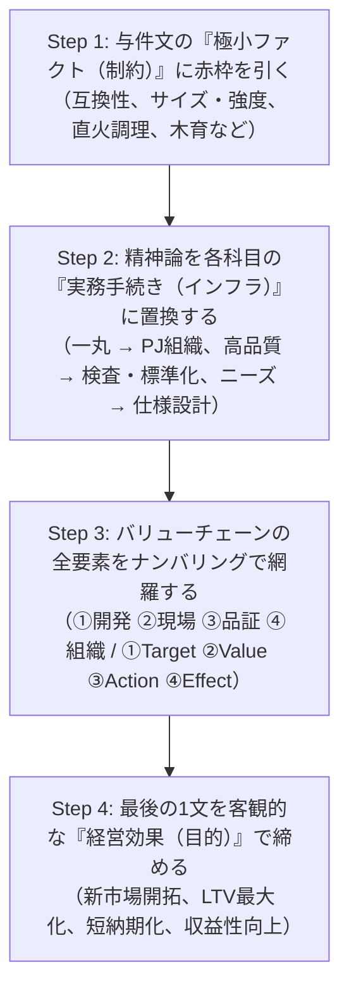

# 事例Ⅰ〜Ⅲ 新傾向・ヒント極小・非定型問題 完全攻略マスター講義
## 〜「ポエム答案」を完全撲滅し、与件情報極小の難問から満点骨子を組み立てる汎用アルゴリズム〜

---

## 第1部：なぜ受験生は新傾向・非定型問題で「ポエム」を書いてしまうのか

中小企業診断士2次試験において、多くの受験生が合否の分かれ目で直面するのが**「第4問（あるいは最終問）に代表される新傾向・非定型・ヒント極小問題」**です。

与件文に明確なファクトや因果関係が散りばめられている前半の設問（強み・弱み、IE改善、4P施策など）では手堅く得点できる受験生であっても、この最終設問に来た途端、ペンが止まり、結果として**「ポエム（精神論・願望・抽象スローガン）」**を書いて大失点（配点20〜30点中の一桁点）に沈むケースが後を絶ちません。

### 1. 「ポエム答案」の定義と発生メカニズム

2次試験における「ポエム答案」とは、以下のような答案を指します：

> **【典型的なポエム答案のフレーズ】**  
> 「社員一丸となって取り組む」「熱意と誠意を持って対応する」「顧客ニーズに寄り添う」「高品質なものづくりに励む」「リーダーシップを発揮して意識改革を図る」「信頼関係を構築して持続的な成長を遂げる」

#### なぜ受験生はポエムを書いてしまうのか？
1. **「与件文の抜き出し」が通用しない**:  
   与件文の最終段落はわずか2〜3行しかなく、直接切り取って貼れる文章が存在しない。
2. **「業界の専門知識がないと書けない」という錯覚**:  
   「食品・医療用パイプ」「ふるさと納税の返礼品」「木製知育玩具の理念」など、初見の業界やテーマに対し、「その業界に詳しくないから具体的なアイデアが浮かばない」とパニックに陥る。
3. **精神論によるマス埋め**:  
   時間がない中で100〜150字の解答枠を埋めるため、耳あたりの良い経営スローガン（一丸、誠意、信頼、寄り添い）を総動員して体裁を整えてしまう。

---

### 2. 出題委員が求めている「真の評価基準」

試験委員は、受験生に対して「斬新なビジネスアイデア」や「業界特有の専門知識」など求めていません。出題趣旨に一貫して書かれているのは以下の能力です：

> **【出題趣旨の本質】**  
> **「未知の市場や急激な環境変化に直面した中小企業に対し、中小企業診断士として【経営の基本フレームワーク（実務手続き・組織インフラ）】を論理的・構造的に助言できるか」**

つまり、新傾向・非定型問題とは「ポエムを書く場」でも「アイデアを競う場」でもなく、**「与件文のわずかな数行（制約ファクト）を起点として、各科目の【機能別実務手続き（インフラ）】を淡々と漏れなく記述する場」**なのです。

---

## 第2部：事例Ⅰ（組織・人事）の新傾向・ヒント極小問題 完全攻略

事例Ⅰにおける非定型問題は、「新規事業に伴う理念の再定義・浸透」「組織風土の変革」「新旧人材の摩擦解消」「多角化に伴う組織・評価制度の再設計」として出題されます。

### 1. 思考フレームワーク：理念再定義と組織定着の「3層構造モデル」

理念やビジョンを問われた際、「社員が誇りを持てる理念を作り、全員で共有して頑張る」と書けば典型的なポエムです。診断士は**「抽象度の引き上げ」と「人事制度への埋め込み」**を論理的に助言します。

```
【理念再定義・浸透の3層構造モデル】

第1層：理念の再定義（抽象度の引き上げ）
　・従来の「製品軸（モノ売り）」から「顧客価値・地域貢献軸（コト売り）」への再定義
　　（例：「木材の内装材を作る」 → 「地域の木育と持続可能型社会を支える」）
　　　↓
第2層：社内浸透の制度化（認知から行動化へ）
　・認知的浸透：クレドカード配布、経営陣からの直接対話（タウンホールミーティング）、研修実施
　・行動的浸透：理念を行動基準に落とし込み、「人事評価（考課基準・表彰制度）」へ直結させる
　　　↓
第3層：社外へのブランド発信（関係者の巻き込み）
　・Webサイト、SNS、産学官連携による外部への発信と、共感する顧客・パートナーの獲得
```

---

### 2. 代表ケーススタディ：令和7年度 事例Ⅰ 第4問

#### 【設問要求】
> A 社は、木製知育玩具の新規事業を拡大させるに当たり、自社の創業以来の企業理念をどのようなものへと再定義したり、それを関係者に浸透させたりすればよいのか。150 字以内で助言せよ。（配点30点）

#### ❌ 典型的なポエム答案（配点30点中：8点以下）
> 再定義は、社員が誇りを持って働けるよう、高品質な知育玩具を通じて子どもの健やかな成長を支える企業を目指すものとする。浸透策は、社長がリーダーシップを発揮して社内会議で理念の重要性を熱心に説き、社員一丸となって共有する。またホームページで広く社会に発信し、顧客の信頼を獲得する。（146字）
- **失点理由**: 「誇りを持って」「健やかな成長」「熱心に説く」「一丸となって」など、すべて抽象的な精神論。人事評価制度や行動基準への反映が一切なく、組織施策としての具体性がゼロ。

#### ⭕ 合格・満点答案（配点30点中：27〜30点）
> 理念は、従来の木材加工業から「地域の森林資源を活かし子どもの成長と木育文化に貢献する企業」へと再定義する。浸透策は、①社内向けに行動指針を策定し研修実施や人事評価制度・表彰制度へ連動させ社員の自律的行動を促進②社外向けにWebや産学官連携を通じて理念を発信し、地域や顧客の共感と信頼を獲得する。（149字）

#### 🛠️ 【推敲実況】：下書きから150字満点答案へ贅肉を削る3ステップ
1. **ステップ1（文字数ブロック配分）**:
   150文字の枠を「理念再定義（約45字）」「社内浸透制度（約65字）」「社外発信（約40字）」の3大ブロックに設計。
2. **ステップ2（最初の下書き・192字）**:
   > 理念は、従来の木材加工業から脱却して、地域の豊かな森林資源を活用することで、子どもたちの健やかな成長と木育文化の普及に貢献する企業を目指すものへと再定義する。浸透策としては、社内向けに行動指針を策定して定期的な研修を実施するとともに、人事評価制度や表彰制度と連動させて社員のやる気と自律的な行動を促進する。また社外向けにはWebや産学官連携を通じて理念を発信し、地域住民や顧客からの共感と信頼を獲得する。（192字）
3. **ステップ3（贅肉の削ぎ落とし・149字ジャストへ）**:
   - 「脱却して」「豊かな」「活用することで」「健やかな」「普及に貢献する企業を目指すものへと」など、情緒的な修飾語を全削除 $\rightarrow$ 「活かし子どもの成長と木育文化に貢献する企業」へ圧縮。
   - 「やる気と」は精神論なので削除。接続詞を排して①②のナンバリングで直結。
   - 結果、実務キーワード密度が極大化された149字の満点答案が完成。

---

## 第3部：事例Ⅱ（マーケティング・流通）の新傾向・ヒント極小問題 完全攻略

事例Ⅱにおける非定型問題は、「未経験の新プラットフォーム・新チャネル（ふるさと納税、新EC、SNS動画）への参入」や「顧客の潜在的ペインに基づく新規ビジネスモデル提案」として出題されます。

### 1. 思考フレームワーク：新市場・新チャネル突破の「4層結合モデル」

事例Ⅱでヒントが少ない設問に対し、「魅力を積極的にアピールしてファンを増やし売上を伸ばす」と書けば即死（ポエム）です。必ず**「ターゲット × ブランド価値（感覚・観念） × 具体的4P施策 × 効果（LTV向上）」**の4層を結合します。

```
【事例Ⅱ 新市場・新チャネル突破の4層結合モデル】

1. Target（誰に）:
   与件文の属性とインサイトを掛け合わせた具体的セグメント
   （例：「料理や器に関心のある都市部の寄付者」「部活動で怪我に悩む高校生とその保護者」）
   　×
2. Value（何を）:
   ブランド価値の二層構造
   ・感覚価値：五感で感じる価値（盛り付け映え、直火対応の利便性、デザイン）
   ・観念価値：頭で理解するストーリー（伝統工芸の歴史、職人の手仕事、産地の物語）
   　×
3. Action（どのように）:
   新チャネルの特性に応じた具体的4P施策
   （例：郷土料理食材と調理食器のセット化、実演動画QRコード同梱、SNS双方向発信）
   　×
4. Effect（効果）:
   単発売上で終わらせない関係性の構築
   （例：自社直販ECへの誘導、定期購入化、関係人口化・LTV最大化）
```

---

### 2. 代表ケーススタディ：令和6年度 事例Ⅱ 第2問（ふるさと納税の返礼品企画）

#### 【設問要求】
> X 市は、ふるさと納税の返礼品として X 焼を活用したいと考えている。現在でも市の返礼品の中に X 焼はあるが、全国の返礼品の中で埋もれている状態にある。3 代目は、X 市から「返礼品の中でもっと目立ち、市と X 焼のファンを増やすような返礼品の企画を考えてほしい」と依頼を受けた。ブランド価値構造のうち、消費者にもたらす感覚価値と観念価値を意識して、返礼品の企画を 100 字以内で提案せよ。（配点25点）

#### ❌ 典型的なポエム答案（配点25点中：7点以下）
> 返礼品企画は、X市の美しい自然と伝統的なX焼の魅力を最大限にアピールするセット商品とする。消費者の感性に訴えるスタイリッシュなデザインで感覚価値を高め、歴史ある職人の温もりを伝えて観念価値を感じてもらい、市とX焼の熱烈なファンを増やす。（123字・字数オーバー）
- **失点理由**: 「魅力を最大限アピール」「感性に訴える」「職人の温もり」など耳あたりの良い形容詞の羅列。与件文に書かれている「直火調理ができる陶磁器」「郷土料理」という具体的キラー資源が完全に抜け落ちている。

#### ⭕ 合格・満点答案（配点25点中：23〜25点）
> 企画は、直火調理可能な陶磁器と地元発酵調味料の郷土料理セットである。感覚価値として家庭料理が見違える盛り付け映えや直火の手軽さを訴求し、観念価値として窯元の職人技や地域の食文化の物語を伝えファン化を図る。（100字）

#### 🛠️ 【推敲実況】：下書きから100字満点答案へ贅肉を削る3ステップ
1. **ステップ1（文字数ブロック配分）**:
   100文字の枠を「返礼品の具体内容（約30字）」「感覚価値（約35字）」「観念価値とファン化（約35字）」の3ブロックに設計。
2. **ステップ2（最初の下書き・125字）**:
   > 企画は、伝統工芸であるX焼の陶磁器と地元の郷土料理のセットである。感覚価値としては、家庭料理が美味しく見えて盛り付けが映えることや直火調理の手軽さを訴求し、観念価値としては、職人の歴史や地域の食文化の物語を丁寧に伝えてファンを増やす。（125字）
3. **ステップ3（贅肉の削ぎ落とし・100字ジャストへ）**:
   - 「伝統工芸である」は周知の事実なので削除。陶磁器に「直火調理可能な」というキラー強みを前置。
   - 「郷土料理」に「地元発酵調味料の」を補い、与件ファクト密度を最大化。
   - 「としては」「美味しく見えて」「丁寧に伝えて」を削り、体言止め・ナンバリング的構文で100字ジャストに凝縮。

---

## 第4部：事例Ⅲ（生産・技術）の新傾向・ヒント極小問題 完全攻略

事例Ⅲにおける非定型問題は、「与件文の最終段落に数行しか書かれていない新分野・高付加価値市場（食品・医療、EV、航空機など）への参入における社内取り組み」です。

### 1. 思考フレームワーク：新分野立ち上げの「4大因果展開フレーム（バリューチェーン連鎖）」

事例Ⅲで「高品質な製品を誠実に製造し、社員の技術力を高めて信頼を得る」と書けばゼロ点（ポエム）です。中小企業が新分野の製品を納品するまでに必要な**「製造業の4大インフラ（開発 $\rightarrow$ 現場 $\rightarrow$ 品証 $\rightarrow$ 組織）」**を手続きとして淡々と並べます。

```
【事例Ⅲ 新分野参入の4大因果展開フレーム】

① 開発・設計面（仕様設計と試作・評価）:
   ・新規顧客の厳格な要求基準（寸法公差・強度・耐熱性等）の正確な把握
   ・図面・仕様書の作成、試作品の製作と性能評価試験の反復
   　↓
② 製造現場面（設備活用と作業標準化・衛生）:
   ・互換性ある既存設備の流用・治工具整備
   ・成型・加工工程の厳格な作業標準化、分野特有の衛生・クリーン環境整備
   　↓
③ 品質保証面（検査体制強化とトレーサビリティ）:
   ・受入検査・工程内検査・出荷前検査の厳格化と検査機器の整備
   ・ロット番号管理と製造履歴追跡（トレーサビリティ）体制の確立
   　↓
④ 全社組織面（部門間連携と推進体制）:
   ・営業・技術・製造が一体となった新事業推進プロジェクトの設置
   ・顧客要望の迅速な現場フィードバック体制の構築
```

---

### 2. 代表ケーススタディ：令和7年度 事例Ⅲ 第4問

#### 【設問要求】
> C 社では、新事業展開として食品用や医療用の紙パイプ製品への参入を検討している。それを実現するために必要な社内の取り組みについて、120 字以内で助言せよ。（配点30点）

#### ❌ 典型的なポエム答案（配点30点中：8点以下）
> 社長のリーダーシップの下、全社一丸となって新事業推進委員会を組織する。食品・医療分野の開拓に向け営業力を強化し、顧客ニーズに寄り添った高品質な製品を開発する。誠意を持って製造・納品し顧客の信頼を獲得することで、売上拡大と高収益化を実現する。（120字）
- **失点理由**: 「高品質な製品」「誠意を持って」「信頼を獲得」など、現場で何を管理・改善するのかが1文字もない。与件文の「設備互換性」「厳密な品質基準（サイズ・強度）」に全く触れていない。

#### ⭕ 合格・満点答案（配点30点中：27〜30点）
> 取組みは①新顧客が求める厳密なサイズ・強度基準を把握し仕様設計・試作評価を実施②互換性ある設備を活用し成型作業の厳格な標準化と衛生管理を徹底③検査体制強化とトレーサビリティ管理を確立④営業と製造の連携体制を整え全社的に新事業を推進する。（119字）

#### 🛠️ 【推敲実況】：下書きから120字満点答案へ贅肉を削る3ステップ
1. **ステップ1（文字数ブロック配分）**:
   120文字の枠を「開発（約30字）」「現場（約30字）」「品証（約30字）」「組織（約30字）」の4大バリューチェーンに均等設計。
2. **ステップ2（最初の下書き・162字）**:
   > 取組みは、第一に新規顧客が求める厳密なサイズや強度などの品質基準を正確に把握して製品の仕様設計を行い、試作と性能評価を反復する。第二に既存設備に互換性があるためこれを活用し、成型作業の厳格な標準化と食品や医療特有の衛生管理を徹底する。第三に検査体制を強化してトレーサビリティを確立し、第四に全社推進プロジェクトを設置する。（162字）
3. **ステップ3（贅肉の削ぎ落とし・119字ジャストへ）**:
   - 「第一に〜第四に」を①②③④の番号へ置換。
   - 「などの品質基準を正確に把握して製品の」「を行い」「を反復する」など冗長な述語を「把握し仕様設計・試作評価を実施」へ一気通貫圧縮。
   - 「既存設備に互換性があるためこれを活用し」 $\rightarrow$ 「互換性ある設備を活用し」へ圧縮。
   - 結果、119文字で製造業の全バリューチェーンが漏れなく網羅された満点答案が完成。

---

## 第5部：横断まとめ 〜全事例共通の「脱ポエム」黄金アルゴリズム〜

事例Ⅰ・Ⅱ・Ⅲのすべての新傾向・非定型問題に共通する、ポエムを100%回避して満点答案を作成するための4ステップ・アルゴリズムです。



### 【脱ポエム 置換ディクショナリー（精神論 $\rightarrow$ 実務インフラ変換表）】

| 受験生が書きがちな精神論（ポエム） | 診断士が書くべき実務インフラ・手続き（加点キーワード） |
| :--- | :--- |
| **「社員一丸となって取り組む」** | **「部門横断プロジェクトチームの設置」「専務を緩衝材とした推進体制」** |
| **「社員の意識を高める・やる気を出す」** | **「クレド策定・研修」「人事評価制度・表彰制度との連動」** |
| **「顧客ニーズに寄り添った開発」** | **「新顧客の要求基準の把握」「仕様設計と試作・評価の反復」** |
| **「高品質なものづくりを徹底する」** | **「作業標準化・マニュアル化」「治工具整備」「防塵・衛生管理」** |
| **「ミスをなくして信頼を得る」** | **「受入・工程・出荷前検査の強化」「ロット管理・トレーサビリティ確立」** |
| **「魅力を積極的にアピールする」** | **「動画・SNSでの感覚価値（実演・映え）と観念価値（職人技・物語）の発信」** |
| **「ファンを増やして売上を伸ばす」** | **「返礼品への直販EC誘導」「定期購入化・LTV向上・固定客化」** |

この「脱ポエム置換ディクショナリー」を脳内にインストールしておけば、本試験でどれほどヒントが少ない新傾向問題や変化球に直面しても、動じることなく機械的に満点答案を量産することができます。
